# Singapore: a small country turned global hub

*EC 391 Country Team Project, Fall 2026*

## Singapore in one minute

<section class="summary">

Singapore in one minute
<h2 class="sm-h">A location turned into an economy by institutions and foreign capital</h2>
One number from each chapter carries the argument. Click a card to read the chapter.

<a class="sm" href="#ch02_macro" style="--k:#4338ca"><i>02</i>Institutions<b>1st</b>of 205 on government effectiveness. Courts and regulators work as an export advantage.<svg viewBox="0 0 168 56" class="sm-svg" aria-hidden="true"><rect x="6" y="18.0" width="156" height="6" rx="3" fill="currentColor" fill-opacity=".14"/><circle cx="6.0" cy="21.0" r="7" fill="#4338ca"/><circle cx="6.0" cy="21.0" r="12" fill="#4338ca" fill-opacity=".18"/><text x="6" y="54" class="sm-yr">1st</text><text x="162" y="54" text-anchor="end" class="sm-yr">205th</text></svg><small>World rank</small></a><a class="sm" href="#ch03_trade" style="--k:#e2562b"><i>03</i>Openness<b>313%</b>Trade in goods and services is three times GDP, 3rd of 172 economies.<svg viewBox="0 0 168 56" class="sm-svg" aria-hidden="true"><polygon points="4.0,38.0 4.0,6.8 12.0,5.3 20.0,4.9 28.0,7.3 36.0,4.0 44.0,10.2 52.0,9.3 60.0,8.5 68.0,9.3 76.0,9.5 84.0,10.0 92.0,12.4 100.0,14.6 108.0,13.5 116.0,12.7 124.0,12.8 132.0,12.3 140.0,12.6 148.0,12.3 156.0,12.8 164.0,13.6 164.0,38.0" fill="#e2562b" fill-opacity=".14"/><polyline points="4.0,6.8 12.0,5.3 20.0,4.9 28.0,7.3 36.0,4.0 44.0,10.2 52.0,9.3 60.0,8.5 68.0,9.3 76.0,9.5 84.0,10.0 92.0,12.4 100.0,14.6 108.0,13.5 116.0,12.7 124.0,12.8 132.0,12.3 140.0,12.6 148.0,12.3 156.0,12.8 164.0,13.6" fill="none" stroke="#e2562b" stroke-width="2.4" stroke-linejoin="round" stroke-linecap="round"/><circle cx="164.0" cy="13.6" r="3.4" fill="#e2562b"/><text x="4" y="54" class="sm-yr">2004</text><text x="164" y="54" text-anchor="end" class="sm-yr">2024</text></svg><small>Trade, % of GDP</small></a><a class="sm" href="#ch04_rca" style="--k:#15803d"><i>04</i>Advantage<b>48%</b>of exports are services, up from 20% in 2004, led by transport (RCA 4.5) and finance (2.8).<svg viewBox="0 0 168 56" class="sm-svg" aria-hidden="true"><rect x="8" y="27.2" width="36" height="14.8" rx="3" fill="#15803d" fill-opacity="0.35"/><text x="26.0" y="54" text-anchor="middle" class="sm-yr">2004</text><rect x="62" y="18.3" width="36" height="23.7" rx="3" fill="#15803d" fill-opacity="0.6499999999999999"/><text x="80.0" y="54" text-anchor="middle" class="sm-yr">2014</text><rect x="116" y="6.0" width="36" height="36.0" rx="3" fill="#15803d" fill-opacity="0.95"/><text x="134.0" y="54" text-anchor="middle" class="sm-yr">2024</text></svg><small>Services, % of exports</small></a><a class="sm" href="#ch05_gvc" style="--k:#7c3aed"><i>05</i>Value chains<b>46%</b>of the value of exports is made abroad. Singapore sits downstream, processing and coordinating Asia's supply chains.<svg viewBox="0 0 168 56" class="sm-svg" aria-hidden="true"><polygon points="4.0,38.0 4.0,7.9 12.9,5.4 21.8,5.6 30.7,7.6 39.6,4.2 48.4,7.0 57.3,6.8 66.2,6.4 75.1,5.7 84.0,6.3 92.9,6.3 101.8,4.8 110.7,7.3 119.6,5.7 128.4,6.4 137.3,5.7 146.2,4.1 155.1,4.0 164.0,5.9 164.0,38.0" fill="#7c3aed" fill-opacity=".14"/><polyline points="4.0,7.9 12.9,5.4 21.8,5.6 30.7,7.6 39.6,4.2 48.4,7.0 57.3,6.8 66.2,6.4 75.1,5.7 84.0,6.3 92.9,6.3 101.8,4.8 110.7,7.3 119.6,5.7 128.4,6.4 137.3,5.7 146.2,4.1 155.1,4.0 164.0,5.9" fill="none" stroke="#7c3aed" stroke-width="2.4" stroke-linejoin="round" stroke-linecap="round"/><circle cx="164.0" cy="5.9" r="3.4" fill="#7c3aed"/><text x="4" y="54" class="sm-yr">2004</text><text x="164" y="54" text-anchor="end" class="sm-yr">2022</text></svg><small>Foreign value, % of exports</small></a><a class="sm" href="#ch06_fdi" style="--k:#0369a1"><i>06</i>Investment<b>4th</b>of 193 for inward FDI stock relative to GDP, much of it passing through holding companies.<svg viewBox="0 0 168 56" class="sm-svg" aria-hidden="true"><polygon points="4.0,38.0 4.0,27.0 12.0,26.2 20.0,25.8 28.0,24.7 36.0,23.6 44.0,22.2 52.0,22.2 60.0,22.5 68.0,21.0 76.0,19.8 84.0,16.4 92.0,14.8 100.0,14.4 108.0,12.6 116.0,11.7 124.0,9.1 132.0,4.0 140.0,5.8 148.0,9.4 156.0,5.7 164.0,6.3 164.0,38.0" fill="#0369a1" fill-opacity=".14"/><polyline points="4.0,27.0 12.0,26.2 20.0,25.8 28.0,24.7 36.0,23.6 44.0,22.2 52.0,22.2 60.0,22.5 68.0,21.0 76.0,19.8 84.0,16.4 92.0,14.8 100.0,14.4 108.0,12.6 116.0,11.7 124.0,9.1 132.0,4.0 140.0,5.8 148.0,9.4 156.0,5.7 164.0,6.3" fill="none" stroke="#0369a1" stroke-width="2.4" stroke-linejoin="round" stroke-linecap="round"/><circle cx="164.0" cy="6.3" r="3.4" fill="#0369a1"/><text x="4" y="54" class="sm-yr">2004</text><text x="164" y="54" text-anchor="end" class="sm-yr">2024</text></svg><small>Inward stock, % of GDP</small></a><a class="sm" href="#ch07_policy" style="--k:#b45309"><i>07</i>Policy<b>0.07%</b>average MFN tariff, while 29 trade agreements open partners' markets.<svg viewBox="0 0 168 56" class="sm-svg" aria-hidden="true"><polyline points="4.0,9.6 12.9,8.2 21.8,8.9 30.7,8.8 39.6,9.0 48.4,7.4 57.3,6.2 66.2,8.3 75.1,10.7 84.0,11.0 92.9,11.1 101.8,11.2 110.7,10.7 119.6,13.5 128.4,10.7 137.3,4.0 146.2,10.2 155.1,9.9 164.0,10.8" fill="none" stroke="currentColor" stroke-opacity=".4" stroke-width="1.4" stroke-dasharray="3 3"/><polygon points="4.0,38.0 4.0,38.0 12.9,37.9 21.8,37.9 30.7,37.9 39.6,37.7 48.4,37.7 57.3,37.7 66.2,37.7 75.1,37.7 84.0,37.7 92.9,37.7 101.8,37.7 110.7,37.7 119.6,37.7 128.4,37.0 137.3,35.9 146.2,37.7 155.1,37.7 164.0,37.8 164.0,38.0" fill="#b45309" fill-opacity=".14"/><polyline points="4.0,38.0 12.9,37.9 21.8,37.9 30.7,37.9 39.6,37.7 48.4,37.7 57.3,37.7 66.2,37.7 75.1,37.7 84.0,37.7 92.9,37.7 101.8,37.7 110.7,37.7 119.6,37.7 128.4,37.0 137.3,35.9 146.2,37.7 155.1,37.7 164.0,37.8" fill="none" stroke="#b45309" stroke-width="2.4" stroke-linejoin="round" stroke-linecap="round"/><circle cx="164.0" cy="37.8" r="3.4" fill="#b45309"/><text x="4" y="54" class="sm-yr">2004</text><text x="164" y="54" text-anchor="end" class="sm-yr">2022</text></svg><small>Tariff, dashed: median economy</small></a><a class="sm" href="#ch09_case" style="--k:#be123c"><i>09</i>Case study<b>4.8×</b>rise in the pharmaceutical advantage after the 2000 biomedical push, while chips kept an RCA of 4.6.<svg viewBox="0 0 168 56" class="sm-svg" aria-hidden="true"><line x1="4" x2="164" y1="34.6" y2="34.6" stroke="currentColor" stroke-opacity=".25" stroke-width="1"/><line x1="31.6" x2="31.6" y1="2" y2="40" stroke="currentColor" stroke-opacity=".35" stroke-dasharray="2 3"/><polyline points="4.0,34.6 9.5,28.9 15.0,35.5 20.6,34.7 26.1,34.6 31.6,37.0 37.1,31.2 42.6,34.7 48.1,38.0 53.7,30.0 59.2,16.7 64.7,11.3 70.2,9.4 75.7,13.3 81.2,15.6 86.8,11.9 92.3,7.8 97.8,9.1 103.3,9.8 108.8,11.8 114.3,16.6 119.9,10.8 125.4,10.7 130.9,7.0 136.4,9.4 141.9,7.8 147.4,8.0 153.0,12.1 158.5,5.4 164.0,4.0" fill="none" stroke="#be123c" stroke-width="2.4" stroke-linejoin="round" stroke-linecap="round"/><circle cx="164.0" cy="4.0" r="3.4" fill="#be123c"/><text x="4" y="54" class="sm-yr">1995</text><text x="164" y="54" text-anchor="end" class="sm-yr">2024</text></svg><small>Pharma vs. controls, 2000 marked</small></a><a class="sm sm-verdict" href="#conclusion"><i>&#10003;</i>Verdict<b>Base for high value work</b>The region's best base for headquarters and high value production, and a costly one for everything else.Read the recommendation &rarr;</a>
</section>

---

# 1 Country profile

## Key finding

Singapore is a city state with the land of a small county and the human development of a rich nation. Its 6.2 million people live on 745.1 square kilometres, 181st of 214 economies by area, and its Human Development Index ranks 13th of 193 and 3rd in East Asia and the Pacific.

## What kind of country is it?

**A crowded island republic on one of the world's busiest sea lanes.** A third of its 6.21 million people (June 2026) are foreign workers and students, so the labour force can grow with demand, and English as the language of business connects it to China, India and the Malay world. The atlas on the opening screen of the website maps the country, its places of trade and its partners.

<section class="facts">
Capital<b>Singapore (city state)</b>

Official languages<b>Malay (national), English, Mandarin, Tamil</b>

Land area<b>745.1 km² (June 2026), +28% since 1965</b>

Population<b>6.21 million (June 2026)</b>

Political system<b>Parliamentary republic, PAP in government since 1959</b>

Prime minister<b>Lawrence Wong, since May 2024</b>

Currency<b>Singapore dollar (S$)</b>

Memberships<b>ASEAN (1967), APEC (1989), WTO (1995), CPTPP, RCEP</b>

SingStat Population Trends 2026 and land area series, Constitution of Singapore, Prime Minister's Office, WTO.
</section>

More on land, population, languages and politics

Reclamation has added 28 percent to the land since 1965, when it was 581.5 square kilometres ([SingStat via data.gov.sg](https://data.gov.sg/datasets/d_0b2c034da121ef8efc71949af1694b4d/view)). Of the 6.21 million people, 4.23 million are residents ([SingStat, Population Trends 2026](https://www.singstat.gov.sg/publication-resources/population-trends-2026)). In the election of May 2025 the People's Action Party won 87 of 97 seats with 65.6 percent of the vote ([AP via PBS](https://www.pbs.org/newshour/world/singapores-long-ruling-party-wins-another-election-landslide-in-boost-for-new-prime-minister)).

**It leads the region on every human development measure.** Gross tertiary enrolment is 97 percent against 62 percent in East Asia and the Pacific (2023), and life expectancy 83.3 years against 76.7. Literacy (97.7 percent in 2021) is close to the regional 96.2 percent.

More: human development against the region, the ranking table and what the economy produces

| Indicator | Singapore | Year | Global rank | East Asia & Pacific rank | East Asia & Pacific average | Malaysia | Hong Kong SAR | Vietnam |
| --- | --- | --- | --- | --- | --- | --- | --- | --- |
| Population | 6.04 m | 2024 | 113th of 217 | 16th of 37 | 2388.32 m | 35.56 m | 7.52 m | 100.99 m |
| Land area | 725 km² | 2024 | 181st of 214 | 27th of 37 | n/a | 328,550 km² | 1,050 km² | 313,429 km² |
| Population density | 8,329 per km² | 2024 | 3rd of 214 | 2nd of 37 | 98 per km² (2023) | 108 per km² | 7,166 per km² | 322 per km² |
| Urban population | 100% | 2024 | 1st of 217 | 1st of 37 | 64% | 77% | 100% | 38% |
| Life expectancy at birth | 83.3 years | 2024 | 15th of 217 | 5th of 37 | 76.7 years | 76.8 years | 85.4 years | 74.7 years |
| Adult literacy rate | 97.7% | 2021 | 9th of 44 | 2nd of 5 | 96.2% | 95.8% (2022) | n/a | 96.1% (2022) |
| Secondary enrolment (gross) | 103% | 2023 | 40th of 147 | 4th of 23 | 92% | 79% | 107% (2024) | 93% (2022) |
| Tertiary enrolment (gross) | 97% | 2023 | 11th of 128 | 5th of 23 | 62% | 37% | 105% | 33% |
| Population aged 65+ | 13.7% | 2024 | 72nd of 217 | 9th of 37 | 13.6% | 7.7% | 22.7% | 9.0% |
| Human Development Index | 0.946 | 2023 | 13th of 193 | 3rd of 30 | 0.775 (UNDP) | 0.819 | 0.955 | 0.766 |
| Mean years of schooling | 12.0 years | 2023 | 42nd of 193 | 7th of 30 | 8.3 years (UNDP) | 11.1 years | 12.4 years | 9.0 years |
| Expected years of schooling | 16.7 years | 2023 | 29th of 195 | 5th of 31 | 14.6 years (UNDP) | 12.7 years | 16.9 years | 15.5 years |

*Ranks: 1st = highest value among economies with data that year (World Bank aggregates excluded); East Asia & Pacific = World Bank region; its average is the World Bank aggregate (UNDP's regional average for HDI and schooling, which covers developing economies only). A year in brackets marks an earlier latest year. Sources: World Bank WDI (SP.POP.TOTL, AG.LND.TOTL.K2, EN.POP.DNST, SP.URB.TOTL.IN.ZS, SP.DYN.LE00.IN, SE.ADT.LITR.ZS, SE.SEC.ENRR, SE.TER.ENRR, SP.POP.65UP.TO.ZS), retrieved Nov 12, 2026; UNDP Human Development Report 2025 (HDI, schooling).*

Manufacturing is still 16 percent of GDP (33rd of 178 economies and 10th of 28 in the region), against less than 1 percent in Hong Kong SAR.

## How did it get rich?
**By answering every outside shock with a move up the value chain.** Real GDP grew 64-fold between 1960 and 2023, interrupted six times when growth fell below 1 percent. Each break came through trade, and each was followed by a push toward higher value work.

<section class="timeline">
<b>1819</b>Free port
A trading post that moves goods it does not make.

<b>1961</b>EDB founded
The state starts courting foreign manufacturers.

<b>1964 to 65</b>Break and independence
Output falls, then separation from Malaysia.

<b>1965 to 79</b>Export factories
Multinationals build plants in Jurong. <a class="xref" href="#ch06_fdi">Ch. 6</a>

<b>1985</b>Recession
Services become a second engine. <a class="xref" href="#ch03_trade">Ch. 3</a>

<b>1998 and 2001</b>Asian crisis, chip slump
Two shocks hit electronics.

<b>2000</b>Biomedical pillar
Medicines join chips. <a class="xref" href="#ch09_case">Ch. 9</a>

<b>2009 and 2020</b>Crisis, pandemic
World demand collapses twice.

<b>2020s</b>Resilience
Digital trade and supply chain security. <a class="xref" href="#ch07_policy">Ch. 7</a>

Shaded: years in which real GDP grew by less than 1 percent (Penn World Table). Sources: NLB Infopedia, METI, EDB.
</section>

More: the long run chart and the development phases

In the Penn World Table output fell by 3.8 percent in 1964, 2.2 percent in 1998 and 3.9 percent in 2020. The free port of 1819 lived by moving goods it did not make ([NLB Infopedia](https://eresources.nlb.gov.sg/infopedia/articles/SIP_2018-04-20_085007.html)), and in 1979 the National Wages Council raised wages on purpose to push firms toward higher value work ([NLB](https://www.nlb.gov.sg/main/article-detail?cmsuuid=98e1b55f-093d-4d44-b219-d51f6a38c313)).

A small island with no resources has to trade to live, and investors get skills and stable government at the price of expensive land and an ageing population (13.7 percent were 65 or older in 2024). Chapter 2 asks how this became income and institutions.

Sources for this chapter

World Bank, World Development Indicators; Penn World Table 11.0; UNDP, Human Development Report 2025; Singapore Department of Statistics; National Library Board Infopedia; Ministry of Education; Ministry of Energy, Trade and Industry. Full list in the [appendix](appendix.html).

---

# 2 Macroeconomy, business climate and governance

## Key finding

Singapore is the second richest economy in the world per person at purchasing power parity, and one of the best governed. It ranks first of 205 on government effectiveness and regulatory quality, and only on voice and accountability does it fall to the middle of the table.

## How big and how rich is it?

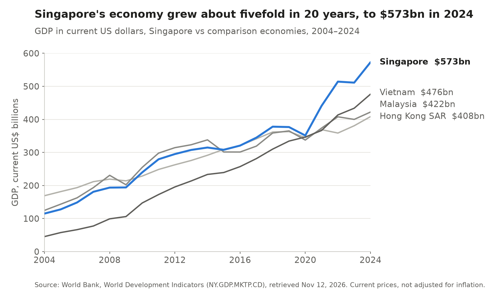

**About five times bigger than in 2004, and second in the world and first in East Asia and the Pacific per person.** GDP rose from $115 billion to $573 billion between 2004 and 2024, from 43rd to 26th in the world and from 9th to 6th of 33 in the region. GDP per person at purchasing power parity is $153,161, almost four times Malaysia's, and real growth averaged 5.0 percent a year, 41st of 193.

**Inequality is high for a rich country but falling.** The World Bank publishes no poverty or Gini data for Singapore, so we use the official series. The Gini of employment income after taxes and transfers fell from 0.419 in 2004 to 0.359 in 2025.

More: income per person, growth, GDP at PPP, the current account, inequality and poverty

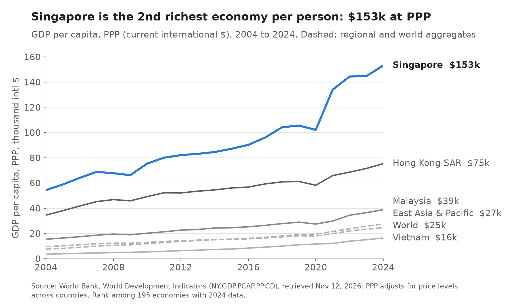

GDP per person at purchasing power parity almost tripled from $54,384 in 2004.

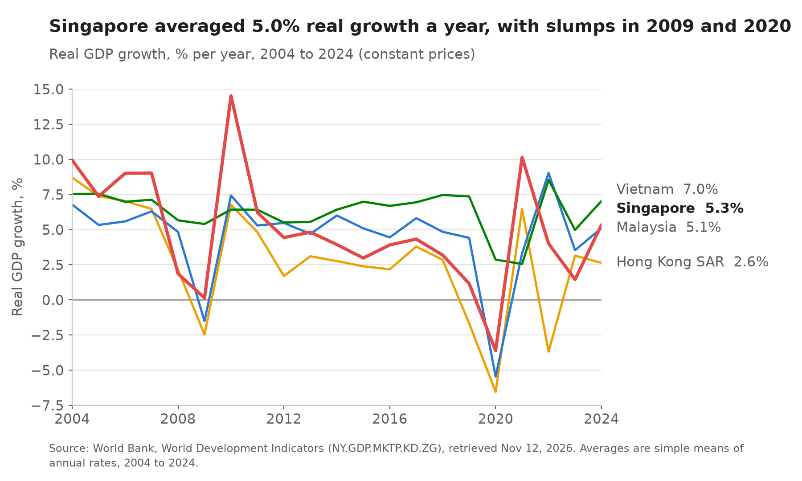

Growth swings with world demand, rebounding by 14.5 percent in 2010 and falling by 3.6 percent in 2020.

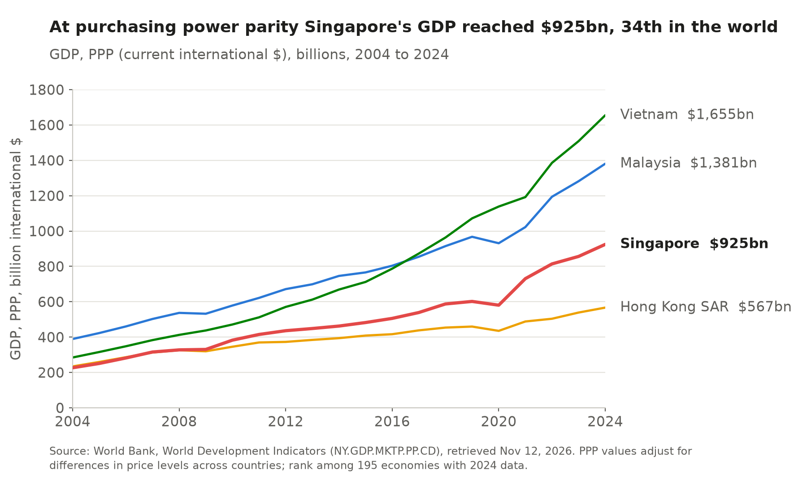

At purchasing power parity the economy is $925 billion, 34th in the world.

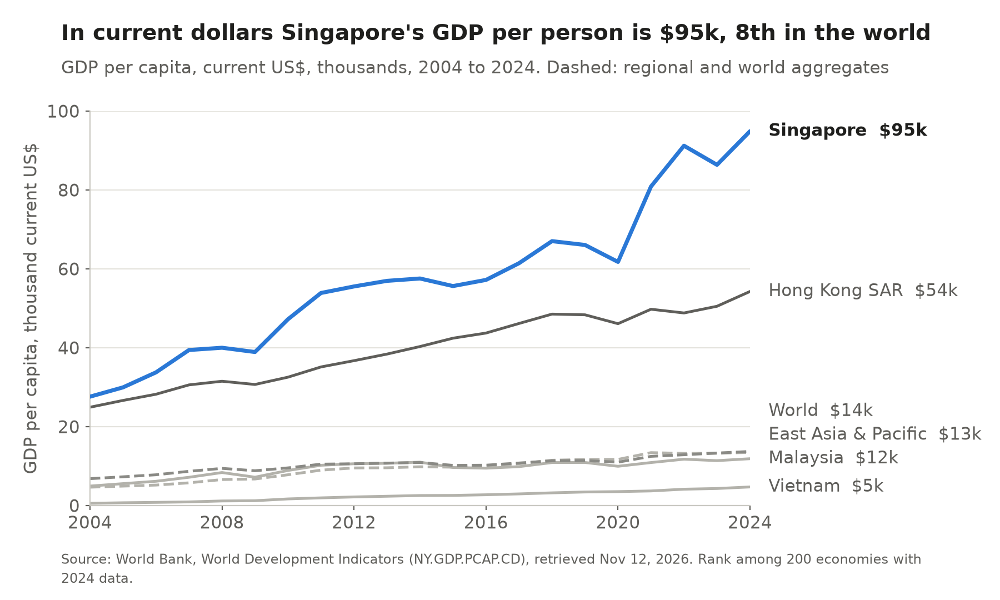

In current dollars GDP per person was $94,897 in 2024, eighth in the world, and the current account surplus of 17.2 percent of GDP is the sixth largest.

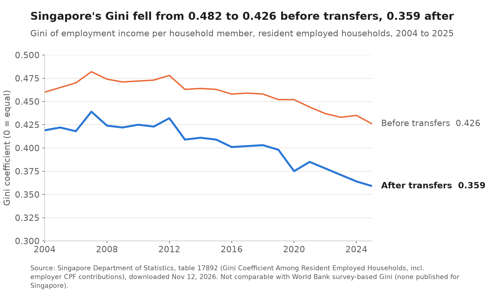

In June 2025 the World Bank replaced the $2.15 line of the guidelines with $3.00 a day, and in East Asia and the Pacific 2.0 percent of people lived below it in 2024, so extreme poverty is not the relevant measure for a high income city. The national Gini covers only residents' employment income, so we do not rank it.

## How good are its institutions?
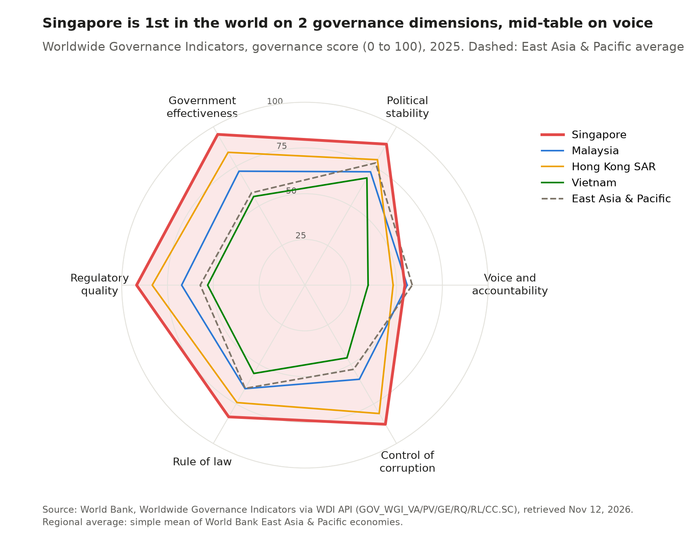

**Among the best in the world, with one exception.** Singapore is first of 205 for government effectiveness and regulatory quality, fourth for control of corruption and first of 138 on logistics, but 111th of 203 on voice and accountability.

More: every rank in one table, and corruption perceptions since 2012

| Indicator | Singapore | Year | Global rank | East Asia & Pacific rank |
| --- | --- | --- | --- | --- |
| GDP, current US$ | $573bn | 2024 | 26th of 200 | 6th of 33 |
| GDP, PPP | $925bn | 2024 | 34th of 195 | 10th of 31 |
| GDP per capita, current US$ | $94,897 | 2024 | 8th of 200 | 1st of 33 |
| GDP per capita, PPP | $153,161 | 2024 | 2nd of 195 | 1st of 31 |
| Real GDP growth, 2024 | 5.3% | 2024 | 36th of 200 | 6th of 33 |
| Inflation (CPI), 2024 | 2.4% | 2024 | 65th of 176 | 15th of 26 |
| Current account, % of GDP | 17.2% | 2024 | 6th of 168 | 3rd of 26 |
| Logistics Performance Index (1 to 5) | 4.30 | 2022 | 1st of 138 | 1st of 18 |
| Ease of Doing Business rank (legacy, DB2020 report) | 2 of 190 | 2019 | 2nd of 189 | 2nd of 28 |
| Average real growth 2004 to 2024 | 5.0% | 2004 to 2024 | 41st of 193 | 10th of 32 |
| WGI: Voice and accountability (0 to 100) | 54.6 | 2025 | 111th of 203 | 22nd of 34 |
| WGI: Political stability (0 to 100) | 89.0 | 2025 | 12th of 207 | 7th of 36 |
| WGI: Government effectiveness (0 to 100) | 95.2 | 2025 | 1st of 205 | 1st of 34 |
| WGI: Regulatory quality (0 to 100) | 91.9 | 2025 | 1st of 205 | 1st of 34 |
| WGI: Rule of law (0 to 100) | 83.2 | 2025 | 18th of 207 | 3rd of 36 |
| WGI: Control of corruption (0 to 100) | 87.8 | 2025 | 4th of 207 | 1st of 36 |
| Corruption Perceptions Index (0 to 100) | 84 | 2024 | 3rd of 178 | 1st of 22 |
| B-READY: Regulatory framework (0 to 100) | 77.6 | 2025 | 13th of 100 | 2nd of 15 |
| B-READY: Public services (0 to 100) | 75.3 | 2025 | 7th of 100 | 2nd of 15 |
| B-READY: Operational efficiency (0 to 100) | 79.3 | 2025 | 1st of 100 | 1st of 15 |
| Gini, after taxes and transfers (SingStat) | 0.359 | 2025 | not ranked¹ | not ranked¹ |
| Poverty headcount, $3.00/day (2021 PPP) | no data² | | | |

*Ranks: 1st = best (highest, except inflation: lowest) among economies with data; World Bank aggregates excluded; ties share a rank. Doing Business (discontinued in 2021) ranked 190 economies; its last edition, DB2020, uses 2019 data (WDI IC.BUS.EASE.XQ). B-READY ranks are among the economies it covers. ¹ Singapore's Gini is a national series on employment income and is not comparable with survey-based Gini for other countries. ² The World Bank publishes no poverty headcount for Singapore (no household survey in its database). Sources: World Bank WDI, WGI and B-READY via the WDI API, retrieved Nov 12, 2026; Transparency International CPI; Singapore Department of Statistics.*

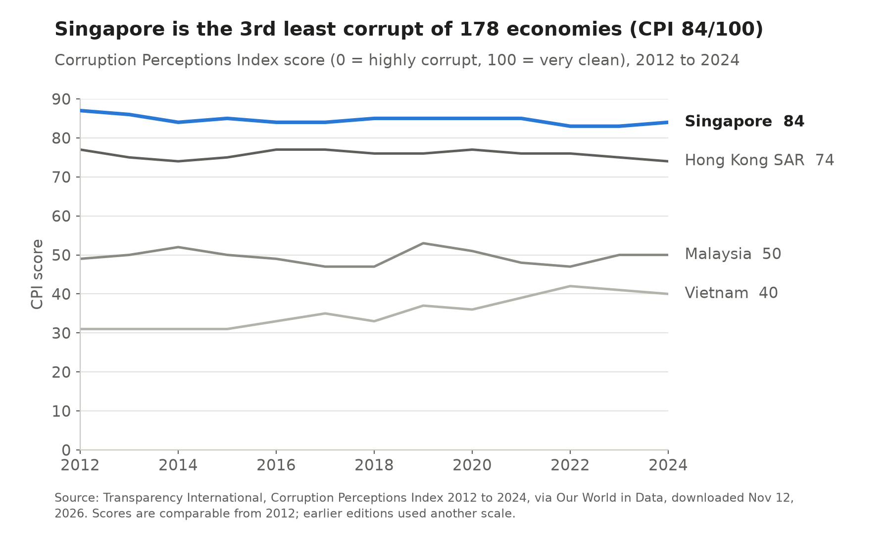

Transparency International scores Singapore 84 of 100 in 2024, third of 178 and first in the region.

**Business climate: almost nowhere is easier.** Singapore was second of 190 in Doing Business 2020 and is first of 100 on operational efficiency in B-READY 2025.

More: B-READY scores by topic, compared with Malaysia, Hong Kong SAR and Vietnam

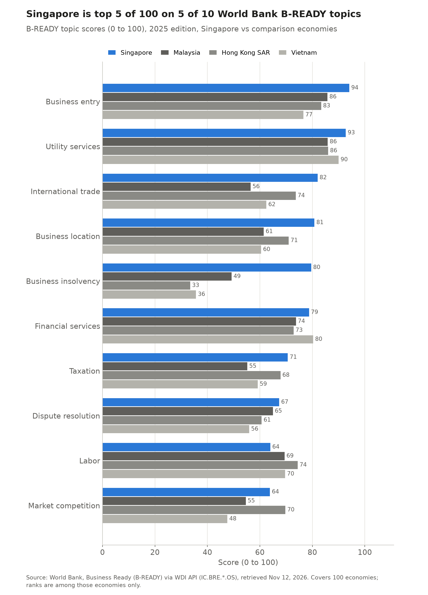

B-READY places Singapore lower on labour regulation (65th) and market competition (17th), where the index rewards rules that Singapore keeps deliberately light.

In Nunn's (2007) terms good contract enforcement is itself a comparative advantage, which Chapter 3 follows into trade.

Sources for this chapter

World Bank, World Development Indicators, Worldwide Governance Indicators, B-READY and Doing Business (via the WDI API); Transparency International, Corruption Perceptions Index; Singapore Department of Statistics, table 17892. All figures are generated by `scripts/ch02_macro.py`.

---

# 3 Openness and trade patterns

## Key finding

Singapore is the third most open economy in the world, and almost half of what it sells abroad is now services. Its trade is spread across many partners and follows the gravity model, with distance mattering slightly more than in the class estimate.

## How open is it?
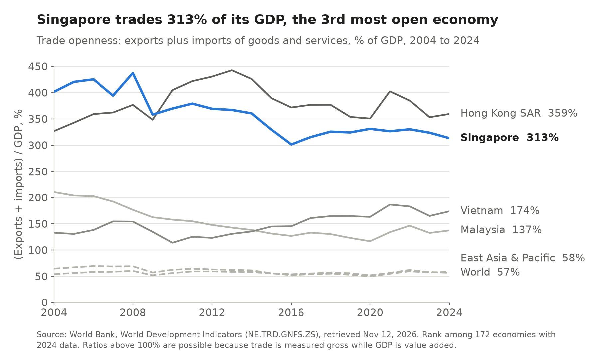

**Trade is three times GDP, the third highest ratio of 172 economies and second in East Asia and the Pacific.** Exports plus imports were 313 percent of GDP in 2024, against 137 percent in Malaysia and 58 percent in East Asia and the Pacific.

**Surpluses on goods and on services.** The goods surplus grew from $41 billion in 2004 to $172 billion in 2024, and services swung from a $10 billion deficit to a $34.5 billion surplus. Services exports of $399 billion are 6th in the world and 1st in the region.

More: the balances chart, and why openness has fallen since 2008

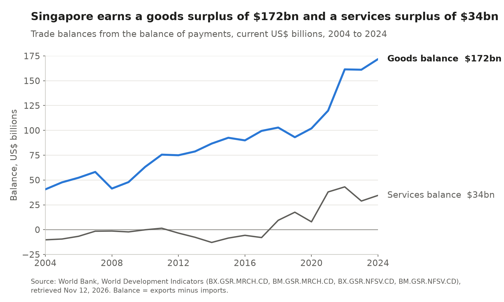

Openness peaked at 437 percent in 2008 and has drifted down as services and domestic activity grew faster than goods trade. It can pass 100 percent because trade is counted gross while GDP is value added.

## What does it sell, and how much does it make?

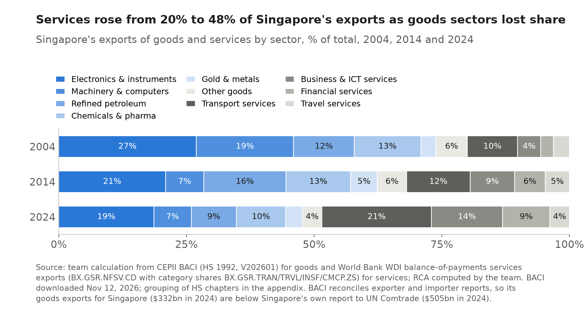

**More and more services.** Combining goods from CEPII's BACI with services from the World Bank, services rose from 20 to 48 percent of exports between 2004 and 2024, led by transport (21.5 percent). Electronics remain the largest goods group but fell from 26.9 to 18.7 percent.

**Less than half of what it ships is made at home.** Re-exports rose from 46.5 to 57.5 percent of merchandise exports, so gross exports overstate what Singapore produces. That is why we use BACI, which assigns re-exports to their origin, and value added in Chapter 5.

More: re-exports, imports and the BACI correction

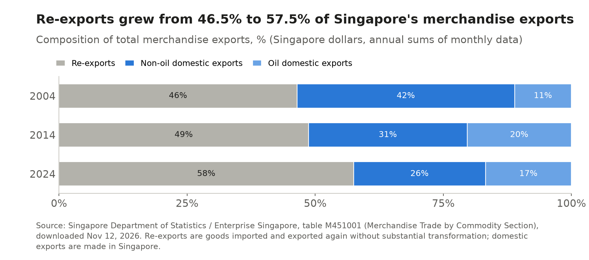

BACI's $332 billion of goods exports in 2024 is about a third below the $505 billion Singapore reports to UN Comtrade.

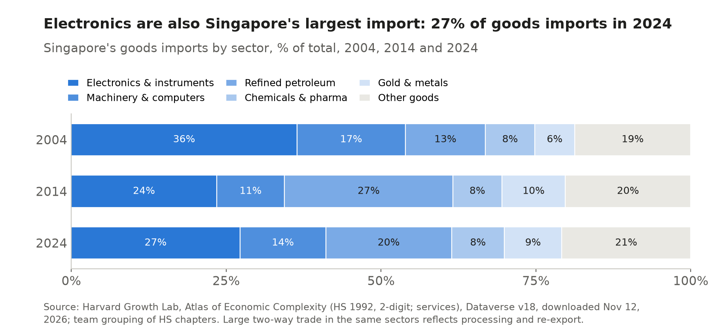

Imports mirror exports, with electronics and instruments at 34.8 percent of goods imports, the signature of an economy that processes inputs and ships them on.

## Who does it trade with?

*Interactive figure on the website: [Where Singapore's goods come from and go to](https://ziqijia825-afk.github.io/ec391-singapore/)*

**Mostly Asia, and no single market dominates.** On Singapore's own figures mainland China took 14.0 percent of exports in 2024, Hong Kong SAR 11.0 percent and Malaysia 10.4 percent. The concentration index on BACI data, 0.074, is 45th lowest of 208 exporters and 3rd of 37 in East Asia and the Pacific, so a downturn in one market hurts Singapore less than its neighbours.

More: partner shares and concentration over time

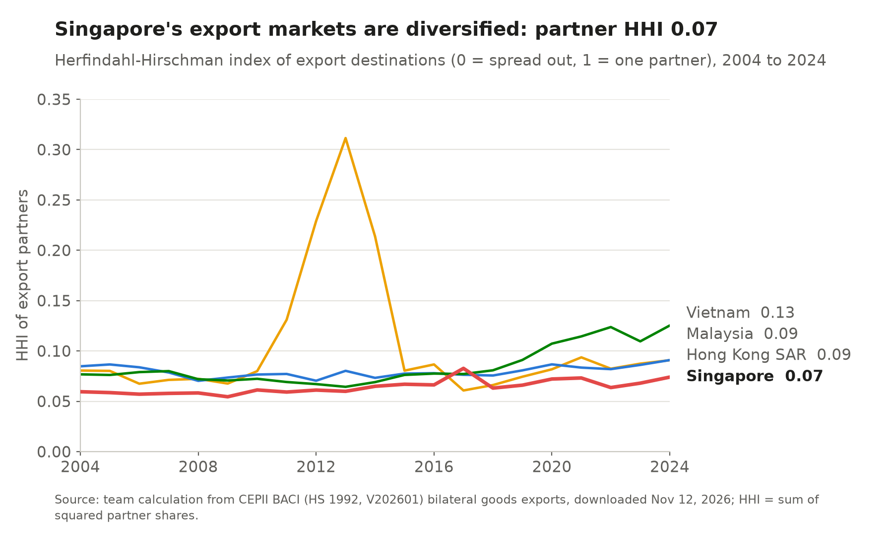

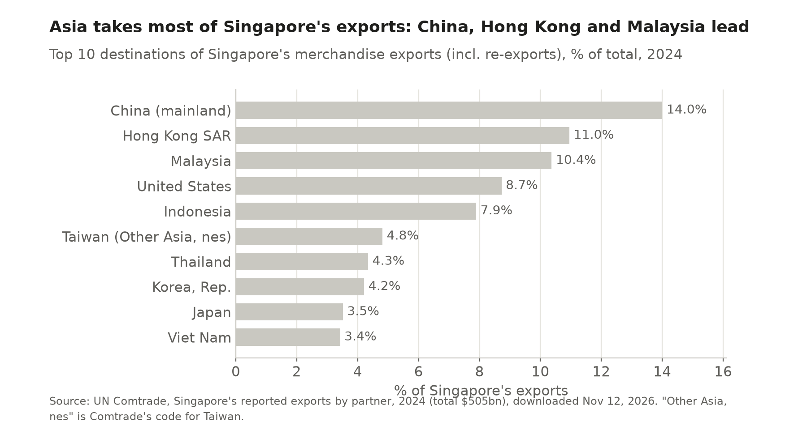

Singapore's index has barely moved since 2004 (0.060), while Vietnam's rose from 0.077 to 0.125 as exports to the United States grew.

## Does its trade follow gravity?
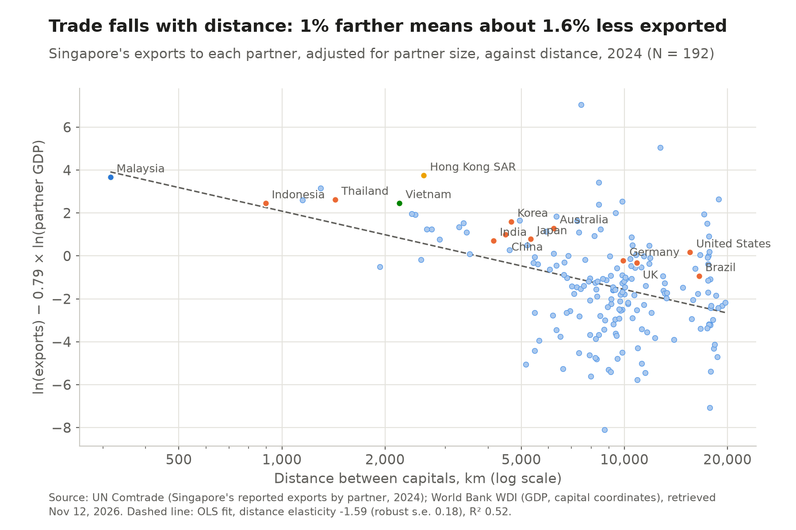

**Yes, slightly more tightly than world trade as a whole.** Log exports to each partner in 2024 on log partner GDP and log distance between capitals give:

ln Xj = 13.04 + 0.79 · ln GDPj − 1.59 · ln Distjrobust s.e. 0.08 and 0.18 · R² 0.52 · N = 192 · UN Comtrade, 2024

**Distance and size.** A partner 1 percent farther away buys 1.59 percent less, close to the class estimate of −1.46 (and −1.69 on BACI data), and nearby small economies buy more than their size predicts, as expected of a hub. Agreement partners buy about seven times what size and distance predict.

**Distance as a cost.** Feyrer's (2009) Suez Canal experiment gives a sea distance elasticity of −0.46, less than a third of ours, because distance between capitals also carries history and networks. Chapter 4 asks what Singapore is good at producing.

More: the regression table, with BACI, the FTA dummy and the class estimate

| Sample, 2024 | ln partner GDP | ln distance | FTA in force | R² | Partners (N) |
| --- | --- | --- | --- | --- | --- |
| Reported exports (incl. re-exports), Comtrade | 0.79 (s.e. 0.08) | −1.59 (s.e. 0.18) | not included | 0.52 | 192 |
| BACI reconciled exports | 0.87 (s.e. 0.06) | −1.69 (s.e. 0.15) | not included | 0.68 | 190 |
| Reported exports, with FTA dummy | 0.55 (s.e. 0.09) | −1.29 (s.e. 0.19) | 1.98 (s.e. 0.37) | 0.58 | 192 |
| Class estimate, world bilateral trade (slides) | 1.00 (importer), 1.35 (exporter) | −1.46 (s.e. 0.02) | not included | 0.63 | 23,790 pairs |

*OLS of ln(Singapore's exports to partner j) on ln(GDP of j, current US$, 2024) and ln(great-circle distance between capitals, km). Robust (HC1) standard errors in parentheses. FTA in force = 1 for the 64 partners covered by an agreement in force in 2024 (team list from Enterprise Singapore and METI). The class estimate is the 2024 gravity regression on all country pairs in the EC 391 gravity lecture (CEPII and UN Comtrade data). Sources: UN Comtrade; CEPII BACI; World Bank WDI (GDP, capital coordinates). Taiwan is excluded (no World Bank GDP).*

Sources for this chapter

World Bank, World Development Indicators; Singapore Department of Statistics and Enterprise Singapore, table M451001; CEPII, BACI HS92 V202601 (Gaulier and Zignago, 2010); UN Comtrade; EC 391 lecture "The Gravity Equation: Geography and Size as Sources of Comparative Advantage" (Prof. Ramondo), slides on gravity determinants, the 2000 and 2024 class estimates and Feyrer's first stage; Feyrer, J. (2009), "The 1967 to 1975 Suez Canal closure: lessons for trade and the trade income link", VoxEU, CEPR, 23 December; Head, K. and T. Mayer (2014), "Gravity equations: workhorse, toolkit, and cookbook", *Handbook of International Economics* 4. Figures generated by `scripts/ch03_trade.py`.

---

# 4 Specialization and comparative advantage

## Key finding

Singapore's comparative advantage has moved from factories to services, and transport and finance are now its strongest sectors. The pattern fits its abundance of capital and skills, and it fits Nunn's institutional explanation even better.

## What is Singapore good at, and how has it changed?
*Interactive figure on the website: [Revealed comparative advantage by sector](https://ziqijia825-afk.github.io/ec391-singapore/)*

**Moving goods and money, plus a core of high technology manufacturing.** Singapore's RCA is 4.5 in transport and logistics, 2.8 in finance, 1.4 in electronics, 1.3 in ICT and business services and 1.2 in pharmaceuticals. Only Singapore and Hong Kong SAR have advantages in both transport and finance, the fingerprint of a regional hub.

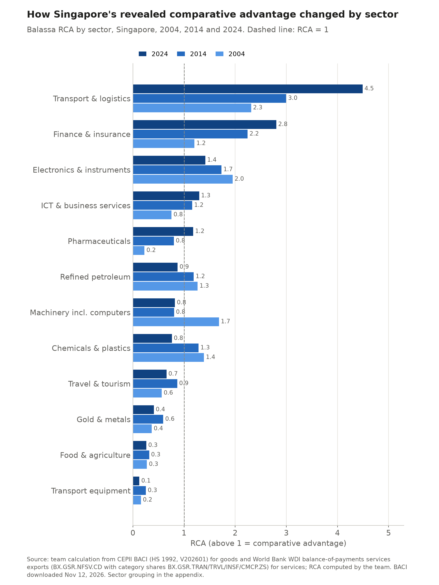

**From goods to services within twenty years.** Transport rose from 2.3 to 4.5 and finance from 1.2 to 2.8 between 2004 and 2024, while electronics fell from 1.95 to 1.41. Since 2014 refined petroleum (1.19 to 0.87) and chemicals (1.28 to 0.76) lost their advantage and pharmaceuticals gained one (0.80 to 1.18).

More: the index, and Singapore against its peers

RCAik = (Xik / Xi) ÷ (Xwk / Xw)X = exports · i = Singapore · k = sector · w = world · above 1 = comparative advantage

We computed the index ourselves, goods from BACI and services from the World Bank.

<table class="rca">
<thead><tr><th>Sector</th><th>Singapore</th><th>Malaysia</th><th>Hong Kong SAR</th><th>Vietnam</th></tr></thead>
<tbody>
<tr><td>Electronics & instruments</td><td style="background:#86b6ef;color:#1f1f1d;text-align:center">1.41</td><td style="background:#256abf;color:#ffffff;text-align:center">2.68</td><td style="background:#86b6ef;color:#1f1f1d;text-align:center">1.45</td><td style="background:#256abf;color:#ffffff;text-align:center">3.09</td></tr>
<tr><td>Machinery incl. computers</td><td style="background:#fbd2b8;color:#1f1f1d;text-align:center">0.82</td><td style="background:#86b6ef;color:#1f1f1d;text-align:center">1.11</td><td style="background:#fbd2b8;color:#1f1f1d;text-align:center">0.99</td><td style="background:#86b6ef;color:#1f1f1d;text-align:center">1.74</td></tr>
<tr><td>Refined petroleum</td><td style="background:#fbd2b8;color:#1f1f1d;text-align:center">0.87</td><td style="background:#86b6ef;color:#1f1f1d;text-align:center">1.90</td><td style="background:#fde9dc;color:#5f5e5a;text-align:center">0.02</td><td style="background:#fde9dc;color:#5f5e5a;text-align:center">0.07</td></tr>
<tr><td>Chemicals & plastics</td><td style="background:#fbd2b8;color:#1f1f1d;text-align:center">0.76</td><td style="background:#fbd2b8;color:#1f1f1d;text-align:center">0.84</td><td style="background:#fde9dc;color:#5f5e5a;text-align:center">0.23</td><td style="background:#fbd2b8;color:#1f1f1d;text-align:center">0.62</td></tr>
<tr><td>Pharmaceuticals</td><td style="background:#86b6ef;color:#1f1f1d;text-align:center">1.18</td><td style="background:#fde9dc;color:#5f5e5a;text-align:center">0.04</td><td style="background:#fde9dc;color:#5f5e5a;text-align:center">0.14</td><td style="background:#fde9dc;color:#5f5e5a;text-align:center">0.02</td></tr>
<tr><td>Gold & metals</td><td style="background:#fde9dc;color:#5f5e5a;text-align:center">0.41</td><td style="background:#fbd2b8;color:#1f1f1d;text-align:center">0.69</td><td style="background:#256abf;color:#ffffff;text-align:center">2.84</td><td style="background:#fde9dc;color:#5f5e5a;text-align:center">0.49</td></tr>
<tr><td>Food & agriculture</td><td style="background:#fde9dc;color:#5f5e5a;text-align:center">0.26</td><td style="background:#86b6ef;color:#1f1f1d;text-align:center">1.04</td><td style="background:#fde9dc;color:#5f5e5a;text-align:center">0.38</td><td style="background:#fbd2b8;color:#1f1f1d;text-align:center">0.97</td></tr>
<tr><td>Transport equipment</td><td style="background:#fde9dc;color:#5f5e5a;text-align:center">0.13</td><td style="background:#fde9dc;color:#5f5e5a;text-align:center">0.12</td><td style="background:#fde9dc;color:#5f5e5a;text-align:center">0.10</td><td style="background:#fde9dc;color:#5f5e5a;text-align:center">0.15</td></tr>
<tr><td>Transport & logistics</td><td style="background:#256abf;color:#ffffff;text-align:center">4.49</td><td style="background:#fde9dc;color:#5f5e5a;text-align:center">0.35</td><td style="background:#256abf;color:#ffffff;text-align:center">3.04</td><td>n/a</td></tr>
<tr><td>Finance & insurance</td><td style="background:#256abf;color:#ffffff;text-align:center">2.80</td><td style="background:#fde9dc;color:#5f5e5a;text-align:center">0.08</td><td style="background:#256abf;color:#ffffff;text-align:center">3.77</td><td>n/a</td></tr>
<tr><td>ICT & business services</td><td style="background:#86b6ef;color:#1f1f1d;text-align:center">1.29</td><td style="background:#fde9dc;color:#5f5e5a;text-align:center">0.37</td><td style="background:#fde9dc;color:#5f5e5a;text-align:center">0.22</td><td>n/a</td></tr>
<tr><td>Travel & tourism</td><td style="background:#fbd2b8;color:#1f1f1d;text-align:center">0.66</td><td style="background:#fbd2b8;color:#1f1f1d;text-align:center">0.79</td><td style="background:#86b6ef;color:#1f1f1d;text-align:center">1.64</td><td>n/a</td></tr>
<tr><td>Other goods</td><td style="background:#fde9dc;color:#5f5e5a;text-align:center">0.10</td><td style="background:#fde9dc;color:#5f5e5a;text-align:center">0.46</td><td style="background:#fde9dc;color:#5f5e5a;text-align:center">0.44</td><td style="background:#256abf;color:#ffffff;text-align:center">2.85</td></tr>
</tbody></table>

*Balassa RCA = (country's exports of sector k / its total exports of goods and services) ÷ (world exports of k / world total), 2024. Shading: dark blue ≥ 10, blue 2 to 10, light blue 1 to 2 (advantage); light orange 0.5 to 1 and pale orange below 0.5 (no comparative advantage); n/a = no services breakdown reported. Source: team calculation from CEPII BACI (HS 1992, V202601) for goods and World Bank WDI balance-of-payments services exports (BX.GSR.NFSV.CD with category shares BX.GSR.TRAN/TRVL/INSF/CMCP.ZS) for services; RCA computed by the team. BACI downloaded Nov 12, 2026. Sector grouping in the appendix.*

Malaysia's strengths are electronics, refined oil and food and Vietnam's electronics and garments. Hong Kong SAR's are finance (3.8) and transport (3.0).

More: RCA by HS chapter

Within goods alone Singapore has an RCA above 1 in 17 of 97 HS chapters, against 11 for Malaysia and 27 for Vietnam, led by electrical machinery (RCA 2.1).

| HS | Product | Share of Singapore's goods exports, 2024 | RCA 2004 | RCA 2014 | RCA 2024 |
| --- | --- | --- | --- | --- | --- |
| 85 | Electrical machinery and equipment and parts thereof; sound… | 29.9% | 2.28 | 2.16 | 2.10 |
| 27 | Mineral fuels, mineral oils and products of their distillation;… | 17.1% | 1.30 | 1.40 | 1.28 |
| 84 | Machinery and mechanical appliances, boilers, nuclear reactors;… | 14.2% | 1.73 | 0.95 | 1.20 |
| 30 | Pharmaceutical products | 6.9% | 0.23 | 0.94 | 1.72 |
| 90 | Optical, photographic, cinematographic, measuring, checking,… | 5.9% | 0.97 | 1.66 | 1.97 |
| 71 | Natural, cultured pearls; precious, semi-precious stones; precious… | 4.5% | 0.56 | 1.24 | 1.13 |
| 29 | Organic chemicals | 4.0% | 2.87 | 3.25 | 1.84 |
| 39 | Plastics and articles thereof | 3.7% | 1.26 | 1.36 | 1.09 |
| 21 | Miscellaneous edible preparations | 1.7% | 0.71 | 1.76 | 3.40 |
| 38 | Chemical products n.e.c. | 1.4% | 1.21 | 1.67 | 1.47 |
| 33 | Essential oils and resinoids; perfumery, cosmetic or toilet… | 1.3% | 0.80 | 1.17 | 1.56 |
| 89 | Ships, boats and floating structures | 1.0% | 0.92 | 2.22 | 1.59 |
| 73 | Iron or steel articles | 0.6% | 0.43 | 0.65 | 0.37 |
| 22 | Beverages, spirits and vinegar | 0.5% | 0.55 | 1.03 | 0.80 |
| 88 | Aircraft, spacecraft, and parts thereof | 0.4% | 0.36 | 0.31 | 0.39 |

*Goods-only Balassa RCA by HS 1992 chapter (world = all BACI exporters). Source: team calculation from CEPII BACI; chapter titles from UN Comtrade's HS reference.*

## Does it fit Heckscher Ohlin?
**Yes, and institutions explain it even better.** Singapore has the 14th highest capital per worker of 173 economies and almost no resource rents (178th of 197), so it is capital and skill abundant and resource poor.

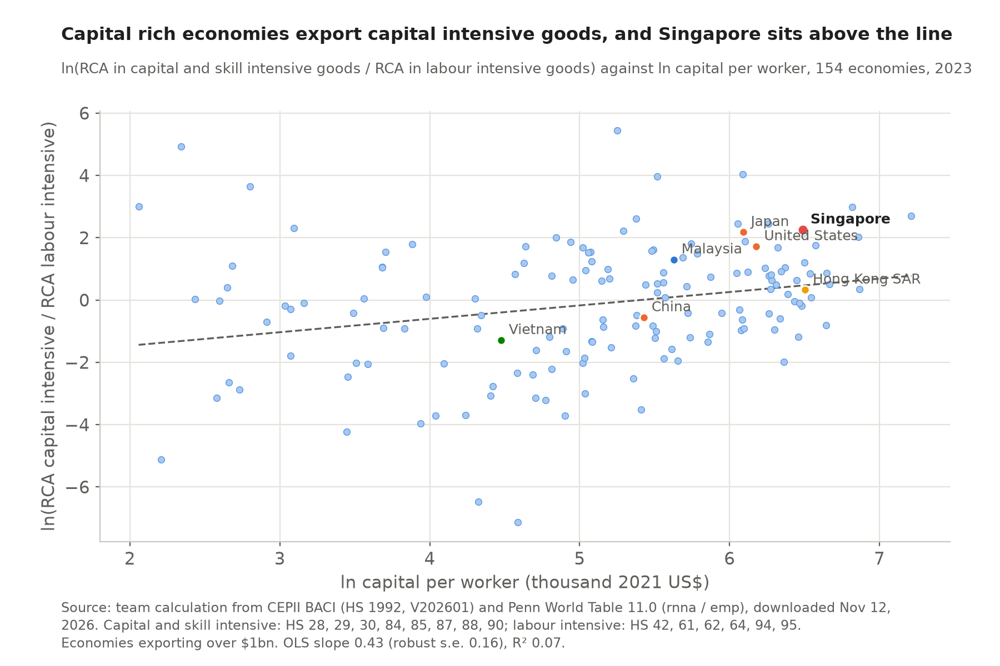

**A cross-country check.** Across 154 economies, 1 percent more capital per worker goes with a 0.43 percent higher ratio of capital to labour intensive RCA (s.e. 0.16), as Heckscher and Ohlin predict, but it explains only 7 percent of the variation, and Singapore sits far above the line.

**The Nunn test.** Singapore ranks 18th of 207 on rule of law, and the goods it kept, electronics and instruments, are among Nunn's (2007) most contract intensive industries while those it lost are among the least. Chapter 5 asks how much of the value is made at home.

More: capital per worker, endowments against the peers, and caveats

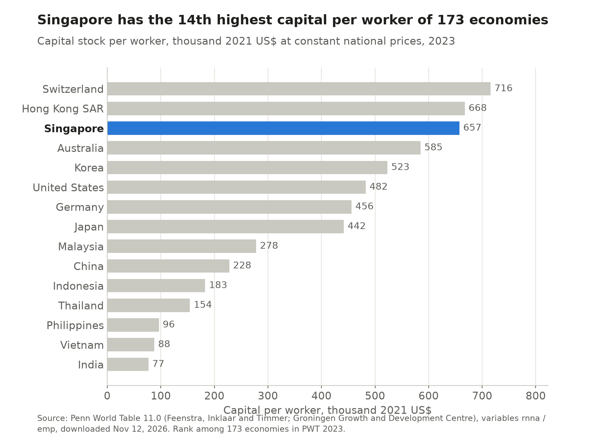

| Endowment | Singapore | Year | Global rank | East Asia & Pacific rank | Malaysia | Hong Kong SAR | Vietnam |
| --- | --- | --- | --- | --- | --- | --- | --- |
| Capital per worker (PWT rnna/emp) | $657k | 2023 | 14th of 173 | 3rd of 19 | $278k | $668k | $88k |
| Human capital index (PWT hc) | 3.40 | 2023 | 28th of 143 | 4th of 19 | 3.21 | 3.36 | 2.74 |
| Arable land per person | 0.0001 ha | 2024 | 205th of 205 | 34th of 34 | 0.0239 ha | 0.0003 ha | 0.0666 ha |
| Natural resource rents, % of GDP | 0.00% | 2021 | 178th of 197 | 29th of 35 | 6.92% | 0.00% | 2.55% |

*Rank 1st = most abundant. Sources: Penn World Table 11.0; World Bank WDI (AG.LND.ARBL.HA.PC, NY.GDP.TOTL.RT.ZS), retrieved Nov 12, 2026.*

Two caveats apply. The split of HS chapters by factor intensity follows textbook examples, and much of the capital was brought in by foreign multinationals, as Young (1992) stressed (Chapter 6).

Sources for this chapter

CEPII, BACI HS92 V202601 (Gaulier and Zignago, 2010); World Bank, World Development Indicators (services exports by category); UN Comtrade (HS chapter titles); Penn World Table 11.0 (Feenstra, Inklaar and Timmer, Groningen Growth and Development Centre); Nunn, N. (2007) and Young, A. (1992), see appendix. Figures and tables generated by `scripts/ch04_rca.py`.

---

# 5 Global value chains

## Key finding

Almost half the value of Singapore's exports is created abroad, which makes it one of the most integrated and most downstream economies in global value chains. It buys components, crude oil and services, adds processing and coordination, and ships the result on.

## How much of its exports is foreign, and where does it sit?

**Almost half, 46.1 percent in 2022, the 7th highest share of 80 economies and 2nd of 17 in East Asia and the Pacific.** Among the peers only Vietnam, with its foreign owned electronics assembly, is higher, while Malaysia (34.2 percent) and Hong Kong SAR (18.0 percent) export more home grown resources and services.

**Far downstream, 73rd of 80 on the position index.** Singapore's value added used in other countries' exports is only 17.3 percent of its exports, against 46.1 percent foreign content, so total participation of 63.4 percent ranks 5th in the world while the position index (Koopman and coauthors, 2010) is −0.22.

More: how we measured participation, the foreign share chart, what downstream looks like and the participation table

Backward participation is the foreign share of a country's exports, forward participation the share of its exports used in other countries' exports. We computed both from OECD TiVA 2025, which covers 80 economies up to 2022.

<section class="chains">
<h4>Chips</h4>Midstream
Wafers, tools and designs come in, and Singapore fabricates and tests the chips that assemblers across Asia build into devices.
<b>46%</b><small>foreign value in electronics exports</small>

<h4>Refining</h4>Downstream processing
Every barrel of crude is imported, and the refineries on Jurong Island turn it into fuels that leave by sea.
<b>72%</b><small>foreign value in refined fuel exports</small>

<h4>Biologics</h4>Midstream
Plants make active ingredients and biologics that are formulated, packed and sold by parent firms abroad.
<b>3.1</b><small>RCA in biologics and vaccines, 2024</small>

<h4>Logistics and finance</h4>Hub services
Ships, warehouses, banks and insurers move and finance goods made elsewhere in the region.
<b>28%</b><small>foreign value in finance exports, the most domestic sector</small>

OECD TiVA 2025 edition (2022) and CEPII BACI, team calculations.
</section>

| Indicator, 2022 | Singapore | Global rank | East Asia & Pacific rank | Malaysia | Hong Kong SAR | Vietnam |
| --- | --- | --- | --- | --- | --- | --- |
| Backward participation (FVA, % of exports) | 46.1% | 7th of 80 | 2nd of 17 | 34.2% | 18.0% | 48.5% |
| Forward participation (% of exports) | 17.3% | 53rd of 80 | 12th of 17 | 20.8% | 15.6% | 11.6% |
| Total GVC participation | 63.4% | 5th of 80 | 1st of 17 | 55.0% | 33.6% | 60.1% |
| GVC position index (+ upstream, − downstream) | -0.220 | 73rd of 80 | 16th of 17 | -0.104 | -0.020 | -0.286 |
| Re-exported intermediate imports, % of exports | 47.1% | 7th of 80 | 2nd of 17 | 34.4% | 18.0% | 49.0% |

*Ranks among the 80 economies in TiVA 2025 (1st = highest). Position index: Koopman et al. (2010), ln(1 + forward) − ln(1 + backward). Source: OECD TiVA 2025 edition; team calculation.*

Re-exported intermediate imports equalled 47.1 percent of gross exports in 2022, the 7th highest share, which confirms Singapore's role as the region's processor.

## Which sectors rely most on foreign inputs?

**Refining and transport, while finance is the most home grown.** Refined fuels carry 72 percent foreign value and transport 60 percent, against 28 percent for finance.

More: sector table and where Singapore's foreign inputs come from

| Sector | Share of Singapore's gross exports | Foreign value added, % | Malaysia FVA % | Hong Kong SAR FVA % | Vietnam FVA % |
| --- | --- | --- | --- | --- | --- |
| Transport & logistics | 20.6% | 60% | 27% | 36% | 45% |
| ICT & business services | 18.7% | 48% | 23% | 17% | 36% |
| Electronics & instruments | 17.8% | 46% | 47% | 24% | 56% |
| Wholesale trade | 14.8% | 34% | 10% | 18% | 33% |
| Finance & insurance | 8.7% | 28% | 17% | 7% | 26% |
| Chemicals & plastics | 5.0% | 46% | 40% | 28% | 55% |
| Machinery incl. computers | 3.5% | 45% | 46% | 28% | 53% |
| Refined petroleum | 2.5% | 72% | 34% | 58% | 55% |
| Pharmaceuticals | 1.7% | 34% | 34% | 15% | 50% |
| Transport equipment | 1.6% | 51% | 39% | 28% | 56% |
| Food & agriculture | 0.9% | 48% | 28% | 22% | 38% |
| Travel & tourism | 0.6% | 37% | 21% | 19% | 33% |
| Gold & metals | 0.6% | 45% | 52% | 27% | 36% |

*Gross exports and foreign value added by industry, 2022. Source: OECD TiVA 2025 edition; industries mapped to the team's sector table.*

The United States and China each supplied 13.7 percent of the foreign value added in 2022, while Malaysia supplies only 2.6 percent although it is a top source of imports, so much of what comes from Malaysia passes through.

**Why a high cost location wins some stages.** Fort (2017) finds that cheaper communication lets firms split production toward high human capital locations, so Singapore (28th of 143 on human capital) keeps design intensive stages while assembly moves to its neighbours. The price is exposure to upstream shocks, which after the 2011 Tohoku earthquake cut American affiliates' output almost one for one with lost Japanese inputs (Boehm, Flaaen and Pandalai Nayar, 2015). Chapter 6 turns to the foreign firms that run these links.

Sources for this chapter

OECD, Trade in Value Added (TiVA) database, 2025 edition (principal indicators and origin of value added in gross exports), via the OECD SDMX API; Koopman, R., W. Powers, Z. Wang and S.J. Wei (2010), "Give credit where credit is due: tracing value added in global production chains", NBER Working Paper 16426; Fort, T.C. (2017), "Technology and production fragmentation: domestic versus foreign sourcing", *Review of Economic Studies* 84(2); Boehm, C.E., A. Flaaen and N. Pandalai Nayar (2015), VoxEU, CEPR, 9 January. Figures and tables generated by `scripts/ch05_gvc.py`.

---

# 6 Foreign direct investment

## Key finding

Singapore is the world's second largest destination for foreign direct investment, and foreign firms own assets worth four times its GDP. Much of that money passes through holding companies on its way to the rest of Asia, while the productive part sits in trade, chips and business services.

## How much FDI comes in?

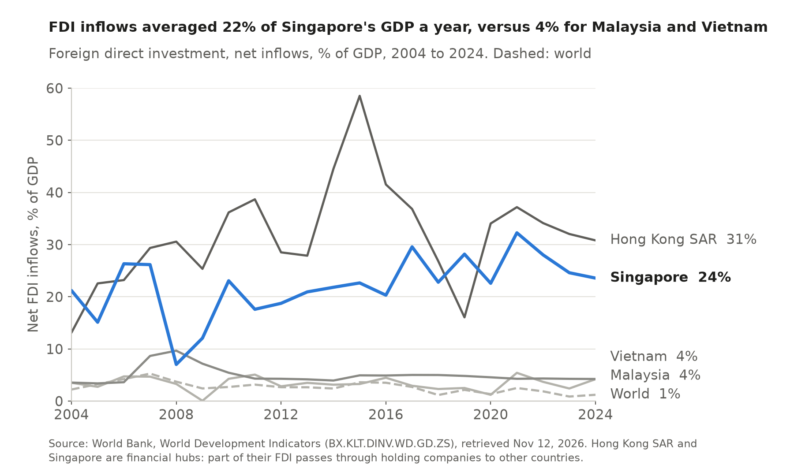

**About a fifth of GDP every year, second only to the United States in dollars.** Net inflows averaged 22 percent of GDP between 2004 and 2024, against 3 percent in Malaysia and 5 percent in Vietnam, and reached $135 billion in 2024, 6th of 194 relative to GDP (2nd in the region) and 2nd in the world in value.

**Slightly more new plants than takeovers.** Over 2016 to 2025 announced greenfield projects were worth 1.3 times net acquisitions, between Malaysia and Vietnam, where new factories dominate, and Hong Kong SAR, where buying firms dominates.

More: the accumulated stock, and greenfield and M&A for all four economies

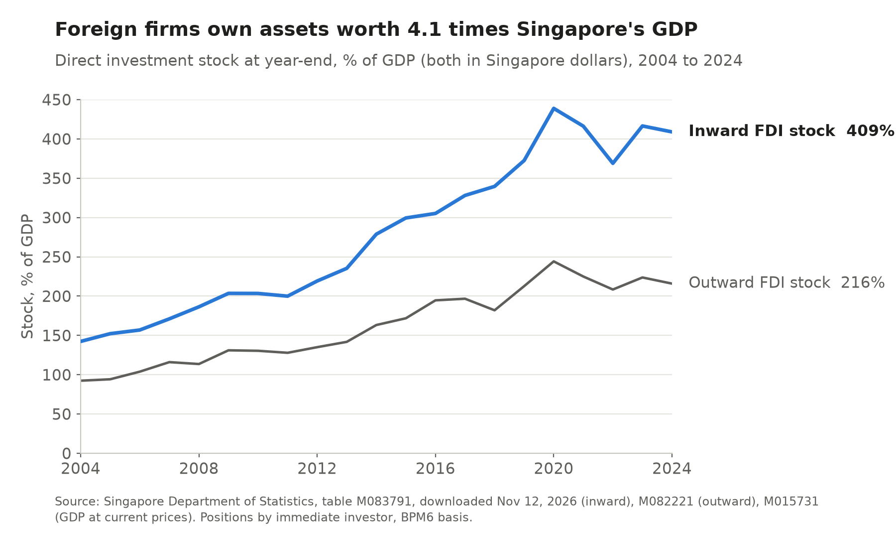

Inward FDI rose from 142 percent of GDP in 2004 to 409 percent (S$3,130 billion) in 2024. UNCTAD, which leaves out special purpose entities, puts it at 389 percent, the 4th highest of 193 economies and 2nd in East Asia and the Pacific.

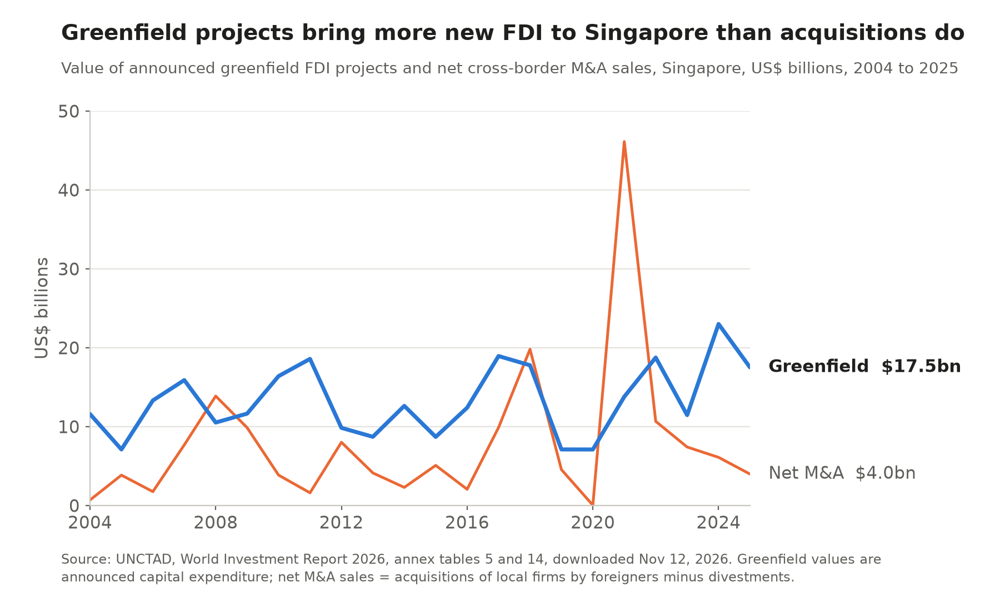

| Economy | FDI inflows, 2025 (US$ bn) | Greenfield projects, 2025 (number) | Greenfield value, 2025 (US$ bn) | Net M&A sales, 2025 (number) | Net M&A value, 2025 (US$ bn) | Greenfield value 2016 to 2025 / M&A value 2016 to 2025 |
| --- | --- | --- | --- | --- | --- | --- |
| Singapore | 150.9 | 354 | 17.5 | 100 | 4.0 | 1.3× |
| Malaysia | 15.4 | 236 | 22.2 | 48 | 2.3 | 14.8× |
| Hong Kong SAR | 116.5 | 147 | 5.0 | 45 | 2.6 | 0.6× |
| Vietnam | 20.4 | 249 | 24.3 | 33 | 0.9 | 7.8× |

*Source: UNCTAD, World Investment Report 2026, annex tables 1, 5, 7, 14 and 17. Greenfield = announced new projects (capital expenditure); M&A = net sales of domestic firms to foreign buyers. The two are not additive and do not sum to FDI flows.*

## Who invests, and in what?
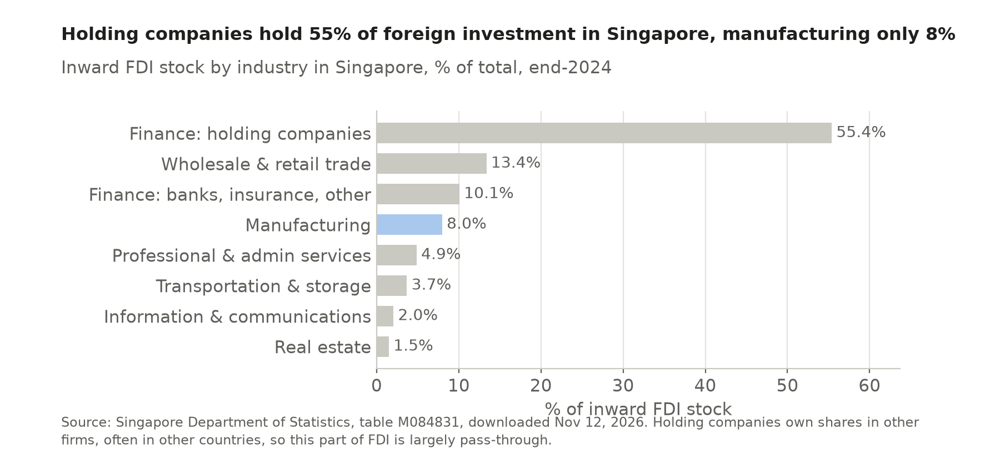

**American firms and Caribbean holding companies, mostly in holding companies themselves.** The United States holds 24.9 percent of the inward stock and the Cayman Islands and British Virgin Islands 17.5 percent, and by industry holding companies hold 55.4 percent. Because the data record the immediate investor, much of this is pass through money invested onward in Asia.

More: sources by country, and immediate versus ultimate investors

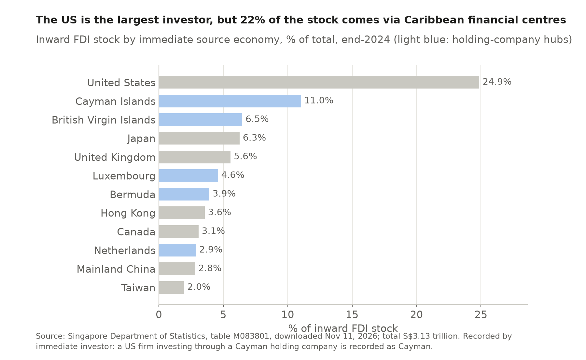

Manufacturing holds 8.0 percent of the stock, semiconductors 2.2 percent and pharmaceuticals only 0.3 percent (Chapter 9). Singapore publishes no series by ultimate investor, and Damgaard, Elkjaer and Johannesen (2019) name it among the ten economies that host most of the world's "phantom" investment through empty shells ([IMF Finance and Development](https://www.imf.org/en/Publications/fandd/issues/2019/09/the-rise-of-phantom-FDI-in-tax-havens-damgaard)).

**What firms seek: a base for the region.** Six million people are too few for market seeking investment, so firms come for export platform investment (Ekholm, Forslid and Markusen, 2007) and regional headquarters. In Dunning's OLI terms the location advantages are the institutions of Chapter 2, low taxes with incentives, skilled workers and the agreements of Chapter 7.

## Does Singapore invest abroad?

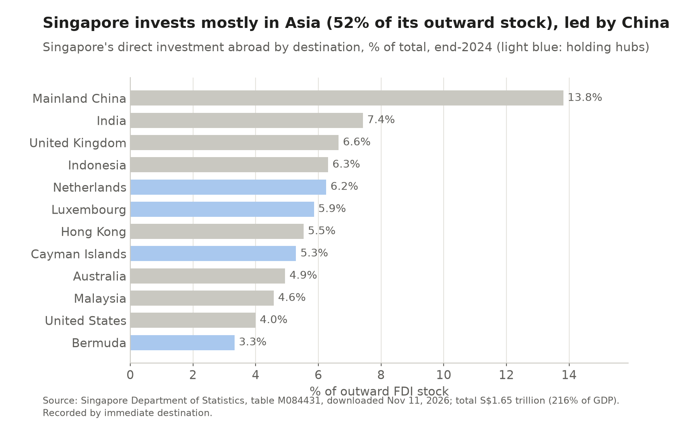

**Heavily, mostly in Asia.** Direct investment abroad reached S$1,653 billion in 2024, 216 percent of GDP (205 percent on UNCTAD's figures, 5th of 174 economies), and Asia takes 52 percent. Income from it rose from 19.5 to 36.3 percent of GDP, but foreign investors in Singapore earn even more (53.7 percent), so gross national income is only 82.7 percent of GDP.

More: investment income over time and outward FDI by industry

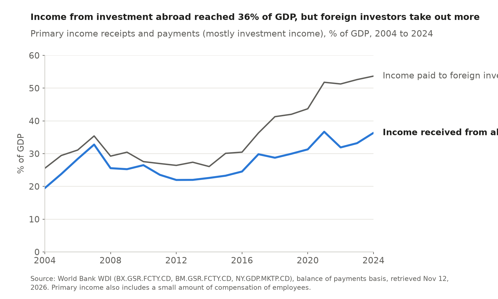

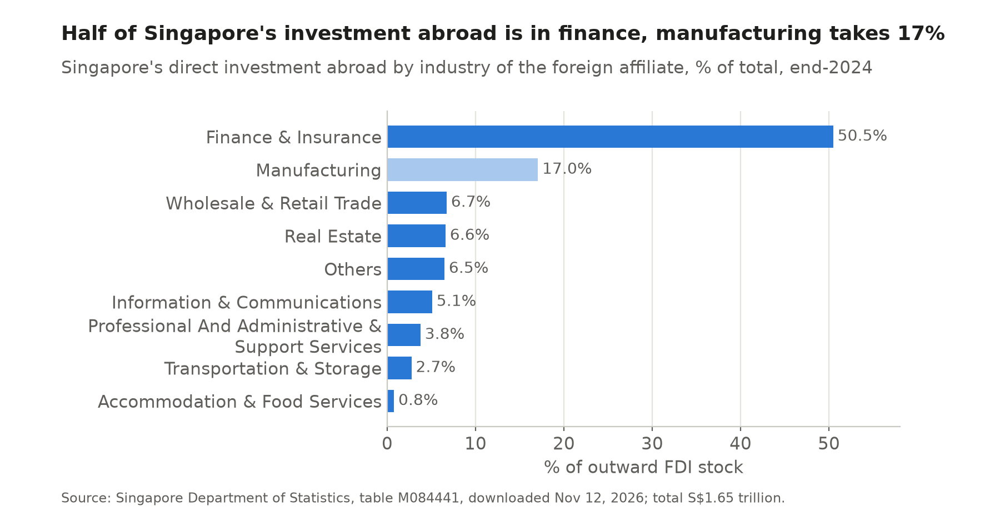

Half of the outward stock is in finance and insurance and 17.0 percent in manufacturing, including plants moved to neighbouring countries.

FDI brings capital, technology and market access that six million people could not build alone. Much of it is pass through money that reacts to global tax rules (Chapter 9). Chapter 7 looks at the policies that keep it coming.

Sources for this chapter

World Bank, World Development Indicators; Singapore Department of Statistics, tables M083791, M083801, M084831, M082221, M084431, M084441, M015731; UNCTAD, World Investment Report 2026, annex tables 1, 3, 4, 5, 7, 14, 17; Economic Development Board; Damgaard, J., T. Elkjaer and N. Johannesen (2019), IMF; Ekholm, K., R. Forslid and J. Markusen (2007), "Export-platform foreign direct investment", *Journal of the European Economic Association* 5(4). Figures generated by `scripts/ch06_fdi.py`.

---

# 7 Trade policy

## Key finding

Singapore is close to a pure free trader at home and uses 29 free trade agreements to open markets abroad. Its new risks come from outside, as US tariffs and export controls reach it whatever its own policy.

## How high are its barriers?
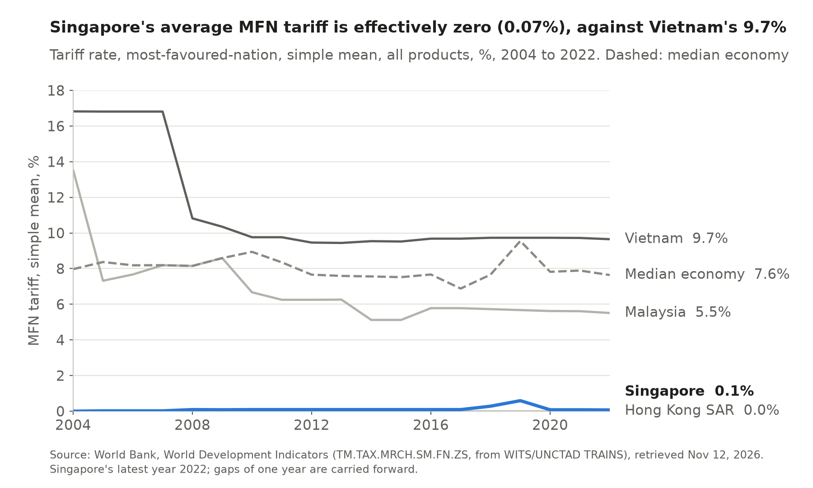

**Close to zero.** A founding member of the WTO in 1995, Singapore had an average MFN tariff of 0.07 percent in 2022, 3rd lowest of 143 economies and of 21 in East Asia and the Pacific, against 5.5 percent in Malaysia and 9.7 percent in Vietnam. Only beer, stout and two rice spirits pay customs duty.

**Non-tariff measures mostly protect consumers.** They touch 39.3 percent of imports, against 55.0 percent in Malaysia, and nine of the ten most common are technical rules on food, fuel and chemicals that Singapore hardly produces ([WITS](https://wits.worldbank.org/tariff/non-tariff-measures/en/country/SGP)).

More: the WTO tariff profile, tariff rankings, excise duties and non-tariff measures

| WTO tariff profile, 2025 | Singapore | Malaysia | Hong Kong SAR | Vietnam |
| --- | --- | --- | --- | --- |
| MFN applied tariff, simple average (all products) | 0.0% | 5.5% | 0.0% | 9.5% |
| of which agricultural products | 0.1% | 6.7% | 0.0% | 17.0% |
| of which non-agricultural products | 0.0% | 5.3% | 0.0% | 8.3% |
| MFN applied tariff, trade-weighted average | 0.0% | 3.3% | 0.0% | 5.1% |
| Duty-free tariff lines, agriculture | 99.8% | 74.5% | 100.0% | 15.1% |
| Duty-free tariff lines, non-agriculture | 100.0% | 65.6% | 100.0% | 39.4% |
| Tariff peaks: lines above 15%, agriculture | 0.2% | 7.6% | 0.0% | 41.8% |
| Tariff peaks: lines above 15%, non-agriculture | 0.0% | 14.3% | 0.0% | 21.0% |
| Highest applied duty in any product group | 90% | >1,000% | 0% | 135% |
| Simple average final bound tariff | 8.9% | 20.8% | 0.0% | 11.7% |

*Source: WTO, Tariff Profiles (Part A.1 and A.2), downloaded Nov 12, 2026. Tariff peaks follow the WTO convention of duties above 15%. Ad valorem equivalents of specific duties are included where the WTO reports them.*

| Tariff measure | Singapore | Year | Global rank (1st = lowest) | East Asia & Pacific rank | Malaysia | Hong Kong SAR | Vietnam |
| --- | --- | --- | --- | --- | --- | --- | --- |
| MFN tariff, simple mean | 0.07% | 2022 | 3rd of 143 | 3rd of 21 | 5.51% (2022) | 0.00% (2022) | 9.65% (2022) |
| MFN tariff, trade-weighted mean | 0.11% | 2022 | 4th of 143 | 4th of 21 | 3.42% (2022) | 0.00% (2022) | 4.98% (2022) |
| Applied tariff, simple mean | 0.05% | 2022 | 3rd of 143 | 3rd of 21 | 5.43% (2022) | 0.00% (2022) | 3.71% (2022) |
| Applied tariff, trade-weighted mean | 0.00% | 2022 | 1st of 143 | 1st of 21 | 3.42% (2022) | 0.00% (2022) | 1.07% (2022) |

*Ties share the best rank, so many zero-tariff economies can be '1st'. Source: World Bank WDI (WITS/UNCTAD TRAINS), retrieved Nov 12, 2026.*

Singapore's average bound rate is 8.9 percent, far above what it applies, and revenue comes instead from excise duties and a 9 percent goods and services tax ([WTO tariff profile](https://www.wto.org/english/res_e/statis_e/daily_update_e/tariff_profiles/SG_e.pdf)).

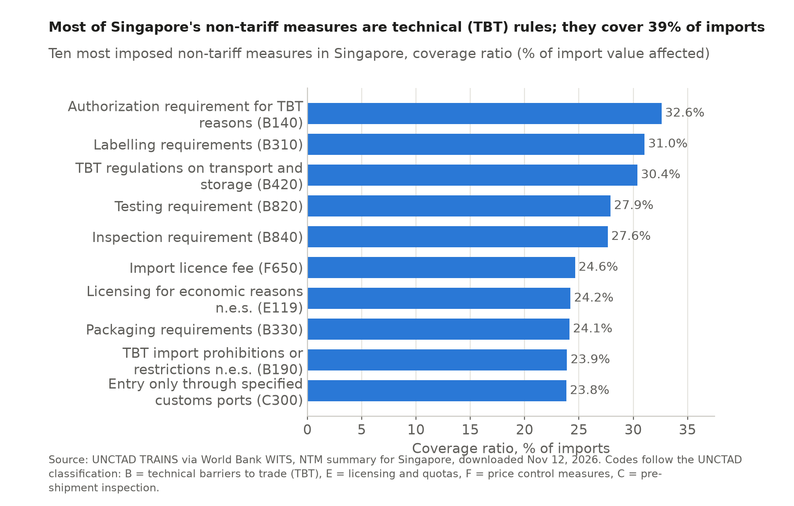

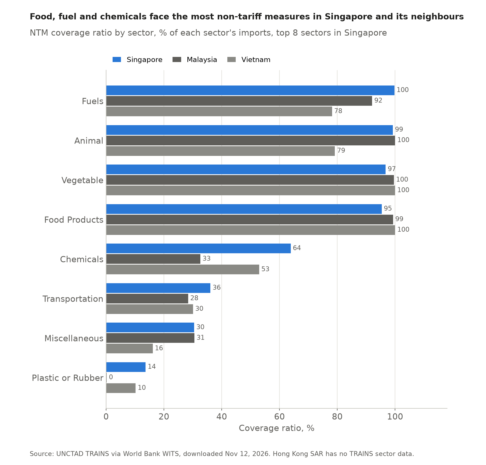

By tariff line, measures cover 27.8 percent of Singapore's lines, against 36.6 percent in Malaysia and 47.0 percent in Vietnam.

## What are its trade agreements for?
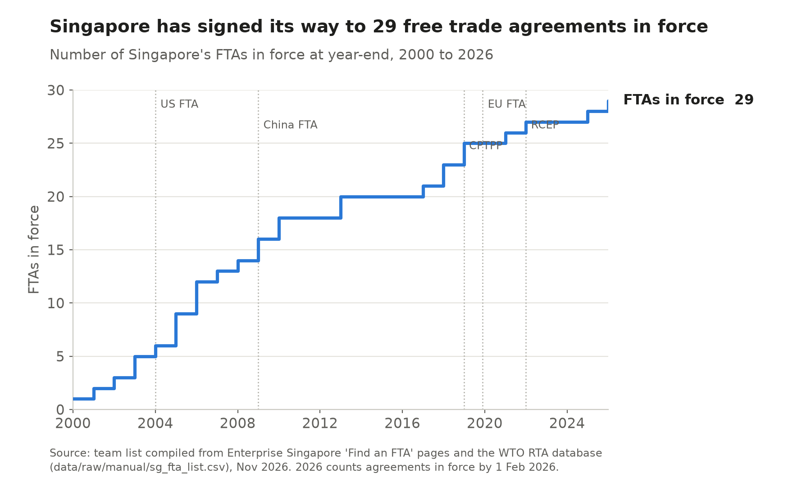

**To open partners' markets, since Singapore's own is already open.** The network grew from 6 agreements in 2004 to 29 in 2026, including the US (2004), China (2009), the EU (2019) and RCEP (2022). **Rules of origin.** Partners use them to stop third country goods entering through Singapore, and Conconi and coauthors (2016) show they cut NAFTA Mexico's imports of non member inputs by around 30 percentage points. With 46 percent foreign content in its exports (Chapter 5), Singapore gains most from RCEP's common rules, which count inputs from all fifteen members.

Full list of the 29 FTAs: partners, year of entry into force and scope

MERCOSUR became the twenty-ninth agreement in February 2026 ([METI](https://www.meti.gov.sg/newsroom/mercosur-singapore-free-trade-agreement-enters-into-force-for-singapore-and-paraguay)).

| Agreement | Partner(s) | Type | In force for Singapore | Scope |
| --- | --- | --- | --- | --- |
| AFTA (CEPT / ATIGA) | ASEAN | Regional (ASEAN) | 01 Jan 1993 | Goods (ATIGA 2010), services (AFAS/ATISA), investment (ACIA) |
| ANZSCEP | New Zealand | Bilateral | 01 Jan 2001 | Goods, services |
| JSEPA | Japan | Bilateral | 30 Nov 2002 | Goods, services, investment |
| ESFTA | EFTA (Switzerland, Norway, Iceland, Liechtenstein) | Plurilateral | 01 Jan 2003 | Goods, services |
| SAFTA | Australia | Bilateral | 28 Jul 2003 | Goods, services |
| USSFTA | United States | Bilateral | 01 Jan 2004 | Goods, services, investment |
| ACFTA | ASEAN and China | ASEAN+1 | 01 Jul 2005 | Goods (2005), services (2007), investment (2009) |
| CECA | India | Bilateral | 01 Aug 2005 | Goods, services, investment |
| SJFTA | Jordan | Bilateral | 22 Aug 2005 | Goods, services |
| KSFTA | Korea | Bilateral | 02 Mar 2006 | Goods, services |
| TPSEP (P4) | New Zealand, Chile, Brunei | Plurilateral | 01 May 2006 | Goods, services |
| PSFTA | Panama | Bilateral | 24 Jul 2006 | Goods, services |
| AKFTA | ASEAN and Korea | ASEAN+1 | 01 Jun 2007 | Goods (2007), services (2009), investment (2009) |
| AJCEP | ASEAN and Japan | ASEAN+1 | 01 Dec 2008 | Goods (2008), services and investment (2020) |
| CSFTA | China | Bilateral | 01 Jan 2009 | Goods, services, investment |
| PeSFTA | Peru | Bilateral | 01 Aug 2009 | Goods, services |
| AANZFTA | ASEAN, Australia and New Zealand | ASEAN+1 | 01 Jan 2010 | Goods, services, investment |
| AIFTA | ASEAN and India | ASEAN+1 | 01 Jan 2010 | Goods (2010), services and investment (2015) |
| SCRFTA | Costa Rica | Bilateral | 01 Jul 2013 | Goods, services |
| GSFTA | Gulf Cooperation Council | Plurilateral | 01 Sep 2013 | Goods, services |
| TRSFTA | Türkiye | Bilateral | 01 Oct 2017 | Goods, services |
| SLSFTA | Sri Lanka | Bilateral | 01 May 2018 | Goods, services, investment |
| CPTPP | 11 Pacific Rim parties + UK | Mega-regional | 30 Dec 2018 | Goods, services, investment, e-commerce, IP |
| AHKFTA | ASEAN and Hong Kong | ASEAN+1 | 11 Jun 2019 | Goods, services; investment agreement |
| EUSFTA | European Union | Bilateral | 21 Nov 2019 | Goods, services, procurement, IP |
| UKSFTA | United Kingdom | Bilateral | 01 Jan 2021 | Goods, services (rolls over EUSFTA) |
| RCEP | ASEAN-10, China, Japan, Korea, Australia, New Zealand | Mega-regional | 01 Jan 2022 | Goods, services, investment, e-commerce; cumulative rules of origin |
| PASFTA | Pacific Alliance (Chile, Peru; Colombia and Mexico pending) | Plurilateral | 03 May 2025 | Goods, services |
| MCSFTA | MERCOSUR (Paraguay, Uruguay; Argentina and Brazil pending) | Plurilateral | 01 Feb 2026 | Goods, services, investment |

*Sources: Enterprise Singapore 'Find an FTA'; WTO Regional Trade Agreements database; Ministry of Energy, Trade and Industry. AFTA dated from the start of CEPT tariff cuts (1993). Where sources differ, see data/raw/manual/sg_fta_list.csv.*

Singapore also pioneered digital economy agreements, starting with Chile and New Zealand in 2020 ([METI](https://www.meti.gov.sg/trade/digital-economy-agreements)).

**ASEAN is still a free trade area, the first rung of Balassa's ladder.** Singapore's zero tariff next to Vietnam's 9.7 percent shows there is no common external tariff, so a customs union is out of reach.

## How does it attract and protect investors?

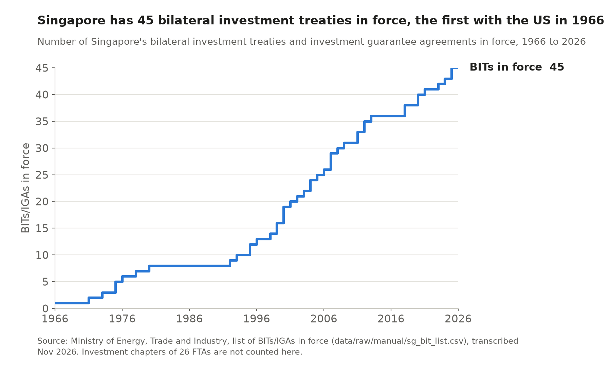

**With 45 investment treaties and investment chapters in 26 trade agreements.** The treaties run from the United States in 1966 to Nigeria and Côte d'Ivoire in 2025 ([METI](https://www.meti.gov.sg/trade-international-economic-relations/agreements-/international-investment-agreements--iias-/)).

**Zones and estates.** Free Trade Zones at the seaports and Changi Airport let goods be stored and reshipped without duty or goods and services tax, serving the re-export trade. Estates built by the state agency JTC give foreign manufacturers ready land and utilities, and their industries hold more than half of the foreign capital in manufacturing, with S$69.3 billion in semiconductors and 2.0 percent of all inward FDI in refining and chemicals, out of 8.0 percent for manufacturing as a whole (Chapter 6).

All 45 treaty partners, by decade of entry into force

| Decade | Partners (year of entry into force) |
| --- | --- |
| 1960s | United States (1966) |
| 1970s | Canada (1971), Netherlands (1973), United Kingdom (1975), Germany (1975), France (1976), Switzerland (1978) |
| 1980s | Belgium and Luxembourg (1980) |
| 1990s | Vietnam (1992), Poland (1993), Pakistan (1995), Czech Republic (1995), Mongolia (1996), Lao PDR (1998), Hungary (1999), Latvia (1999) |
| 2000s | Cambodia (2000), Mauritius (2000), Slovenia (2000), Belarus (2001), Egypt (2002), Uzbekistan (2003), Bangladesh (2004), Bahrain (2004), Jordan (2005), Bulgaria (2006), Slovak Republic (2007), Ukraine (2007), Saudi Arabia (2007), Oman (2008), DPRK (2009) |
| 2010s | Mexico (2011), Libya (2011), United Arab Emirates (2012), Russia (2012), Kuwait (2013), Iran (2018), Qatar (2018) |
| 2020s | Myanmar (2020), Rwanda (2020), Indonesia (2021), Kenya (2023), Kazakhstan (2024), Nigeria (2025), Cote d'Ivoire (2025) |

*Source: Ministry of Energy, Trade and Industry (METI), BITs/IGAs in force. Ten treaties with EU members will lapse when the EU-Singapore Investment Protection Agreement enters into force.*

## What is the controversy now?
**US tariffs and chip export controls.** The United States imposed a 10 percent tariff on Singapore in April 2025 despite its goods surplus and their FTA, and a 12.5 percent Section 301 tariff has applied since July 2026 to about a third of Singapore's domestic exports to the US, with pharmaceuticals and chips under separate investigation ([METI](https://www.meti.gov.sg/newsroom/mti-media-statement-on-the-office-of-the-united-states-trade-representative--ustr--s-determination-on-the-section-301-investigation-on-forced-labour/)). Singapore has not retaliated.

Singapore's policy gives a single base cheap access to most of Asia and the Pacific, but the open rules it depends on are weakening, and Chapter 9 asks how its industrial policy copes.

Sources for this chapter

WTO tariff profiles and member page; World Bank WDI (WITS/UNCTAD TRAINS); UNCTAD TRAINS NTM summaries via WITS; Enterprise Singapore and the WTO RTA database (FTA list in `data/raw/manual/sg_fta_list.csv`); Ministry of Energy, Trade and Industry (BIT list in `data/raw/manual/sg_bit_list.csv`); Singapore Customs; Conconi, P., M. García Santana, L. Puccio and R. Venturini (2016), "The perverse effect of preferential rules of origins", VoxEU, CEPR, 16 March. Figures and tables generated by `scripts/ch07_policy.py`.

---

# 9 Case study: chips and pills, Singapore's investment-led industrial policy

## Key finding

Singapore twice tried to grow a high technology industry by courting foreign firms instead of raising tariffs. Chips learned, keeping a strong advantage while value added and investment grew, and pharmaceuticals learned only to export, building an advantage abroad while their weight at home shrank.

## The course argument
**Comparative advantage can be learned, if support stops once the learning is done.** Temporary help lets a new industry ride down its learning curve until it can export alone, as Juhász (2015) shows for French cotton spinning shielded by the Napoleonic blockade. With zero tariffs (Chapter 7), Singapore gave the help through the Economic Development Board instead, with tax holidays, estates and training, and pioneer firms paying 5 to 15 percent or nothing against a headline rate of 17 percent ([EDB](https://www.edb.gov.sg/content/dam/edb-en/how-we-help/incentive-and-schemes/factsheets/DEI(Mfg)%20Factsheet.pdf)).

*Interactive figure on the website: [Try it: when should support have stopped? (learning curve model)](https://ziqijia825-afk.github.io/ec391-singapore/)*

**Two bets, chips from 1968 and pills from 2000.** National Semiconductor opened the first assembly plant in 1968 and Chartered the first wafer fab in 1987 ([EDB](https://www.edb.gov.sg/en/business-insights/insights/made-in-singapore-60-years-of-manufacturing.html)), and the Biomedical Sciences Initiative of 2000 brought plants from Pfizer, GSK and Novartis.

More: the new wave of investment and an evaluation of the pharma cluster

Chips drew a new wave of fabs after 2021, and the research budget for 2026 to 2030 of S$37 billion names semiconductors first ([EDB](https://www.edb.gov.sg/en/news-and-insights/singapore-invests-s37-billion-in-rie2030-research-plan-semiconductors-ageing-among-focus-areas)). An evaluation of the biomedical cluster found that it met its output and jobs targets but produced few spin-off firms ([CIIP 2021](https://www.ciip.group.cam.ac.uk/wp-content/uploads/2021/02/2021-02-19-SBS.pdf)).

## The scorecard

**Both industries export with an advantage, and only one has deepened at home.** On four digit BACI data, chips have stayed far above 1, at 4.6 in 2024 with 7.1 percent of world integrated circuit exports, and finished medicines rose from 0.16 in 2004 to 1.78. Yet semiconductors' share of manufacturing value added rose from 16 to 35 percent while pharmaceuticals' fell from 19 to 5.5 percent, and foreign capital in pharmaceuticals shrank from S$32 billion to S$10 billion.

| Scorecard | Chips (HS 8541, 8542) | Pharmaceuticals (HS 2933 to 2941, 3002, 3004) |
| --- | --- | --- |
| Revealed comparative advantage, 2004 to 2024 | 5.2 to 4.6 | finished 0.16 to 1.78, ingredients 2.3 to 2.0 |
| Share of manufacturing value added, 2004 to 2025 | 16% to 35% | 19% to 5.5% |
| Inward FDI stock, S$ billion | 20 (2010) to 69 (2024) | 32 (2004) to 10 (2024) |
| Reading in the learning curve model | a strong advantage held while value added and investment grew | export advantage without a deeper domestic industry |

*Sources: team calculation from CEPII BACI (RCA, world shares); EDB Census of Manufacturing Activities via SingStat M355181 (value added, 2025 preliminary); SingStat M084831 (FDI stock).*

More: the RCA chart, and value added and foreign investment over time

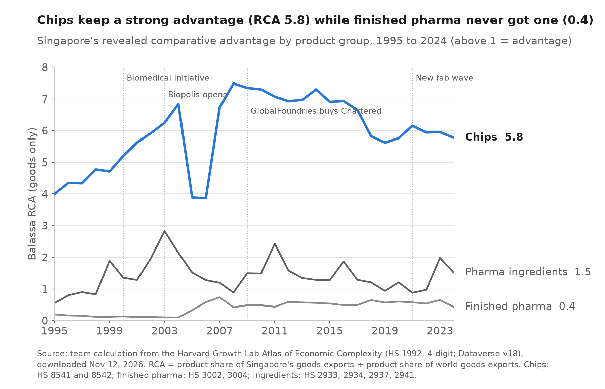

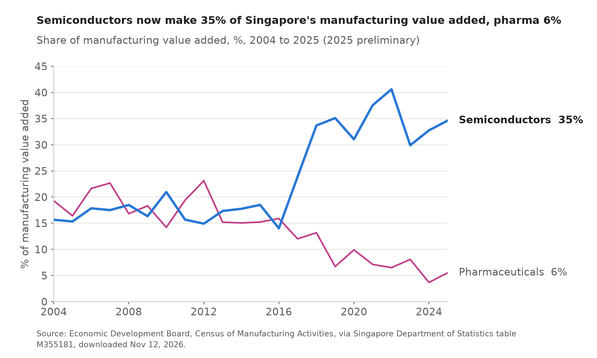

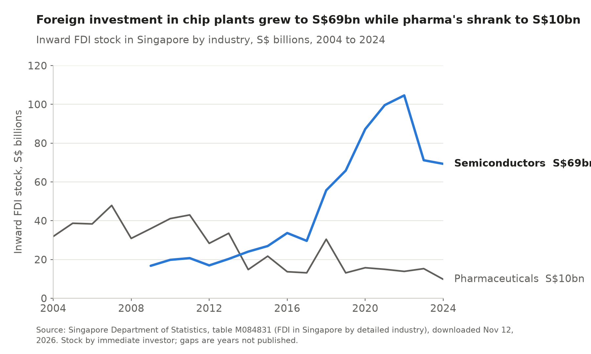

The pharmaceutical share swings because a few foreign plants make most of the output and parents decide where patents and profits are booked.

More: the 2017 outlier and the product detail

BACI's chip exports for 2017 ($125 billion, twice the neighbouring years) lift that year's RCA to 7.6, and we treat it as a reporting anomaly.

## The difference in differences test

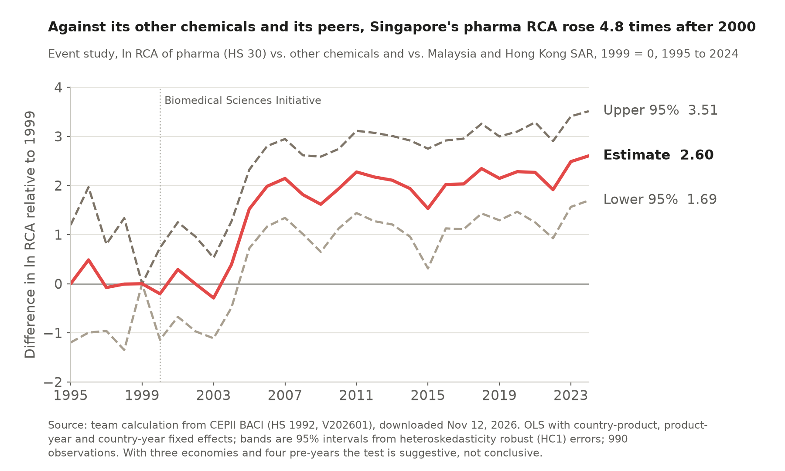

**Pharmaceuticals gained an advantage that Singapore's other chemicals and its neighbours did not.** We compared Singapore's RCA in pharmaceuticals (HS 30) with its other chemical chapters (HS 28 to 38) and with the same chapters in Malaysia and Hong Kong SAR, before and after 2000, estimating ln RCAckt = ack + bkt + gct + β (Singaporec × Pharmak × Post2000t) + eckt. The estimate β = 1.57 (robust s.e. 0.27) means the advantage rose 4.8 times relative to the comparison, with no gap before 2000 and a jump from 2005.

**What it does not show.** The policy built export capacity, but local value added and foreign capital fell at the same time. With three economies and four years before the policy the test is a guide, and plant level data on local suppliers would make it firmer.

## The verdict
**Chips learned, and pills learned only to export.** Chips are a successful infant industry raised without a tariff, whose advantage survived decades of rising wages because Singapore's capital, skills and suppliers now carry it. Pharmaceuticals built an export advantage while value added and foreign capital moved the other way, which fits Young's (1992) finding that Singapore grew mainly by accumulating factors.

**The next test.** The OECD minimum tax weakens tax holidays, which Singapore offsets with a Refundable Investment Credit the global rules allow ([IRAS](https://www.iras.gov.sg/schemes/disbursement-schemes/refundable-investment-credit-(ric))), and US tariffs put both industries at the centre of strategic rivalry (Chapter 7).

## Sources

CEPII, BACI HS92 V202601 (4-digit products); Economic Development Board, Census of Manufacturing Activities via SingStat table M355181; Singapore Department of Statistics, table M084831; EDB; IRAS; Cambridge CIIP (2021); Juhász (2015), VoxEU; Young (1992). Figures generated by `scripts/ch09_case.py`.

---

# Conclusion

## Key finding

Singapore turned a location into an economy. Trade is three times GDP, foreign firms own assets worth four times GDP and its government ranks first of 205 for effectiveness, which makes it the region's best base for headquarters and high value production and a costly one for everything else.

## SWOT analysis

**World class institutions and connections, set against high costs and exposure to rivalry between its two largest partners.** The strengths come from Chapters 2, 4 and 7, the weaknesses from Chapters 1 and 5, and the opportunities and threats from the policy changes of Chapters 7 and 9.

| Strengths | Weaknesses |
| --- | --- |
| World-leading institutions: 1st in government effectiveness and regulatory quality, 3rd least corrupt, 1st in logistics. Highly educated workforce, top PISA results. Dense network of 29 FTAs and digital agreements. Established clusters in semiconductors, logistics, finance and regional headquarters. | No natural resources, farmland or water of its own; dependent on imports for food and energy. Very high land and labour costs. Small, ageing population (21% of citizens over 65 in 2026). Heavy dependence on foreign firms, high import content of exports and mid-table voice and accountability score. |
| **Opportunities** | **Threats** |
| Supply chain diversification out of China favours neutral, reliable hubs. RCEP and CPTPP cumulation and digital trade agreements. Growth of services exports (finance, logistics, data) where Singapore's advantage is rising. New wave of chip investment and the revival of biomedical commitments. Johor Singapore Special Economic Zone to relieve land and labour constraints. | US tariffs (12.5% Section 301 since July 2026) and pending Section 232 action on chips and pharmaceuticals. Export controls and transshipment scrutiny in the rivalry between the US and China. Global minimum tax reduces the value of tax incentives. Competition for manufacturing FDI from Vietnam and Malaysia. Volatile world demand, as in 2009 and 2020. |

## Investment recommendation

For a multinational firm choosing a base in Southeast Asia, our analysis supports Singapore for activities that depend on reliability and connectivity more than on cost, such as regional headquarters, treasury and trading, logistics, research and the most capital and skill intensive stages of chip and pharmaceutical production. For these, its institutions, skills and agreements outweigh high costs.

For labour or land intensive production Singapore is the wrong choice. Malaysia, Vietnam and the Johor side of the new special economic zone offer the same market access at lower cost, and many firms already pair a Singapore headquarters with plants there (Chapter 6). The main risk to watch is US trade policy toward chips and pharmaceuticals.

## Sources

See the [appendix](appendix.html) for all data sources and methods.

---

# Appendix: sources and methods

## Data sources

Every chart and table was built by the team from raw files downloaded by the scripts in the repository (`scripts/fetch_*.py`) and logged in `data/SOURCES.md`, accessed in November 2026.

| Source | Type | Used for | Access |
| --- | --- | --- | --- |
| World Bank, World Development Indicators | IGO | GDP, growth, inflation, population, literacy and education, trade, balance of payments including services exports by category and investment income, FDI flows, tariffs (from WITS/UNCTAD TRAINS), LPI, resource rents, legacy Doing Business rank | [API](https://api.worldbank.org/v2), `fetch_worldbank.py` |
| World Bank, Worldwide Governance Indicators (2025 release) | IGO | Six governance scores (0 to 100) | WDI API, `fetch_worldbank.py` |
| World Bank, Business Ready (B-READY) 2025 | IGO | Ten topic scores and three pillars | WDI API, `fetch_worldbank.py` |
| UNDP, Human Development Report 2025 | UN | HDI, schooling | [CSV](https://hdr.undp.org/data-center/documentation-and-downloads), `fetch_other.py` |
| Transparency International, Corruption Perceptions Index 2012 to 2024 | NGO (required by the guidelines) | CPI scores | via [Our World in Data](https://ourworldindata.org/grapher/ti-corruption-perception-index), `fetch_other.py` |
| Singapore Department of Statistics, Table Builder | Government | Re-exports, Gini, FDI stock by source and industry, direct investment abroad, GDP in S$, manufacturing census | [API](https://tablebuilder.singstat.gov.sg), `fetch_singstat.py` |
| CEPII BACI (HS 1992, V202601) | Research centre (harmonised UN Comtrade) | Exports and imports by HS chapter and product, bilateral trade, for RCA, export structure, concentration and the case study | [CEPII](https://www.cepii.fr/CEPII/en/bdd_modele/bdd_modele_item.asp?id=37), `process_baci.py` |
| UN Comtrade | UN | Singapore's reported exports and imports by partner, every year 2004 to 2024; HS chapter titles | [API](https://comtradeplus.un.org), `fetch_comtrade.py` |
| OECD, Trade in Value Added, 2025 edition | IGO | Foreign and domestic value added in exports, origin of value added | [SDMX API](https://sdmx.oecd.org), `fetch_tiva.py` |
| Penn World Table 11.0 | University (Groningen Growth and Development Centre) | Capital stock, employment, human capital | [Dataverse](https://doi.org/10.34894/FABVLR), `fetch_other.py` |
| UNCTAD, World Investment Report 2026 annex tables | UN | FDI inflows, inward and outward FDI stocks for ranks, greenfield projects, cross-border M&A | [Annex tables](https://unctad.org/topic/investment/world-investment-report), `fetch_other.py` |
| WTO Tariff Profiles | IGO | MFN averages, duty-free lines, tariff peaks and maximum duties for Singapore and peers | [WTO](https://www.wto.org/english/res_e/statis_e/tariff_profiles_list_e.htm), `fetch_other.py` |
| UNCTAD TRAINS via World Bank WITS | UN / IGO | Non-tariff measures by type and sector | [WITS](https://wits.worldbank.org/tariff/non-tariff-measures/en/country/SGP), `fetch_wits_ntm.py` |
| Enterprise Singapore, WTO RTA database, METI | Government / IGO | List of free trade agreements | `data/raw/manual/sg_fta_list.csv` |
| Ministry of Energy, Trade and Industry (METI) | Government | Bilateral investment treaties in force and partners | `data/raw/manual/sg_bit_list.csv` |
| Natural Earth; geoBoundaries (CC BY 4.0) | Public domain / open data | Country boundaries for the maps (not statistics) | `fetch_geo.py` |
| WTO, Singapore Customs, IRAS, EDB, NLB, MOE | Government / IGO | Facts on membership, tariffs, incentives, taxes, history and education | linked in the text |
| SingStat Population Trends 2026; data.gov.sg land area series | Government | Population by residency, land area in 1965 and 2026 | linked in Chapter 1 |
| Associated Press via PBS | News | Result of the general election of May 2025 | linked in Chapter 1 |

**Limitations.** Singapore's role as an entrepôt and financial centre complicates almost every statistic, so we pair reported exports with BACI and value added data and read FDI as recorded by immediate investor. There are no World Bank poverty or Gini data for Singapore, and TiVA and tariff data end in 2022.

Three gaps remain. Transparency International's 2025 results file must be downloaded by hand to replace the Our World in Data copy, Singapore publishes no FDI by ultimate investor, and the Chapter 9 test would be firmer with plant level data on local suppliers.

## Methods

**Every method in one place.** Ranks, RCA, gravity, concentration, value chains, the Heckscher Ohlin check and the difference in differences are defined below.

The formulas and estimation details

**Ranks.** For every indicator we rank all economies with data in the same year, excluding the World Bank's aggregates. Rank 1 is the highest value unless stated (for inflation and tariffs the lowest), and the regional rank is within the World Bank's East Asia and Pacific region.

**Revealed comparative advantage.** RCA = (Xik / Xi) ÷ (Xwk / Xw), with goods from CEPII BACI and services from the World Bank's balance of payments. Sector RCAs use goods and services, HS chapter and product RCAs goods only.

**Gravity.** OLS of ln(Singapore's exports to partner *j*, 2024) on ln(GDP of *j*) and ln(distance between capitals), with robust (HC1) standard errors.

**Concentration.** Herfindahl Hirschman index HHI = Σ sj2, where sj is partner *j*'s share of exports.

**Value chains.** Backward participation = foreign value added in gross exports ÷ gross exports. Forward participation = value added in other economies' exports ÷ own gross exports. Position = ln(1 + forward) − ln(1 + backward) (Koopman and coauthors, 2010).

**Heckscher Ohlin check.** For 154 economies exporting over $1bn in 2023, OLS of ln(RCA in HS 28 to 30, 84, 85, 87, 88 and 90 ÷ RCA in HS 42, 61, 62, 64, 94 and 95) on ln(capital per worker, PWT), robust errors.

**Difference in differences.** The Chapter 9 equation for Singapore, Malaysia and Hong Kong SAR, chemical chapters HS 28 to 38, 1995 to 2024, with robust errors; the event study uses one dummy per year, 1999 = 0.

**Shared sector table.** Chapters 3 to 6 map trade, value added and FDI data to one approximate set of sectors.

| Sector | HS 1992 chapters (BACI) | WDI services exports | OECD TiVA (ISIC rev.4) | SingStat FDI series |
| --- | --- | --- | --- | --- |
| Electronics & instruments | 85, 90 to 92 |  | C26_27 | 1.1.10, 1.1.11 |
| Machinery incl. computers | 84 |  | C28 | 1.1.9 |
| Refined petroleum | 27 |  | C19 | 1.1.3 |
| Chemicals & plastics | 28 to 29, 31 to 40 |  | C20, C22 | 1.1.4, 1.1.6 |
| Pharmaceuticals | 30 |  | C21 | 1.1.5 |
| Gold & metals | 71 to 83 |  | C24_25 | 1.1.7, 1.1.8 |
| Food & agriculture | 01 to 24 |  | A, C10T12 | 1.1.1 |
| Transport equipment | 86 to 89 |  | C29_30 | 1.1.12 |
| Other goods | all other |  |  |  |
| Wholesale trade |  |  | G | 1.3.1 |
| Transport & logistics |  | BX.GSR.TRAN.ZS | H | 1.5 |
| Finance & insurance |  | BX.GSR.INSF.ZS | K | 1.7 |
| ICT & business services |  | BX.GSR.CMCP.ZS | J, M_N | 1.6, 1.9 |
| Travel & tourism |  | BX.GSR.TRVL.ZS | I | 1.4 |

*Mapping between classifications is approximate (for example, HS 84 includes computers, which ISIC classifies in C26).*

## References

Full reference list

Boehm, C.E., A. Flaaen and N. Pandalai Nayar (2015), "The role of global supply chains in the transmission of shocks: firm-level evidence from the 2011 Tohoku earthquake", VoxEU, CEPR, 9 January, published as "Input linkages and the transmission of shocks", *Review of Economics and Statistics* 101(1), 2019, 60 to 75. Conconi, P., M. García Santana, L. Puccio and R. Venturini (2016), "The perverse effect of preferential rules of origins", VoxEU, CEPR, 16 March. Damgaard, J., T. Elkjaer and N. Johannesen (2019), "The rise of phantom investments", IMF *Finance and Development*, September. Ekholm, K., R. Forslid and J. Markusen (2007), "Export-platform foreign direct investment", *Journal of the European Economic Association* 5(4), 776 to 795. Feyrer, J. (2009), "The 1967 to 1975 Suez Canal closure: lessons for trade and the trade income link", VoxEU, CEPR, 23 December. Fort, T.C. (2017), "Technology and production fragmentation: domestic versus foreign sourcing", *Review of Economic Studies* 84(2), 650 to 687. Head, K. and T. Mayer (2014), "Gravity equations: workhorse, toolkit, and cookbook", *Handbook of International Economics* 4. Juhász, R. (2015), "Temporary protection and technology adoption: evidence from the Napoleonic blockade", VoxEU, CEPR, 15 January, published in the *American Economic Review* 108(11), 2018, 3339 to 3376. Koopman, R., W. Powers, Z. Wang and S.J. Wei (2010), "Give credit where credit is due", NBER Working Paper 16426. Nunn, N. (2007), "Relationship-specificity, incomplete contracts, and the pattern of trade", *Quarterly Journal of Economics* 122(2), 569 to 600. Young, A. (1992), "A tale of two cities: factor accumulation and technical change in Hong Kong and Singapore", *NBER Macroeconomics Annual* 7, 13 to 54. Ramondo, N. (2026), CAS EC 391 International Trade, syllabus and lecture notes, Boston University, Fall 2026.

