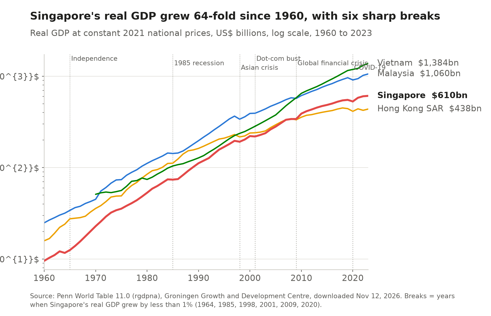
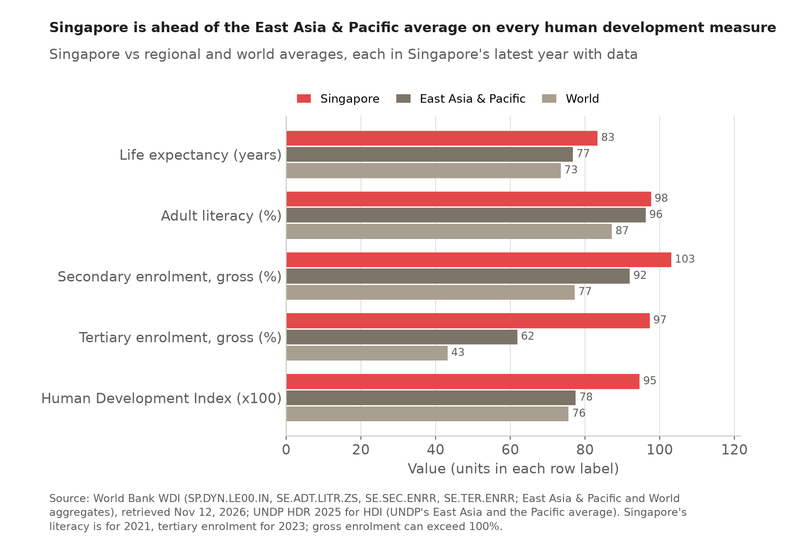
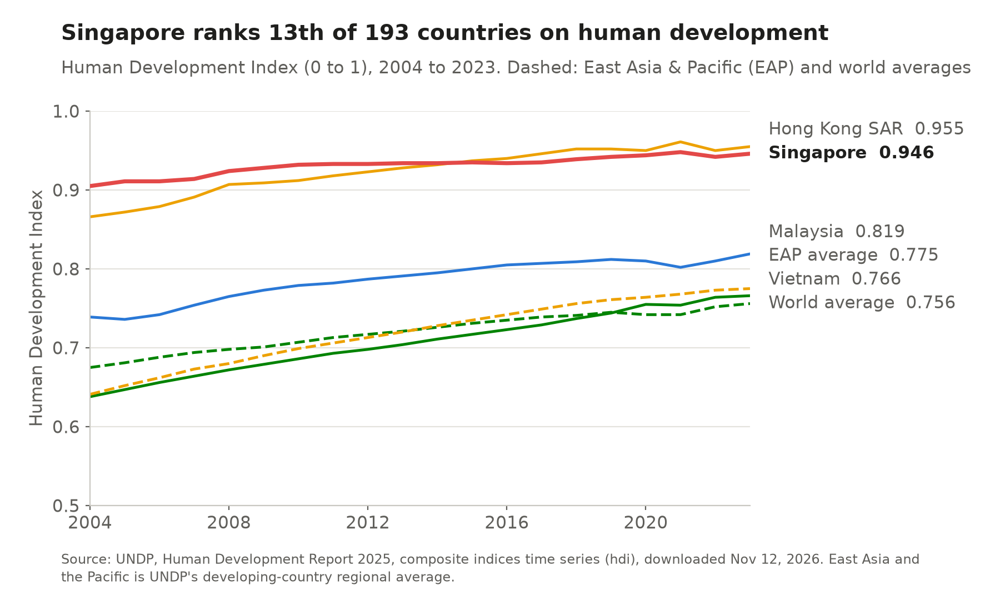
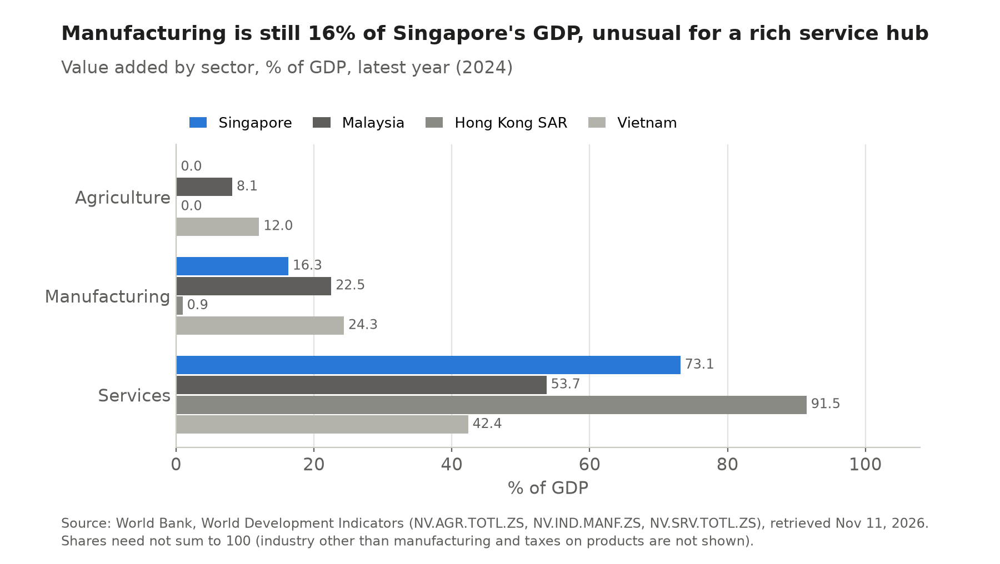
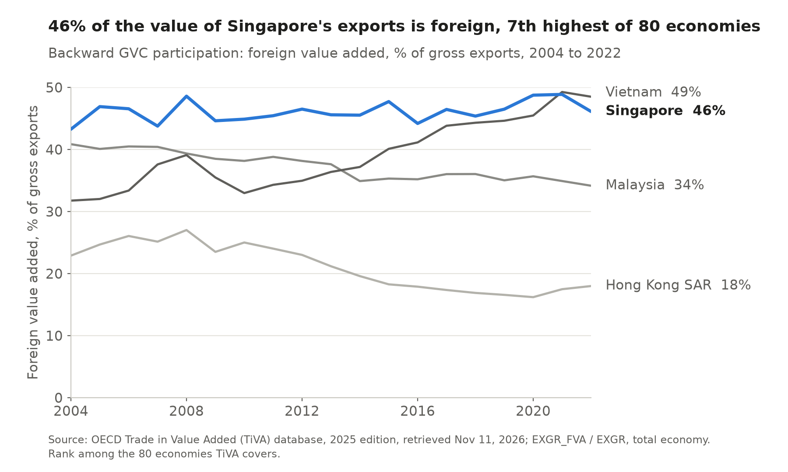
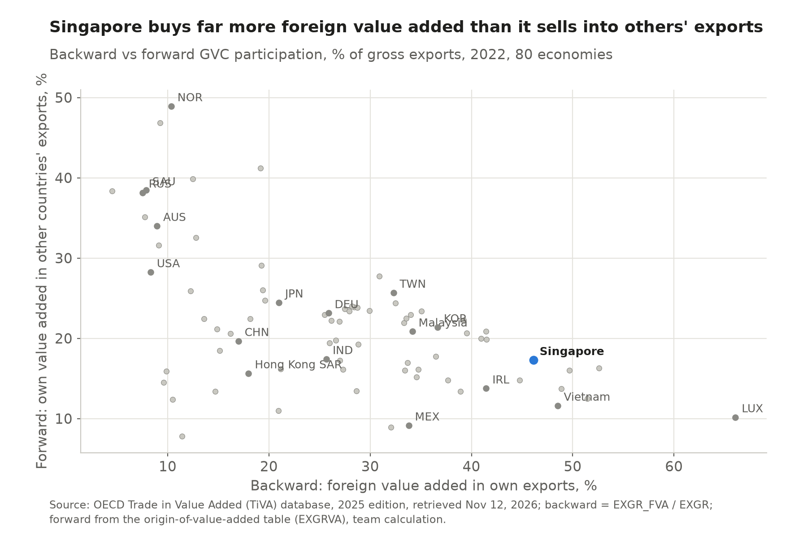
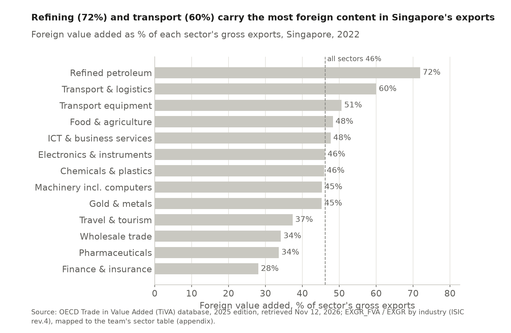
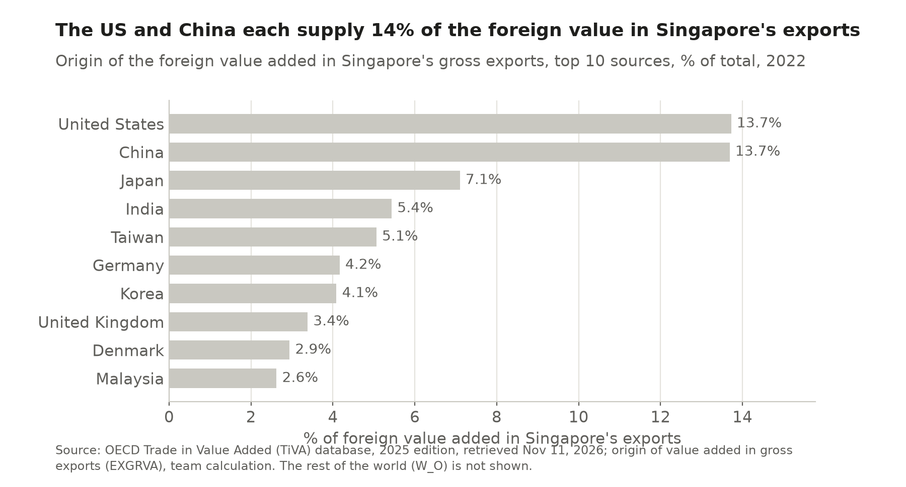

# Singapore: a small country turned global hub

*EC 391 Country Team Project, Fall 2026*

**How did a city of six million with no resources become one of the busiest hubs of world trade and investment?** Singapore has no farmland, no oil and a tiny home market, yet in 2024 it produced $573 billion of output, the second highest income per person in the world at purchasing power parity, and traded more than three times its GDP.

**Our answer is that it turned what it had into comparative advantage.** Its place on the Strait of Malacca made it an entrepôt, institutions ranked first in the world drew multinational factories, headquarters and money, and zero tariffs with 29 trade agreements kept both doors open. The result is an economy in the middle of global value chains that earns more and more from services.

| Part | Question | Chapters |
| --- | --- | --- |
| 1 Starting point | A small country with no resources but top tier institutions | [1 Profile](ch01_profile.html), [2 Macro and governance](ch02_macro.html) |
| 2 Openness | How large is trade relative to GDP, with whom, and how much of it is re-export? | [3 Trade patterns](ch03_trade.html) |
| 3 Advantage | In which goods and services does Singapore specialize, and does this match its endowments? | [4 Comparative advantage](ch04_rca.html) |
| 4 Position | Where does Singapore sit in global value chains? | [5 Value chains](ch05_gvc.html) |
| 5 FDI and policy | Why do foreign firms come, and how does policy attract them? | [6 FDI](ch06_fdi.html), [7 Trade policy](ch07_policy.html) |
| 6 Case and conclusion | Did investment-led industrial policy create lasting advantage? | [9 Case study](ch09_case.html), [Conclusion](conclusion.html) |

Singapore is compared throughout with Malaysia, the resource rich neighbour, Hong Kong SAR, the other Asian city hub, and Vietnam, the newcomer competing for the same factories, and with the East Asia and Pacific region. Every indicator carries its global and regional rank, and every chart is drawn by the team from the raw files in the [appendix](appendix.html), for 2004 to 2024 unless a source ends earlier.

This site is a working draft. Figures and tables are generated by the scripts in the team repository, so the numbers in the text can be checked against data/derived/*.json. Each section owner is checking two or three numbers per chart against the original source and rewriting the text in their own words before submission.

---

# 1 Country profile

## Key finding

Singapore is a city state with the land of a small county and the human development of a rich nation. Its 6.2 million people live on 725 square kilometres, 181st of 214 economies by area, and its Human Development Index ranks 13th of 193 and 3rd in East Asia and the Pacific.

## What kind of country is it?

**A crowded island republic on one of the world's busiest sea lanes.** Singapore sits on the Strait of Malacca, its capital is the city itself, and the People's Action Party has governed the parliamentary republic since 1959. A third of the 6.21 million people (June 2026) are foreign workers and students, so the labour force can grow with demand, and the four official languages, with English for business, connect it to China, India and the Malay world.

More on land, population, languages and politics

Singapore's land area was 581.5 square kilometres in 1965 and 744.3 square kilometres at the end of 2025, an increase of 28 percent that came mostly from reclamation ([SingStat via data.gov.sg](https://data.gov.sg/datasets/d_0b2c034da121ef8efc71949af1694b4d/view)). The World Bank series used in the table below records 725 square kilometres for 2024 because it lags the national figure.

In June 2026 the population was 6.21 million, of whom 4.23 million were residents (3.68 million citizens and 0.55 million permanent residents) and about 1.98 million were foreign workers, students and dependants ([SingStat, Population Trends 2026](https://www.singstat.gov.sg/publication-resources/population-trends-2026)). The resident population is 73.9 percent Chinese, 13.5 percent Malay, 9.0 percent Indian and 3.6 percent other groups. Malay is the national language and English the working language of government and business. The large share of non-residents matters for trade, because the labour force can expand with demand in a way that a country of six million citizens could not manage on its own.

The prime minister and cabinet answer to an elected parliament, and a directly elected president holds a largely ceremonial office with custodial powers over the national reserves. In the general election of 3 May 2025 the People's Action Party won 87 of 97 seats with about 65.6 percent of the vote ([AP via PBS](https://www.pbs.org/newshour/world/singapores-long-ruling-party-wins-another-election-landslide-in-boost-for-new-prime-minister)). Lawrence Wong has been prime minister since 15 May 2024 and Tharman Shanmugaratnam president since September 2023. This long continuity of government is one reason investors treat policy in Singapore as predictable, a point Chapter 2 returns to with the governance indicators.

## How did it get rich?

**By answering every outside shock with a move up the value chain.** Real GDP grew 64-fold between 1960 and 2023, interrupted six times when growth fell below 1 percent, in 1964, 1985, 1998, 2001, 2009 and 2020. Each break came through trade, and each was followed by a policy push toward higher value work, from export factories in the 1960s to services, biomedicine and digital trade.

<section class="timeline">
<b>1819</b>Free port
Raffles opens a free port and Singapore lives by moving goods it does not make.

<b>1961</b>EDB founded
The Economic Development Board begins to court foreign manufacturers.

<b>1964 to 65</b>Break and independence
Output falls, then separation from Malaysia ends a brief turn to import substitution.

<b>1965 to 79</b>Export factories
Multinationals build labour intensive plants in Jurong until full employment.

<b>1979</b>Wage correction
Higher wages push firms toward higher value work.

<b>1985</b>Recession
Cost cuts and services become a second engine of growth.

<b>1990s</b>Clusters and the region
Industry clusters at home and parks abroad, such as Suzhou in 1994.

<b>1998 and 2001</b>Asian crisis, chip slump
Two external shocks hit trade and electronics.

<b>2000</b>Biomedical pillar
Biomedicine joins electronics, chemicals and engineering.

<b>2009 and 2020</b>Global crisis, pandemic
World demand collapses twice and recovers.

<b>2020s</b>Resilience
Digital trade, AI, energy and supply chain security.

Shaded: years in which real GDP grew by less than 1 percent (Penn World Table). Sources: NLB Infopedia, METI, EDB.
</section>

More on the development phases, from entrepôt port to knowledge economy

The Penn World Table shows output falling by 3.8 percent in 1964, the year of race riots and confrontation with Indonesia that preceded separation from Malaysia in 1965, by 0.6 percent in 1985, by 2.2 percent in 1998 and by 1.1 percent in 2001, stalling in 2009 and falling by 3.9 percent in 2020.

Singapore's modern economy began as an entrepôt. Stamford Raffles established a free port in 1819, and within five years it had become the main transit point for regional trade, earning its living by moving goods it did not produce ([NLB Infopedia](https://eresources.nlb.gov.sg/infopedia/articles/SIP_2018-04-20_085007.html)). This history explains why re-exports are still more than half of Singapore's merchandise exports today (Chapter 3).

The Economic Development Board was set up in 1961, and after independence in August 1965 the government turned from a short attempt at import substitution to export oriented manufacturing led by foreign multinationals. Labour intensive plants in Jurong produced garments, wigs and electronic components, and by the late 1970s the economy had reached full employment. In 1979 the National Wages Council deliberately raised wages to push firms toward higher value activities ([NLB](https://www.nlb.gov.sg/main/article-detail?cmsuuid=98e1b55f-093d-4d44-b219-d51f6a38c313)). The 1985 recession led to cuts in business costs and a decision to build services as a second engine of growth alongside manufacturing.

The 1990s brought a Strategic Economic Plan built on industry clusters and a drive to invest in the region, symbolised by the China Singapore Suzhou Industrial Park of 1994. In 2000 the Biomedical Sciences Initiative added a fourth manufacturing pillar next to electronics, chemicals and engineering. The 2010s were about productivity, with a target of 2 to 3 percent productivity growth a year. In the 2020s the agenda has shifted to resilience, digital trade, artificial intelligence and energy, and in October 2026 the Ministry of Trade and Industry was renamed the Ministry of Energy, Trade and Industry ([METI](https://www.mti.gov.sg/newsroom/mti-to-be-renamed-ministry-of-energy--trade-and-industry/)).

## How does it compare with the region?

**It leads the region on every human development measure, most of all in university education and longevity.** Gross tertiary enrolment is 97 percent against 63 percent in East Asia and the Pacific, and life expectancy 83.3 years against 76.7. Literacy (97.7 percent) is close to the regional 96.6 percent because basic literacy is now near universal in the region.

More: HDI over time, schooling, PISA and the full ranking table

Singapore's Human Development Index rose from 0.905 in 2004 to 0.946 in 2023. It was ahead of Hong Kong SAR until 2014 and slightly behind it since 2015, while both city economies stay far above Malaysia (0.819) and Vietnam (0.766). A child entering school can expect 16.7 years of education, and Singapore's fifteen year olds ranked first of 81 systems in mathematics, reading and science in PISA 2022 and first in reading and second in mathematics and science in PISA 2025 ([Ministry of Education](https://www.moe.gov.sg/news/press-releases/20260908-pisa-2025-singapore-students-demonstrate-strong-real-world-problem-solving-skills-in-computational-thinking-domain)). Mean years of schooling of adults (12.0 years, 42nd) ranks lower because older cohorts were educated before the expansion of secondary and university education.

| Indicator | Singapore | Year | Global rank | East Asia & Pacific rank | East Asia & Pacific average | Malaysia | Hong Kong SAR | Vietnam |
| --- | --- | --- | --- | --- | --- | --- | --- | --- |
| Population | 6.04 m | 2024 | 113th of 217 | 16th of 37 | 2388.32 m | 35.56 m | 7.52 m | 100.99 m |
| Land area | 725 km² | 2024 | 181st of 214 | 27th of 37 | n/a | 328,550 km² | 1,050 km² | 313,429 km² |
| Population density | 8,329 per km² | 2024 | 3rd of 214 | 2nd of 37 | 98 per km² (2023) | 108 per km² | 7,166 per km² | 322 per km² |
| Urban population | 100% | 2024 | 1st of 217 | 1st of 37 | 64% | 77% | 100% | 38% |
| Life expectancy at birth | 83.3 years | 2024 | 15th of 217 | 5th of 37 | 76.7 years | 76.8 years | 85.4 years | 74.7 years |
| Adult literacy rate | 97.7% | 2021 | 9th of 44 | 2nd of 5 | 96.2% | 95.8% (2022) | n/a | 96.1% (2022) |
| Secondary enrolment (gross) | 103% | 2023 | 40th of 147 | 4th of 23 | 92% | 79% | 107% (2024) | 93% (2022) |
| Tertiary enrolment (gross) | 97% | 2023 | 11th of 128 | 5th of 23 | 62% | 37% | 105% | 33% |
| Population aged 65+ | 13.7% | 2024 | 72nd of 217 | 9th of 37 | 13.6% | 7.7% | 22.7% | 9.0% |
| Human Development Index | 0.946 | 2023 | 13th of 193 | 3rd of 30 | 0.775 (UNDP) | 0.819 | 0.955 | 0.766 |
| Mean years of schooling | 12.0 years | 2023 | 42nd of 193 | 7th of 30 | 8.3 years (UNDP) | 11.1 years | 12.4 years | 9.0 years |
| Expected years of schooling | 16.7 years | 2023 | 29th of 195 | 5th of 31 | 14.6 years (UNDP) | 12.7 years | 16.9 years | 15.5 years |

*Ranks: 1st = highest value among economies with data that year (World Bank aggregates excluded); East Asia & Pacific = World Bank region; its average is the World Bank aggregate (UNDP's regional average for HDI and schooling, which covers developing economies only). A year in brackets marks an earlier latest year. Sources: World Bank WDI (SP.POP.TOTL, AG.LND.TOTL.K2, EN.POP.DNST, SP.URB.TOTL.IN.ZS, SP.DYN.LE00.IN, SE.ADT.LITR.ZS, SE.SEC.ENRR, SE.TER.ENRR, SP.POP.65UP.TO.ZS), retrieved Nov 12, 2026; UNDP Human Development Report 2025 (HDI, schooling).*

## What does the economy produce?

**Mostly services, with a factory sector that Hong Kong SAR gave up.** Services are 73 percent of value added and manufacturing 16 percent, against less than 1 percent in Hong Kong SAR, which moved its factories into mainland China while Singapore kept courting high value manufacturing at home.

## Implications for trade and investment

A small island with no resources and a skilled, partly foreign workforce has to trade to live, importing food, water and energy and reaching scale only in world markets. Investors get skills and stable government at the price of very expensive land and a population ageing fast (13.7 percent were 65 or older in 2024). Chapter 2 asks how this mix has turned into income and institutions.

Sources for this chapter

World Bank, World Development Indicators; Penn World Table 11.0; UNDP, Human Development Report 2025; Singapore Department of Statistics; National Library Board Infopedia; Ministry of Education; Ministry of Energy, Trade and Industry. Full list in the [appendix](appendix.html).

---

# 2 Macroeconomy, business climate and governance

## Key finding

Singapore is the second richest economy in the world per person at purchasing power parity, and one of the best governed. It ranks first of 205 on government effectiveness and regulatory quality, and only on voice and accountability does it fall to the middle of the table.

## How big and how rich is it?

**About five times bigger than in 2004, and second in the world per person.** GDP rose from $115 billion to $573 billion between 2004 and 2024, from 43rd to 26th in the world, overtaking Malaysia in 2015 and Hong Kong SAR in 2017 with a sixth of Malaysia's population. GDP per person at purchasing power parity is $153,161, almost four times Malaysia's, although income per resident is lower because foreign owners and workers take part of it home (Chapter 6). Real growth averaged 5.0 percent a year, 41st of 193, with deep swings in 2009 and 2020.

More: income per person, real growth, GDP at PPP and the current account

GDP per person at purchasing power parity rose from $54,384 in 2004 to $153,161 in 2024. Gross national income is only 83 percent of GDP, because a large non-resident workforce and the profits of foreign owned firms are counted in GDP but partly paid abroad.

Singapore moved from 9th to 6th of the 33 economies of East Asia and the Pacific by size, behind only China, Japan, Korea, Australia and Indonesia. Growth swings with world demand. Output stalled in 2009, rebounded by 14.5 percent in 2010 and fell by 3.6 percent in 2020.

At purchasing power parity the economy is $925 billion, 34th in the world.

In current dollars GDP per person was $94,897 in 2024, eighth in the world. Real growth in 2024 was 5.3 percent, faster than Malaysia (5.1 percent) and Hong Kong SAR (2.6 percent), and the 2020 contraction was smaller than in Malaysia (5.5 percent) or Hong Kong SAR (6.5 percent). Inflation was 2.4 percent in 2024 and the current account surplus 17.2 percent of GDP, the sixth largest in the world relative to output, reflecting high national saving and large income from investment abroad.

## Is growth shared?

**Less evenly than in most rich countries, although inequality is falling.** The World Bank publishes no poverty or Gini data for Singapore, so we use the official series. The Gini of employment income fell from a peak of 0.482 in 2007 to 0.426 in 2025 before taxes and transfers, and from 0.419 in 2004 to 0.359 after them.

More on the poverty line and why this Gini is not ranked

The guidelines ask for the share of the population below $2.15 a day. In June 2025 the World Bank replaced that line, set in 2017 prices, with a new international poverty line of $3.00 a day in 2021 prices, and the World Development Indicators now report only the new line. Singapore's household surveys are not in the World Bank's poverty database. The regional benchmarks show that 2.0 percent of people in East Asia and the Pacific lived below $3.00 a day in 2024, against 10.1 percent worldwide, and the latest figures for Malaysia (0.0 percent in 2021) and Vietnam (1.6 percent in 2022) suggest that extreme poverty is not the relevant measure for a high income city. The national Gini covers only employment income of resident households, so it is not comparable with the survey based Gini of 40.7 for Malaysia (2021) and 36.1 for Vietnam (2022), and we do not rank it. Whether the Department of Statistics is acceptable for this indicator is one of our questions for the professor.

## Is it easy to do business?

**Almost nowhere is easier.** Singapore was second of 190 economies in the last Doing Business report (2020). Its successor, B-READY 2025, ranks it first of 100 on operational efficiency, how quickly and cheaply firms get through procedures, and in the top five on business entry, location, utilities, international trade and taxation.

More: B-READY scores by topic, compared with Malaysia, Hong Kong SAR and Vietnam

Doing Business was discontinued in 2021 after data irregularities. In DB2020 Singapore was behind New Zealand and ahead of Hong Kong SAR (third), Malaysia (twelfth) and Vietnam (seventieth). In B-READY Singapore scores lower on labour regulation (65th) and market competition (17th), where the index rewards worker protection and competition rules that Singapore has kept deliberately light. Malaysia, Hong Kong SAR and Vietnam score below Singapore on most topics, with the largest gaps in business insolvency and international trade.

## How good is its government?

**Among the best in the world, with one exception.** Singapore is first of 205 for government effectiveness and regulatory quality, fourth for control of corruption and first of 138 on the Logistics Performance Index. Voice and accountability (54.6, 111th of 203) is below the regional average, reflecting limits on press freedom and political competition.

| Indicator | Singapore | Year | Global rank | East Asia & Pacific rank |
| --- | --- | --- | --- | --- |
| GDP, current US$ | $573bn | 2024 | 26th of 200 | 6th of 33 |
| GDP, PPP | $925bn | 2024 | 34th of 195 | 10th of 31 |
| GDP per capita, current US$ | $94,897 | 2024 | 8th of 200 | 1st of 33 |
| GDP per capita, PPP | $153,161 | 2024 | 2nd of 195 | 1st of 31 |
| Real GDP growth, 2024 | 5.3% | 2024 | 36th of 200 | 6th of 33 |
| Inflation (CPI), 2024 | 2.4% | 2024 | 65th of 176 | 15th of 26 |
| Current account, % of GDP | 17.2% | 2024 | 6th of 168 | 3rd of 26 |
| Logistics Performance Index (1 to 5) | 4.30 | 2022 | 1st of 138 | 1st of 18 |
| Ease of Doing Business rank (legacy, DB2020 report) | 2 of 190 | 2019 | 2nd of 189 | 2nd of 28 |
| Average real growth 2004 to 2024 | 5.0% | 2004 to 2024 | 41st of 193 | 10th of 32 |
| WGI: Voice and accountability (0 to 100) | 54.6 | 2025 | 111th of 203 | 22nd of 34 |
| WGI: Political stability (0 to 100) | 89.0 | 2025 | 12th of 207 | 7th of 36 |
| WGI: Government effectiveness (0 to 100) | 95.2 | 2025 | 1st of 205 | 1st of 34 |
| WGI: Regulatory quality (0 to 100) | 91.9 | 2025 | 1st of 205 | 1st of 34 |
| WGI: Rule of law (0 to 100) | 83.2 | 2025 | 18th of 207 | 3rd of 36 |
| WGI: Control of corruption (0 to 100) | 87.8 | 2025 | 4th of 207 | 1st of 36 |
| Corruption Perceptions Index (0 to 100) | 84 | 2024 | 3rd of 178 | 1st of 22 |
| B-READY: Regulatory framework (0 to 100) | 77.6 | 2025 | 13th of 100 | 2nd of 15 |
| B-READY: Public services (0 to 100) | 75.3 | 2025 | 7th of 100 | 2nd of 15 |
| B-READY: Operational efficiency (0 to 100) | 79.3 | 2025 | 1st of 100 | 1st of 15 |
| Gini, after taxes and transfers (SingStat) | 0.359 | 2025 | not ranked¹ | not ranked¹ |
| Poverty headcount, $3.00/day (2021 PPP) | no data² | | | |

*Ranks: 1st = best (highest, except inflation: lowest) among economies with data; World Bank aggregates excluded; ties share a rank. Doing Business (discontinued in 2021) ranked 190 economies; its last edition, DB2020, uses 2019 data (WDI IC.BUS.EASE.XQ). B-READY ranks are among the economies it covers. ¹ Singapore's Gini is a national series on employment income and is not comparable with survey-based Gini for other countries. ² The World Bank publishes no poverty headcount for Singapore (no household survey in its database). Sources: World Bank WDI, WGI and B-READY via the WDI API, retrieved Nov 12, 2026; Transparency International CPI; Singapore Department of Statistics.*

More: corruption perceptions since 2012

Transparency International's Corruption Perceptions Index scores Singapore 84 out of 100 in 2024, third of 178 economies and first in the region, and the score has stayed between 83 and 87 since 2012. Political stability ranks twelfth and rule of law eighteenth on the Worldwide Governance Indicators.

## Implications for trade and investment
Nunn (2007) shows that countries that enforce contracts well specialize in goods built from made to order inputs, such as electronics and machinery. Singapore's courts, regulators and logistics are exactly that kind of advantage, and they explain why supply chains and regional headquarters settle there despite high costs. Chapter 3 follows the trade these institutions carry.

Sources for this chapter

World Bank, World Development Indicators, Worldwide Governance Indicators, B-READY and Doing Business (via the WDI API); Transparency International, Corruption Perceptions Index; Singapore Department of Statistics, table 17892. All figures are generated by `scripts/ch02_macro.py`.

---

# 3 Openness and trade patterns

## Key finding

Singapore is the third most open economy in the world, and almost half of what it sells abroad is now services. Its trade is spread across many partners and follows the gravity model, with distance mattering slightly more than in the class estimate.

## How open is it?

**Trade is three times GDP, the third highest ratio of 172 economies.** Exports plus imports were 313 percent of GDP in 2024, against 137 percent in Malaysia and 58 percent in East Asia and the Pacific, and only Hong Kong SAR (359 percent) and one other economy are higher. The ratio can pass 100 percent because trade counts the gross value crossing the border while GDP counts only value added at home.

More: why openness has fallen since 2008

Openness peaked at 437 percent in 2008 and was 402 percent in 2004. It has drifted down since, as services and domestic activity have grown faster than goods trade and as commodity prices have fallen from their peaks. A falling ratio therefore does not mean that Singapore has become less integrated. It means that a larger share of what it sells is value added at home.

## Does it earn more on goods or on services?

**It earns surpluses on both, and services are catching up.** The goods surplus grew from $41 billion in 2004 to $172 billion in 2024, and the services account swung from a $10 billion deficit to a $34.5 billion surplus. Services exports of $399 billion are 6th in the world and 1st in East Asia and the Pacific, and goods exports of $601 billion rank 11th.

More: where the services deficit came from and how it closed

The services deficit, still $13 billion in 2014, came mainly from Singaporeans' travel abroad and from firms' payments for foreign transport, insurance and intellectual property. The account has been in surplus every year since 2018 and peaked at $43 billion in 2022. On balance of payments data services rose from 16 percent of Singapore's exports of goods and services in 2004 to 40 percent in 2024.

## How much of what it ships does it make?

**Less than half.** Re-exports, goods shipped on with little change, rose from 46.5 to 57.5 percent of merchandise exports between 2004 and 2024, while non oil domestic exports such as chips and medicines fell from 42.4 to 25.7 percent. Gross exports therefore overstate what Singapore produces, which is why Chapter 5 turns to value added.

More: oil exports and what the split means for other indicators

Oil domestic exports, mainly refined petroleum from the refineries on Jurong Island, rose from 11.1 percent of merchandise exports in 2004 to 16.8 percent in 2024, with peaks above 20 percent when oil prices were high in 2012 to 2014. The split matters for every trade indicator in this report. It is the reason we measure export structure and comparative advantage with reconciled trade data (below and Chapter 4) and test gravity on two samples.

## What does it sell?

**More and more services.** Combining goods from CEPII's BACI with services from the World Bank, services rose from 20 to 48 percent of exports between 2004 and 2024, led by transport (21.5 percent) and business and ICT services (13.9 percent). Electronics remain the largest goods group but fell from 26.9 to 18.7 percent, and machinery and computers from 19.1 to 7.3 percent as assembly moved to cheaper neighbours.

More: why BACI counts fewer goods exports, and the import side

BACI reconciles the reports of exporters and importers, and importers usually record the country where a good was made. Goods that only pass through Singapore are therefore largely attributed to their country of origin, which is the likely reason BACI's figure for Singapore's goods exports in 2024 ($332 billion) is about a third below the $505 billion Singapore reports to UN Comtrade. For a structure of what Singapore itself sells, this is an advantage.

Imports mirror exports. Electronics and instruments were 34.8 percent of goods imports in 2024, refined petroleum and crude oil 20.4 percent and machinery and computers 15.2 percent, much of it capital equipment for semiconductor plants. Large two way trade in the same sectors is the signature of an economy that imports components and crude oil, processes them and ships them on.

## Who does it trade with?

**Mostly Asia, and no single market dominates.** Mainland China took 14.0 percent of exports in 2024, Hong Kong SAR 11.0 percent and Malaysia 10.4 percent, while Taiwan, mainland China and the United States each supplied 12 to 14 percent of imports. The concentration index of export markets, 0.074, is the lowest of the four economies, so a downturn in one market hurts Singapore less than its neighbours.

More: partner shares and how concentration changed

The United States (8.7 percent) and Indonesia (7.9 percent) follow as export markets, and Malaysia (11.2 percent) as a source of imports, a list dominated by chip producers and suppliers of equipment and fuel. The Herfindahl Hirschman index is the sum of squared partner shares, 0.074 in 2024 on BACI data and 0.068 on Singapore's reported figures.

Singapore's index has barely moved since 2004 (0.060). Vietnam's rose from 0.077 to 0.125 as exports to the United States grew, and Malaysia's and Hong Kong SAR's both ended at 0.091. Hong Kong SAR's index jumped to 0.311 in 2013 on BACI data and fell back by 2015, a break we have not been able to explain and treat as a data issue.

## Does its trade follow gravity?

**Yes, slightly more tightly than world trade as a whole.** We regressed the logarithm of Singapore's 2024 exports to each partner on the partner's GDP and the distance between capitals, both in logarithms.

ln Xj = 13.04 + 0.79 · ln GDPj − 1.59 · ln Distjrobust s.e. 0.08 and 0.18 · R² 0.52 · N = 192 · UN Comtrade, 2024

| Sample, 2024 | ln partner GDP | ln distance | FTA in force | R² | Partners (N) |
| --- | --- | --- | --- | --- | --- |
| Reported exports (incl. re-exports), Comtrade | 0.79 (s.e. 0.08) | −1.59 (s.e. 0.18) | not included | 0.52 | 192 |
| BACI reconciled exports | 0.87 (s.e. 0.06) | −1.69 (s.e. 0.15) | not included | 0.68 | 190 |
| Reported exports, with FTA dummy | 0.55 (s.e. 0.09) | −1.29 (s.e. 0.19) | 1.98 (s.e. 0.37) | 0.58 | 192 |
| Class estimate, world bilateral trade (slides) | 1.00 (importer), 1.35 (exporter) | −1.46 (s.e. 0.02) | not included | 0.63 | 23,790 pairs |

*OLS of ln(Singapore's exports to partner j) on ln(GDP of j, current US$, 2024) and ln(great-circle distance between capitals, km). Robust (HC1) standard errors in parentheses. FTA in force = 1 for the 64 partners covered by an agreement in force in 2024 (team list from Enterprise Singapore and METI). The class estimate is the 2024 gravity regression on all country pairs in the EC 391 gravity lecture (CEPII and UN Comtrade data). Sources: UN Comtrade; CEPII BACI; World Bank WDI (GDP, capital coordinates). Taiwan is excluded (no World Bank GDP).*

**Distance.** A partner 1 percent farther away buys 1.59 percent less, close to the class estimate of −1.46 on 23,790 country pairs and well above the value of about 1 typical in the literature (Head and Mayer, 2014). **Size.** A partner with 1 percent higher GDP buys 0.79 percent more, less than the class importer elasticity of 1.00, so small nearby economies buy more from Singapore than their size predicts, as expected of a regional hub.

**Trade agreements.** The lecture lists shared trade agreements among the factors that raise trade. The 64 partners with an agreement in force in 2024 buy about seven times as much as their size and distance predict (coefficient 1.98), and the distance elasticity falls to −1.29 because the nearest partners are mostly agreement partners. This is an association, since Singapore signed first with its largest markets.

**Distance as a cost.** Feyrer (2009) uses the closure of the Suez Canal from 1967 to 1975 as a natural experiment and finds a sea distance elasticity of −0.46, and that each extra dollar of trade raises income by about 25 cents. Our cross section estimate is more than three times larger because distance between capitals also carries history, language and business networks. The ocean distances Feyrer measures are the costs Singapore's port, on the Strait of Malacca, exists to lower.

More: the partners that do not fit

The partners that buy far more than the model predicts are the Marshall Islands, Liberia, Panama, Tuvalu, the Bahamas and Malta. All of them register large merchant fleets, so these exports probably include ships and ship supplies recorded under the flag state, which is where trade statistics place a ship regardless of the routes it sails. The partners that buy much less include Lesotho, Haiti, Afghanistan, Sudan and Iran, where poverty, conflict and sanctions limit trade.

## Implications for trade and investment

Openness on this scale makes Singapore an ideal base for serving the region and also passes every swing in world demand straight into the economy. Because more and more of its earnings come from handling and financing trade, Chapter 4 asks what Singapore is actually good at producing.

Sources for this chapter

World Bank, World Development Indicators; Singapore Department of Statistics and Enterprise Singapore, table M451001; CEPII, BACI HS92 V202601 (Gaulier and Zignago, 2010); UN Comtrade; EC 391 lecture "The Gravity Equation: Geography and Size as Sources of Comparative Advantage" (Prof. Ramondo), slides on gravity determinants, the 2000 and 2024 class estimates and Feyrer's first stage; Feyrer, J. (2009), "The 1967 to 1975 Suez Canal closure: lessons for trade and the trade income link", VoxEU, CEPR, 23 December; Head, K. and T. Mayer (2014), "Gravity equations: workhorse, toolkit, and cookbook", *Handbook of International Economics* 4. Figures generated by `scripts/ch03_trade.py`.

---

# 4 Specialization and comparative advantage

## Key finding

Singapore's comparative advantage has moved from factories to services, and transport and finance are now its strongest sectors. The pattern fits its abundance of capital and skills, and it fits Nunn's institutional explanation even better.

## How do we measure it?
**With Balassa's index, which we computed ourselves from raw trade data.** A sector's share in Singapore's exports is divided by its share in world exports, so a value above 1 is a revealed comparative advantage. Goods come from CEPII's BACI database and services from the World Bank's balance of payments, grouped in the team's sector table (see the [appendix](appendix.html)).

RCAik = (Xik / Xi) ÷ (Xwk / Xw)X = exports · i = Singapore · k = sector · w = world · above 1 = comparative advantage

More: why reconciled data matter for Singapore

BACI reconciles exporter and importer reports, and importers record the country where goods were made, so much of Singapore's re-export trade is attributed to its origin (Chapter 3). Singapore's goods RCAs on BACI are therefore closer to what it produces than RCAs on its own reported exports, although some entrepôt trade remains. The World Bank does not publish services exports by category for Vietnam, so its services RCAs are missing.

## What is Singapore good at?

<table class="rca">
<thead><tr><th>Sector</th><th>Singapore</th><th>Malaysia</th><th>Hong Kong SAR</th><th>Vietnam</th></tr></thead>
<tbody>
<tr><td>Electronics & instruments</td><td style="background:#86b6ef;color:#1f1f1d;text-align:center">1.41</td><td style="background:#256abf;color:#ffffff;text-align:center">2.68</td><td style="background:#86b6ef;color:#1f1f1d;text-align:center">1.45</td><td style="background:#256abf;color:#ffffff;text-align:center">3.09</td></tr>
<tr><td>Machinery incl. computers</td><td style="background:#fbd2b8;color:#1f1f1d;text-align:center">0.82</td><td style="background:#86b6ef;color:#1f1f1d;text-align:center">1.11</td><td style="background:#fbd2b8;color:#1f1f1d;text-align:center">0.99</td><td style="background:#86b6ef;color:#1f1f1d;text-align:center">1.74</td></tr>
<tr><td>Refined petroleum</td><td style="background:#fbd2b8;color:#1f1f1d;text-align:center">0.87</td><td style="background:#86b6ef;color:#1f1f1d;text-align:center">1.90</td><td style="background:#fde9dc;color:#5f5e5a;text-align:center">0.02</td><td style="background:#fde9dc;color:#5f5e5a;text-align:center">0.07</td></tr>
<tr><td>Chemicals & plastics</td><td style="background:#fbd2b8;color:#1f1f1d;text-align:center">0.76</td><td style="background:#fbd2b8;color:#1f1f1d;text-align:center">0.84</td><td style="background:#fde9dc;color:#5f5e5a;text-align:center">0.23</td><td style="background:#fbd2b8;color:#1f1f1d;text-align:center">0.62</td></tr>
<tr><td>Pharmaceuticals</td><td style="background:#86b6ef;color:#1f1f1d;text-align:center">1.18</td><td style="background:#fde9dc;color:#5f5e5a;text-align:center">0.04</td><td style="background:#fde9dc;color:#5f5e5a;text-align:center">0.14</td><td style="background:#fde9dc;color:#5f5e5a;text-align:center">0.02</td></tr>
<tr><td>Gold & metals</td><td style="background:#fde9dc;color:#5f5e5a;text-align:center">0.41</td><td style="background:#fbd2b8;color:#1f1f1d;text-align:center">0.69</td><td style="background:#256abf;color:#ffffff;text-align:center">2.84</td><td style="background:#fde9dc;color:#5f5e5a;text-align:center">0.49</td></tr>
<tr><td>Food & agriculture</td><td style="background:#fde9dc;color:#5f5e5a;text-align:center">0.26</td><td style="background:#86b6ef;color:#1f1f1d;text-align:center">1.04</td><td style="background:#fde9dc;color:#5f5e5a;text-align:center">0.38</td><td style="background:#fbd2b8;color:#1f1f1d;text-align:center">0.97</td></tr>
<tr><td>Transport equipment</td><td style="background:#fde9dc;color:#5f5e5a;text-align:center">0.13</td><td style="background:#fde9dc;color:#5f5e5a;text-align:center">0.12</td><td style="background:#fde9dc;color:#5f5e5a;text-align:center">0.10</td><td style="background:#fde9dc;color:#5f5e5a;text-align:center">0.15</td></tr>
<tr><td>Transport & logistics</td><td style="background:#256abf;color:#ffffff;text-align:center">4.49</td><td style="background:#fde9dc;color:#5f5e5a;text-align:center">0.35</td><td style="background:#256abf;color:#ffffff;text-align:center">3.04</td><td>n/a</td></tr>
<tr><td>Finance & insurance</td><td style="background:#256abf;color:#ffffff;text-align:center">2.80</td><td style="background:#fde9dc;color:#5f5e5a;text-align:center">0.08</td><td style="background:#256abf;color:#ffffff;text-align:center">3.77</td><td>n/a</td></tr>
<tr><td>ICT & business services</td><td style="background:#86b6ef;color:#1f1f1d;text-align:center">1.29</td><td style="background:#fde9dc;color:#5f5e5a;text-align:center">0.37</td><td style="background:#fde9dc;color:#5f5e5a;text-align:center">0.22</td><td>n/a</td></tr>
<tr><td>Travel & tourism</td><td style="background:#fbd2b8;color:#1f1f1d;text-align:center">0.66</td><td style="background:#fbd2b8;color:#1f1f1d;text-align:center">0.79</td><td style="background:#86b6ef;color:#1f1f1d;text-align:center">1.64</td><td>n/a</td></tr>
<tr><td>Other goods</td><td style="background:#fde9dc;color:#5f5e5a;text-align:center">0.10</td><td style="background:#fde9dc;color:#5f5e5a;text-align:center">0.46</td><td style="background:#fde9dc;color:#5f5e5a;text-align:center">0.44</td><td style="background:#256abf;color:#ffffff;text-align:center">2.85</td></tr>
</tbody></table>

*Balassa RCA = (country's exports of sector k / its total exports of goods and services) ÷ (world exports of k / world total), 2024. Shading: dark blue ≥ 10, blue 2 to 10, light blue 1 to 2 (advantage); light orange 0.5 to 1 and pale orange below 0.5 (no comparative advantage); n/a = no services breakdown reported. Source: team calculation from CEPII BACI (HS 1992, V202601) for goods and World Bank WDI balance-of-payments services exports (BX.GSR.NFSV.CD with category shares BX.GSR.TRAN/TRVL/INSF/CMCP.ZS) for services; RCA computed by the team. BACI downloaded Nov 12, 2026. Sector grouping in the appendix.*

**Moving goods and money, plus a core of high technology manufacturing.** Singapore's RCA is 4.5 in transport and logistics, 2.8 in finance, 1.4 in electronics, 1.3 in ICT and business services and 1.2 in pharmaceuticals. Only Singapore and Hong Kong SAR have advantages in both transport and finance, the fingerprint of a regional hub, while Malaysia's strengths are electronics, refined oil and food and Vietnam's are electronics and garments.

More: Hong Kong SAR's profile

Hong Kong SAR's largest advantages are finance (3.8), transport (3.0), gold and metals (2.8) and travel (1.6). Manufacturing is less than 1 percent of its GDP (Chapter 1), so its electronics RCA of 1.45 reflects trade it organizes for mainland China.

## How has it changed?

**From goods to services within twenty years.** Between 2004 and 2024 the RCA in transport rose from 2.3 to 4.5, finance from 1.2 to 2.8 and ICT and business services from 0.8 to 1.3. Electronics stayed above 1 but fell from 1.95 to 1.41, and machinery, chemicals and refined petroleum lost their advantage as assembly moved to the region and refining grew in the Middle East and China. Pharmaceuticals moved the other way, from 0.2 to 1.2 (Chapter 9).

More: RCA by HS chapter

Measured within goods trade alone, which is why these values are higher than in the treemap above, the largest goods exports by HS chapter in 2024 were electrical machinery (29.9 percent of goods exports, RCA 2.1), mineral fuels (17.1 percent, RCA 1.3), industrial machinery (14.2 percent, RCA 1.2), pharmaceuticals (6.9 percent, RCA 1.7) and precision instruments (5.9 percent, RCA 2.0). Singapore has an RCA above 1 in 17 of 97 chapters, the same number as Hong Kong SAR, against 11 for Malaysia and 27 for Vietnam, so its goods exports are concentrated in a few high value lines.

| HS | Product | Share of Singapore's goods exports, 2024 | RCA 2004 | RCA 2014 | RCA 2024 |
| --- | --- | --- | --- | --- | --- |
| 85 | Electrical machinery and equipment and parts thereof; sound… | 29.9% | 2.28 | 2.16 | 2.10 |
| 27 | Mineral fuels, mineral oils and products of their distillation;… | 17.1% | 1.30 | 1.40 | 1.28 |
| 84 | Machinery and mechanical appliances, boilers, nuclear reactors;… | 14.2% | 1.73 | 0.95 | 1.20 |
| 30 | Pharmaceutical products | 6.9% | 0.23 | 0.94 | 1.72 |
| 90 | Optical, photographic, cinematographic, measuring, checking,… | 5.9% | 0.97 | 1.66 | 1.97 |
| 71 | Natural, cultured pearls; precious, semi-precious stones; precious… | 4.5% | 0.56 | 1.24 | 1.13 |
| 29 | Organic chemicals | 4.0% | 2.87 | 3.25 | 1.84 |
| 39 | Plastics and articles thereof | 3.7% | 1.26 | 1.36 | 1.09 |
| 21 | Miscellaneous edible preparations | 1.7% | 0.71 | 1.76 | 3.40 |
| 38 | Chemical products n.e.c. | 1.4% | 1.21 | 1.67 | 1.47 |
| 33 | Essential oils and resinoids; perfumery, cosmetic or toilet… | 1.3% | 0.80 | 1.17 | 1.56 |
| 89 | Ships, boats and floating structures | 1.0% | 0.92 | 2.22 | 1.59 |
| 73 | Iron or steel articles | 0.6% | 0.43 | 0.65 | 0.37 |
| 22 | Beverages, spirits and vinegar | 0.5% | 0.55 | 1.03 | 0.80 |
| 88 | Aircraft, spacecraft, and parts thereof | 0.4% | 0.36 | 0.31 | 0.39 |

*Goods-only Balassa RCA by HS 1992 chapter (world = all BACI exporters). Source: team calculation from CEPII BACI; chapter titles from UN Comtrade's HS reference.*

## Does it fit Heckscher Ohlin?

**Yes, and institutions explain it even better.** Singapore has the 14th highest capital per worker of 173 economies ($657,000 in 2023), a human capital index 28th of 143 and the least arable land per person of 205, so it exports capital and skill intensive services and goods and imports food (RCA 0.3).

**The Nunn test.** Nunn (2007) finds that contract enforcement explains more of world trade than capital and skilled labour combined, because good courts favour goods built from made to order inputs. Singapore ranks 18th of 207 on rule of law. Its surviving goods advantage, electronics and instruments, sits among Nunn's most contract intensive industries, and the sectors it lost, refining and plastics, among his least. Since those industries are skill intensive and less capital intensive than average in his data, Singapore's skills and courts appear to matter more than its capital.

More: endowments against the peers, and caveats

| Endowment | Singapore | Year | Global rank | East Asia & Pacific rank | Malaysia | Hong Kong SAR | Vietnam |
| --- | --- | --- | --- | --- | --- | --- | --- |
| Capital per worker (PWT rnna/emp) | $657k | 2023 | 14th of 173 | 3rd of 19 | $278k | $668k | $88k |
| Human capital index (PWT hc) | 3.40 | 2023 | 28th of 143 | 4th of 19 | 3.21 | 3.36 | 2.74 |
| Arable land per person | 0.0001 ha | 2024 | 205th of 205 | 34th of 34 | 0.0239 ha | 0.0003 ha | 0.0666 ha |
| Natural resource rents, % of GDP | 0.00% | 2021 | 178th of 197 | 29th of 35 | 6.92% | 0.00% | 2.55% |

*Rank 1st = most abundant. Sources: Penn World Table 11.0; World Bank WDI (AG.LND.ARBL.HA.PC, NY.GDP.TOTL.RT.ZS), retrieved Nov 12, 2026.*

Large exports of refined petroleum are consistent with the model too, because they rest on imported crude processed in very large, capital intensive refineries. Two caveats apply. Factor intensities are not observed directly in these data, so the test is a qualitative comparison. And much of the capital and technology was brought in by foreign multinationals, the point Young (1992) made when he found that Singapore's growth came mainly from factor accumulation. With mobile capital, Singapore's abundance of capital is itself partly the result of the FDI analysed in Chapter 6.

## Implications for trade and investment

Activities that need capital, skills, reliable courts and connections, such as advanced chips, biologics, logistics and finance, play to Singapore's strengths, while those that need land, cheap labour or raw materials have moved to Malaysia and Vietnam. Gross exports cannot show how much of this value is created in Singapore, so Chapter 5 turns to value added.

Sources for this chapter

CEPII, BACI HS92 V202601 (Gaulier and Zignago, 2010); World Bank, World Development Indicators (services exports by category); UN Comtrade (HS chapter titles); Penn World Table 11.0 (Feenstra, Inklaar and Timmer, Groningen Growth and Development Centre); Nunn, N. (2007) and Young, A. (1992), see appendix. Figures and tables generated by `scripts/ch04_rca.py`.

---

# 5 Global value chains

## Key finding

Almost half the value of Singapore's exports is created abroad, which makes it one of the most integrated and most downstream economies in global value chains. It buys components, crude oil and services, adds processing and coordination, and ships the result on.

## How much of its exports is foreign?

**Almost half, 46.1 percent in 2022, the 7th highest share of 80 economies.** The share was already 43.3 percent in 2004. Among the peers only Vietnam, with its foreign owned electronics assembly, is higher, while Malaysia (34.2 percent) exports more home grown resources and Hong Kong SAR (18.0 percent) mostly services.

How we measured participation from the OECD TiVA data

Value added trade data split the value of a country's exports into the part created at home and the part embodied in imported inputs. Backward participation is the foreign share of a country's exports. Forward participation is the share of a country's exports that other countries use as inputs into their own exports. We downloaded the 2025 edition of the OECD TiVA database, which covers Singapore and 79 other economies up to 2022, and computed both measures ourselves. Forward participation comes from TiVA's table of the origin of value added in gross exports, summing Singapore's value added in every other country's exports.

## Upstream or downstream?

**Far downstream, 73rd of 80 on the position index.** Singapore's own value added used in other countries' exports is only 17.3 percent of its exports, against 46.1 percent foreign content, so total participation of 63.4 percent ranks 5th in the world while the position index (Koopman and coauthors, 2010) is −0.22. Raw material exporters such as Norway and Australia show the mirror image.

More: participation table and re-exported inputs

| Indicator, 2022 | Singapore | Global rank | East Asia & Pacific rank | Malaysia | Hong Kong SAR | Vietnam |
| --- | --- | --- | --- | --- | --- | --- |
| Backward participation (FVA, % of exports) | 46.1% | 7th of 80 | 2nd of 17 | 34.2% | 18.0% | 48.5% |
| Forward participation (% of exports) | 17.3% | 53rd of 80 | 12th of 17 | 20.8% | 15.6% | 11.6% |
| Total GVC participation | 63.4% | 5th of 80 | 1st of 17 | 55.0% | 33.6% | 60.1% |
| GVC position index (+ upstream, − downstream) | -0.220 | 73rd of 80 | 16th of 17 | -0.104 | -0.020 | -0.286 |
| Re-exported intermediate imports, % of exports | 47.1% | 7th of 80 | 2nd of 17 | 34.4% | 18.0% | 49.0% |

*Ranks among the 80 economies in TiVA 2025 (1st = highest). Position index: Koopman et al. (2010), ln(1 + forward) − ln(1 + backward). Source: OECD TiVA 2025 edition; team calculation.*

A Singapore specific measure in TiVA is the value of re-exported intermediate imports, inputs that are imported and leave the country again inside exports. It equalled 47.1 percent of Singapore's gross exports in 2022, the 7th highest share in the world. Together with the re-export figures in Chapter 3, this confirms that a large part of Singapore's role in value chains is to receive, process and redistribute inputs for the region. The position index is the logarithm of one plus forward participation minus the logarithm of one plus backward participation.

## What does downstream look like in practice?

**Four activities show it.** In chips and medicines Singapore makes intermediate goods inside multinational networks, in refining it processes imported crude, and in logistics and finance it coordinates goods made elsewhere.

<section class="chains">
<h4>Chips</h4>Midstream
Wafers, tools and designs come in, and Singapore fabricates and tests the chips that assemblers across Asia build into devices.
<b>46%</b><small>foreign value in electronics exports</small>

<h4>Refining</h4>Downstream processing
Every barrel of crude is imported, and the refineries on Jurong Island turn it into fuels that leave by sea.
<b>72%</b><small>foreign value in refined fuel exports</small>

<h4>Biologics</h4>Midstream
Plants make active ingredients and biologics that are formulated, packed and sold by parent firms abroad.
<b>3.1</b><small>RCA in biologics and vaccines, 2024</small>

<h4>Logistics and finance</h4>Hub services
Ships, warehouses, banks and insurers move and finance goods made elsewhere in the region.
<b>28%</b><small>foreign value in finance exports, the most domestic sector</small>

OECD TiVA 2025 edition (2022) and CEPII BACI, team calculations.
</section>

## Which sectors rely most on foreign inputs?

**Refining and transport, while finance is the most home grown.** Refined fuels carry 72 percent foreign value because all crude is imported, and transport 60 percent because fuel, ships and aircraft are bought abroad. Finance (28 percent) and wholesale trade (34 percent) carry the most domestic value, which confirms Chapter 4's finding that services are where Singapore adds most of its own value.

More: sector table and where Singapore's foreign inputs come from

Using the team's shared sector table, the industries that account for most of Singapore's gross exports in TiVA are transport and logistics (20.6 percent), ICT and business services (18.7 percent), electronics and instruments (17.8 percent) and wholesale trade (14.8 percent).

| Sector | Share of Singapore's gross exports | Foreign value added, % | Malaysia FVA % | Hong Kong SAR FVA % | Vietnam FVA % |
| --- | --- | --- | --- | --- | --- |
| Transport & logistics | 20.6% | 60% | 27% | 36% | 45% |
| ICT & business services | 18.7% | 48% | 23% | 17% | 36% |
| Electronics & instruments | 17.8% | 46% | 47% | 24% | 56% |
| Wholesale trade | 14.8% | 34% | 10% | 18% | 33% |
| Finance & insurance | 8.7% | 28% | 17% | 7% | 26% |
| Chemicals & plastics | 5.0% | 46% | 40% | 28% | 55% |
| Machinery incl. computers | 3.5% | 45% | 46% | 28% | 53% |
| Refined petroleum | 2.5% | 72% | 34% | 58% | 55% |
| Pharmaceuticals | 1.7% | 34% | 34% | 15% | 50% |
| Transport equipment | 1.6% | 51% | 39% | 28% | 56% |
| Food & agriculture | 0.9% | 48% | 28% | 22% | 38% |
| Travel & tourism | 0.6% | 37% | 21% | 19% | 33% |
| Gold & metals | 0.6% | 45% | 52% | 27% | 36% |

*Gross exports and foreign value added by industry, 2022. Source: OECD TiVA 2025 edition; industries mapped to the team's sector table.*

The United States and China each supplied 13.7 percent of the foreign value added in Singapore's exports in 2022, followed by Japan (7.1 percent), India (5.4 percent) and Taiwan (5.1 percent). Semiconductor production draws on American design and equipment, Japanese materials and Taiwanese and Korean chips, while trade and transport services draw on Chinese and Indian goods and services. Denmark's share of 2.9 percent reflects shipping, since Denmark is home to some of the world's largest container lines. Malaysia supplies only 2.6 percent of the foreign value added although it is one of Singapore's largest sources of imports, which suggests that much of what Singapore buys from Malaysia passes through with little processing.

## Implications for trade and investment
**Why a high cost location wins some stages.** Fort (2017) finds with American plant data that communication technology helps firms split production, most of all in industries with codified designs such as semiconductor machinery, and only toward countries with high human capital. Singapore, 28th of 143 on human capital, is that kind of location, so it keeps the design intensive stages of electronics while assembly goes to Malaysia and Vietnam. The cost of this position is exposure to every upstream shock and to rivalry between its two largest suppliers of foreign value, the United States and China. Chapter 6 turns to the foreign firms that run these links.

Sources for this chapter

OECD, Trade in Value Added (TiVA) database, 2025 edition (principal indicators and origin of value added in gross exports), via the OECD SDMX API; Koopman, R., W. Powers, Z. Wang and S.J. Wei (2010), "Give credit where credit is due: tracing value added in global production chains", NBER Working Paper 16426; Fort, T.C. (2017), "Technology and production fragmentation: domestic versus foreign sourcing", *Review of Economic Studies* 84(2). Figures and tables generated by `scripts/ch05_gvc.py`.

---

# 6 Foreign direct investment

## Key finding

Singapore is the world's second largest destination for foreign direct investment, and foreign firms own assets worth four times its GDP. Much of that money passes through holding companies on its way to the rest of Asia, while the productive part sits in trade, chips and business services.

## How much FDI comes in?

**About a fifth of GDP every year, second only to the United States in dollars.** Net inflows averaged 22 percent of GDP between 2004 and 2024, against 3 percent in Malaysia and 5 percent in Vietnam, and reached $135 billion in 2024, 6th of 194 relative to GDP and 2nd in the world in value. UNCTAD records $151 billion for 2025.

More: the accumulated stock of inward and outward FDI

Inward FDI rose from S$277 billion at the end of 2004 (142 percent of GDP) to S$3,130 billion at the end of 2024 (409 percent of GDP), and Singapore's direct investment abroad from S$180 billion to S$1,653 billion (216 percent of GDP). Both ratios keep rising, which is typical of an economy that serves as a base from which multinationals hold and finance operations in other countries. Malaysia and Vietnam, whose FDI goes mainly into factories, receive far less relative to GDP.

## Who invests, and in what?

**American firms and Caribbean holding companies, mostly in holding companies themselves.** The United States holds 24.9 percent of the inward stock and the Cayman Islands and British Virgin Islands together 17.5 percent, and by industry holding companies hold 55.4 percent. Because the data record the immediate investor, much of this is pass through money owned by American, European and Japanese parents and invested onward in Asia.

More: sources by country, and immediate versus ultimate investors

Japan and the United Kingdom follow the Caribbean centres as sources. Wholesale and retail trade holds 13.4 percent of the stock and manufacturing 8.0 percent.

The Caribbean financial centres together account for 22 percent of the inward stock, and Luxembourg and the Netherlands for another 7.5 percent. Singapore follows the IMF's Balance of Payments Manual and publishes no series by ultimate investor ([SingStat technical notes](https://www.singstat.gov.sg/files/4603e8e3-2291-424f-9c8d-b96962ef6a02.pdf)). Damgaard, Elkjaer and Johannesen (2019) estimate that close to 40 percent of global FDI is "phantom" investment through empty corporate shells, and they name Singapore among the ten economies that host most of it ([IMF Finance and Development](https://www.imf.org/en/Publications/fandd/issues/2019/09/the-rise-of-phantom-FDI-in-tax-havens-damgaard)). Finance and insurance as a whole hold 65.5 percent of the stock, professional and administrative services 4.9 percent and transport and storage 3.7 percent. Within manufacturing, semiconductors account for 2.2 percent of the total stock and pharmaceuticals for only 0.3 percent, a contrast examined in Chapter 9.

## New plants or takeovers?

**Slightly more new plants.** Announced greenfield projects were worth $17.5 billion in 2025 against $4.0 billion of net acquisitions, and over 2016 to 2025 greenfield was 1.3 times acquisitions. That places Singapore between Malaysia and Vietnam, where new factories dominate, and Hong Kong SAR, where buying firms dominates.

More: greenfield and M&A for all four economies

| Economy | FDI inflows, 2025 (US$ bn) | Greenfield projects, 2025 (number) | Greenfield value, 2025 (US$ bn) | Net M&A sales, 2025 (number) | Net M&A value, 2025 (US$ bn) | Greenfield value 2016 to 2025 / M&A value 2016 to 2025 |
| --- | --- | --- | --- | --- | --- | --- |
| Singapore | 150.9 | 354 | 17.5 | 100 | 4.0 | 1.3× |
| Malaysia | 15.4 | 236 | 22.2 | 48 | 2.3 | 14.8× |
| Hong Kong SAR | 116.5 | 147 | 5.0 | 45 | 2.6 | 0.6× |
| Vietnam | 20.4 | 249 | 24.3 | 33 | 0.9 | 7.8× |

*Source: UNCTAD, World Investment Report 2026, annex tables 1, 5, 7, 14 and 17. Greenfield = announced new projects (capital expenditure); M&A = net sales of domestic firms to foreign buyers. The two are not additive and do not sum to FDI flows.*

Singapore combines a large flow of new plants and headquarters with an active market for corporate control, including a spike of $46 billion of acquisitions in 2021.

## What do foreign firms seek?
**A base for the region.** Six million people are too few to explain market seeking investment, so firms come for export platform investment (Ekholm, Forslid and Markusen, 2007) and regional headquarters, about 4,200 of them ([EDB](https://www.edb.gov.sg/en/news-and-insights/futuristic-workspace-spore-a-hub-for-corporate-headquarters)). In Dunning's OLI terms the location advantages are the institutions and logistics of Chapter 2, a 17 percent corporate tax with incentives, skilled workers and the trade agreements of Chapter 7.

## Does Singapore invest abroad?

**Heavily, mostly in Asia.** Direct investment abroad reached S$1,653 billion at the end of 2024, 216 percent of GDP, and Asia, led by mainland China, India and Indonesia, takes 52 percent. Income from these investments rose from 19.5 to 36.3 percent of GDP between 2004 and 2024, but foreign investors in Singapore earn even more (53.7 percent of GDP), so gross national income is only 82.7 percent of GDP.

More: investment income over time and outward FDI by industry

Half of the outward stock (50.5 percent) is in finance and insurance, much of it holding companies that own operating firms elsewhere, 17.0 percent in manufacturing, 6.7 percent in wholesale and retail trade and 6.6 percent in real estate. Part of this outward investment is the second half of the pass through described above. It also includes state linked investors and Singaporean firms that have moved labour intensive production to neighbouring countries, a movement that the Johor Singapore Special Economic Zone agreed with Malaysia in January 2025 is designed to support.

## Implications for trade and investment

FDI is the engine of Singapore's model, bringing the capital, technology and market access that six million people could not build alone. Because so much of it is pass through money, the headline numbers overstate productive capital and react to global tax rules, including the minimum tax of 2025 (Chapter 9). Chapter 7 looks at the policies that keep it coming.

Sources for this chapter

World Bank, World Development Indicators; Singapore Department of Statistics, tables M083791, M083801, M084831, M082221, M084431, M084441, M015731; UNCTAD, World Investment Report 2026, annex tables 1, 5, 7, 14, 17; Economic Development Board; Damgaard, J., T. Elkjaer and N. Johannesen (2019), IMF; Ekholm, K., R. Forslid and J. Markusen (2007), "Export-platform foreign direct investment", *Journal of the European Economic Association* 5(4). Figures generated by `scripts/ch06_fdi.py`.

---

# 7 Trade policy

## Key finding

Singapore is close to a pure free trader at home and uses 29 free trade agreements to open markets abroad. Its new risks come from outside, as US tariffs and export controls reach it whatever its own policy.

## How high are its tariffs?

**Close to zero.** A GATT member since 1973 and a founding member of the WTO in 1995, Singapore had an average MFN tariff of 0.07 percent in 2022, 3rd lowest of 143 economies, against 5.5 percent in Malaysia and 9.7 percent in Vietnam. Only beer, stout and two rice spirits pay customs duty, so peak tariffs above 15 percent cover just 0.2 percent of farm lines, against 41.8 percent in Vietnam.

| WTO tariff profile, 2025 | Singapore | Malaysia | Hong Kong SAR | Vietnam |
| --- | --- | --- | --- | --- |
| MFN applied tariff, simple average (all products) | 0.0% | 5.5% | 0.0% | 9.5% |
| of which agricultural products | 0.1% | 6.7% | 0.0% | 17.0% |
| of which non-agricultural products | 0.0% | 5.3% | 0.0% | 8.3% |
| MFN applied tariff, trade-weighted average | 0.0% | 3.3% | 0.0% | 5.1% |
| Duty-free tariff lines, agriculture | 99.8% | 74.5% | 100.0% | 15.1% |
| Duty-free tariff lines, non-agriculture | 100.0% | 65.6% | 100.0% | 39.4% |
| Tariff peaks: lines above 15%, agriculture | 0.2% | 7.6% | 0.0% | 41.8% |
| Tariff peaks: lines above 15%, non-agriculture | 0.0% | 14.3% | 0.0% | 21.0% |
| Highest applied duty in any product group | 90% | >1,000% | 0% | 135% |
| Simple average final bound tariff | 8.9% | 20.8% | 0.0% | 11.7% |

*Source: WTO, Tariff Profiles (Part A.1 and A.2), downloaded Nov 12, 2026. Tariff peaks follow the WTO convention of duties above 15%. Ad valorem equivalents of specific duties are included where the WTO reports them.*

More: tariff rankings, bound rates and excise duties

| Tariff measure | Singapore | Year | Global rank (1st = lowest) | East Asia & Pacific rank | Malaysia | Hong Kong SAR | Vietnam |
| --- | --- | --- | --- | --- | --- | --- | --- |
| MFN tariff, simple mean | 0.07% | 2022 | 3rd of 143 | 3rd of 21 | 5.51% (2022) | 0.00% (2022) | 9.65% (2022) |
| MFN tariff, trade-weighted mean | 0.11% | 2022 | 4th of 143 | 4th of 21 | 3.42% (2022) | 0.00% (2022) | 4.98% (2022) |
| Applied tariff, simple mean | 0.05% | 2022 | 3rd of 143 | 3rd of 21 | 5.43% (2022) | 0.00% (2022) | 3.71% (2022) |
| Applied tariff, trade-weighted mean | 0.00% | 2022 | 1st of 143 | 1st of 21 | 3.42% (2022) | 0.00% (2022) | 1.07% (2022) |

*Ties share the best rank, so many zero-tariff economies can be '1st'. Source: World Bank WDI (WITS/UNCTAD TRAINS), retrieved Nov 12, 2026.*

Singapore's average bound rate is 8.9 percent, so it has committed to keep tariffs below that level but applies far less ([WTO tariff profile](https://www.wto.org/english/res_e/statis_e/daily_update_e/tariff_profiles/SG_e.pdf)). Hong Kong SAR, also a free port, applies no tariffs at all. Revenue is raised instead through excise duties on liquor, tobacco, motor vehicles and petroleum, which apply equally to imports and local production, and through a 9 percent goods and services tax. Malaysia's highest duty, on alcoholic drinks, exceeds 1,000 percent.

## What are its trade agreements for?

**To open partners' markets, since Singapore's own is already open.** The network grew from 6 agreements in 2004 to 29 in 2026, including the US (2004), China (2009), CPTPP (2018), the EU (2019) and RCEP (2022), and covers services, investment and digital trade. **Rules of origin.** Because Singapore charges no tariffs, partners rely on rules of origin to stop third country goods entering through it, and Conconi and coauthors (2016) show such rules cut NAFTA Mexico's imports of non member inputs by around 30 percentage points. With 46 percent foreign content in its exports (Chapter 5), Singapore gains most from RCEP's common rules, which count inputs from all fifteen members.

Full list of the 29 FTAs: partners, year of entry into force and scope

Fifteen are bilateral agreements, six are agreements between ASEAN and a partner, five are plurilateral and two are mega regional agreements. MERCOSUR became the twenty-ninth in February 2026 ([METI](https://www.meti.gov.sg/newsroom/mercosur-singapore-free-trade-agreement-enters-into-force-for-singapore-and-paraguay)).

| Agreement | Partner(s) | Type | In force for Singapore | Scope |
| --- | --- | --- | --- | --- |
| AFTA (CEPT / ATIGA) | ASEAN | Regional (ASEAN) | 01 Jan 1993 | Goods (ATIGA 2010), services (AFAS/ATISA), investment (ACIA) |
| ANZSCEP | New Zealand | Bilateral | 01 Jan 2001 | Goods, services |
| JSEPA | Japan | Bilateral | 30 Nov 2002 | Goods, services, investment |
| ESFTA | EFTA (Switzerland, Norway, Iceland, Liechtenstein) | Plurilateral | 01 Jan 2003 | Goods, services |
| SAFTA | Australia | Bilateral | 28 Jul 2003 | Goods, services |
| USSFTA | United States | Bilateral | 01 Jan 2004 | Goods, services, investment |
| ACFTA | ASEAN and China | ASEAN+1 | 01 Jul 2005 | Goods (2005), services (2007), investment (2009) |
| CECA | India | Bilateral | 01 Aug 2005 | Goods, services, investment |
| SJFTA | Jordan | Bilateral | 22 Aug 2005 | Goods, services |
| KSFTA | Korea | Bilateral | 02 Mar 2006 | Goods, services |
| TPSEP (P4) | New Zealand, Chile, Brunei | Plurilateral | 01 May 2006 | Goods, services |
| PSFTA | Panama | Bilateral | 24 Jul 2006 | Goods, services |
| AKFTA | ASEAN and Korea | ASEAN+1 | 01 Jun 2007 | Goods (2007), services (2009), investment (2009) |
| AJCEP | ASEAN and Japan | ASEAN+1 | 01 Dec 2008 | Goods (2008), services and investment (2020) |
| CSFTA | China | Bilateral | 01 Jan 2009 | Goods, services, investment |
| PeSFTA | Peru | Bilateral | 01 Aug 2009 | Goods, services |
| AANZFTA | ASEAN, Australia and New Zealand | ASEAN+1 | 01 Jan 2010 | Goods, services, investment |
| AIFTA | ASEAN and India | ASEAN+1 | 01 Jan 2010 | Goods (2010), services and investment (2015) |
| SCRFTA | Costa Rica | Bilateral | 01 Jul 2013 | Goods, services |
| GSFTA | Gulf Cooperation Council | Plurilateral | 01 Sep 2013 | Goods, services |
| TRSFTA | Türkiye | Bilateral | 01 Oct 2017 | Goods, services |
| SLSFTA | Sri Lanka | Bilateral | 01 May 2018 | Goods, services, investment |
| CPTPP | 11 Pacific Rim parties + UK | Mega-regional | 30 Dec 2018 | Goods, services, investment, e-commerce, IP |
| AHKFTA | ASEAN and Hong Kong | ASEAN+1 | 11 Jun 2019 | Goods, services; investment agreement |
| EUSFTA | European Union | Bilateral | 21 Nov 2019 | Goods, services, procurement, IP |
| UKSFTA | United Kingdom | Bilateral | 01 Jan 2021 | Goods, services (rolls over EUSFTA) |
| RCEP | ASEAN-10, China, Japan, Korea, Australia, New Zealand | Mega-regional | 01 Jan 2022 | Goods, services, investment, e-commerce; cumulative rules of origin |
| PASFTA | Pacific Alliance (Chile, Peru; Colombia and Mexico pending) | Plurilateral | 03 May 2025 | Goods, services |
| MCSFTA | MERCOSUR (Paraguay, Uruguay; Argentina and Brazil pending) | Plurilateral | 01 Feb 2026 | Goods, services, investment |

*Sources: Enterprise Singapore 'Find an FTA'; WTO Regional Trade Agreements database; Ministry of Energy, Trade and Industry. AFTA dated from the start of CEPT tariff cuts (1993). Where sources differ, see data/raw/manual/sg_fta_list.csv.*

Singapore has also pioneered agreements on digital trade, beginning with the Digital Economy Partnership Agreement with Chile and New Zealand in 2020 and followed by agreements with Australia, the United Kingdom, Korea and the European Union ([METI](https://www.meti.gov.sg/trade/digital-economy-agreements)). These set rules on data flows, electronic payments and digital identity, the services trade in which Singapore's comparative advantage is growing (Chapter 4).

## How far has regional integration gone?
**ASEAN is still a free trade area, the first rung of Balassa's ladder.** Each member keeps its own external tariff, and Singapore's zero next to Vietnam's 9.7 percent shows there is no common one, so ASEAN cannot become a customs union without one side changing. The ASEAN Economic Community of 2015 reaches toward a common market in services, investment and skilled labour, but only in part.

## Are non-tariff measures a barrier?

**Mostly they protect consumers.** Non-tariff measures touch 39.3 percent of Singapore's imports, against 55.0 percent in Malaysia ([WITS](https://wits.worldbank.org/tariff/non-tariff-measures/en/country/SGP)), and nine of the ten most common are technical rules on labelling, testing and inspection, concentrated on food, fuel and chemicals that Singapore hardly produces.

More: non-tariff measures by sector, compared with the peers

Almost all imports of fuels, animal and vegetable products and processed food are covered by at least one measure, followed by chemicals. These are the sectors with the greatest health, safety and environmental risks, and Singapore produces little of them, so the measures protect consumers and are not designed to shield domestic producers. By tariff line, measures cover 27.8 percent of Singapore's lines, against 36.6 percent in Malaysia and 47.0 percent in Vietnam.

## How does it protect investors?

**With 45 investment treaties and investment chapters in 26 trade agreements.** The treaties run from the United States in 1966 to Nigeria and Côte d'Ivoire in 2025, and with the FTA chapters they cover more than 60 partners ([METI](https://www.meti.gov.sg/trade-international-economic-relations/agreements-/international-investment-agreements--iias-/)). Free Trade Zones at the seaports and Changi Airport, and specialised estates such as Jurong Island and the wafer fab parks, add ready infrastructure for foreign plants (map in Chapter 1).

All 45 treaty partners, by decade of entry into force

| Decade | Partners (year of entry into force) |
| --- | --- |
| 1960s | United States (1966) |
| 1970s | Canada (1971), Netherlands (1973), United Kingdom (1975), Germany (1975), France (1976), Switzerland (1978) |
| 1980s | Belgium and Luxembourg (1980) |
| 1990s | Vietnam (1992), Poland (1993), Pakistan (1995), Czech Republic (1995), Mongolia (1996), Lao PDR (1998), Hungary (1999), Latvia (1999) |
| 2000s | Cambodia (2000), Mauritius (2000), Slovenia (2000), Belarus (2001), Egypt (2002), Uzbekistan (2003), Bangladesh (2004), Bahrain (2004), Jordan (2005), Bulgaria (2006), Slovak Republic (2007), Ukraine (2007), Saudi Arabia (2007), Oman (2008), DPRK (2009) |
| 2010s | Mexico (2011), Libya (2011), United Arab Emirates (2012), Russia (2012), Kuwait (2013), Iran (2018), Qatar (2018) |
| 2020s | Myanmar (2020), Rwanda (2020), Indonesia (2021), Kenya (2023), Kazakhstan (2024), Nigeria (2025), Cote d'Ivoire (2025) |

*Source: Ministry of Energy, Trade and Industry (METI), BITs/IGAs in force. Ten treaties with EU members will lapse when the EU-Singapore Investment Protection Agreement enters into force.*

Most treaties date from the 1970s to the 2000s, when Singapore was both attracting investment and starting to invest abroad, and recent ones with Kazakhstan, Nigeria and Côte d'Ivoire reflect Singaporean investment in new regions. Ten treaties with EU members will lapse when the EU Singapore Investment Protection Agreement enters into force.

## What is the controversy now?

**US tariffs and chip export controls.** The United States imposed a 10 percent tariff on Singapore in April 2025 despite its goods surplus and their FTA, and after a court ruling a 12.5 percent Section 301 tariff has applied since July 2026 to about a third of Singapore's domestic exports to the US, with pharmaceuticals and chips under separate investigation ([METI](https://www.meti.gov.sg/newsroom/mti-media-statement-on-the-office-of-the-united-states-trade-representative--ustr--s-determination-on-the-section-301-investigation-on-forced-labour/)). Singapore has not retaliated and has tightened its own export controls.

More on the US tariffs, export controls and relations with Malaysia

Between the Supreme Court ruling and July 2026 the US applied a temporary 10 percent tariff. Singapore updated its strategic goods control list from December 2025. Closer to home, the 1962 water agreement with Malaysia remains a sensitive topic, while the Johor Singapore Special Economic Zone signed in January 2025 points toward deeper cooperation.

## Implications for trade and investment

Singapore's policy makes it cheap to move goods in and out and gives a single base preferential access to most of Asia and the Pacific. The open rules it depends on are weakening, and Chapter 9 asks how its industrial policy copes.

Sources for this chapter

WTO tariff profiles and member page; World Bank WDI (WITS/UNCTAD TRAINS); UNCTAD TRAINS NTM summaries via WITS; Enterprise Singapore and the WTO RTA database (FTA list in `data/raw/manual/sg_fta_list.csv`); Ministry of Energy, Trade and Industry (BIT list in `data/raw/manual/sg_bit_list.csv`); Singapore Customs; Conconi, P., M. García Santana, L. Puccio and R. Venturini (2016), "The perverse effect of preferential rules of origins", VoxEU, CEPR, 16 March. Figures and tables generated by `scripts/ch07_policy.py`.

---

# 9 Case study: chips and pills, Singapore's investment-led industrial policy

## Key finding

Singapore twice tried to grow a high technology industry by courting foreign firms instead of raising tariffs. Chips learned, keeping a strong advantage while value added and investment grew, and pharmaceuticals learned only to export, building an advantage abroad while their weight at home shrank.

## The course argument
**Comparative advantage can be learned, if support stops once the learning is done.** In the infant industry model a new industry's productivity rises with experience, so temporary help lets it ride down the learning curve until it can compete and export on its own. Most countries gave that help with tariffs. Singapore could not, with a tiny home market and zero tariffs (Chapter 7), so the Economic Development Board offered foreign firms tax holidays, ready built estates, training and research money instead, with pioneer firms paying 5 to 15 percent or nothing against a headline rate of 17 percent ([EDB](https://www.edb.gov.sg/content/dam/edb-en/how-we-help/incentive-and-schemes/factsheets/DEI(Mfg)%20Factsheet.pdf)).

## The two bets

**Chips from 1968, pills from 2000.** National Semiconductor opened an assembly plant in 1968, followed by Fairchild and Texas Instruments, and the state backed Chartered Semiconductor opened the first wafer fab in 1987, moving the industry from assembly into fabrication ([EDB](https://www.edb.gov.sg/en/business-insights/insights/made-in-singapore-60-years-of-manufacturing.html)). The Biomedical Sciences Initiative of June 2000 made medicines the fourth pillar of manufacturing, with Tuas Biomedical Park, the Biopolis research complex of 2003 and plants from Pfizer, GSK, Novartis, Lonza and others.

More: the new wave of chip investment and the research budget

A new wave of investment followed after 2021, including GlobalFoundries' $4 billion expansion (2023), Siltronic's wafer plant (2024), UMC's $5 billion fab (2025), the $7.8 billion VisionPower fab of Vanguard and NXP, and Micron's $7 billion memory packaging plant. The government's research budget for 2026 to 2030 is S$37 billion, with semiconductors as the first flagship ([EDB](https://www.edb.gov.sg/en/news-and-insights/singapore-invests-s37-billion-in-rie2030-research-plan-semiconductors-ageing-among-focus-areas)).

More: recent pharma investment and an evaluation of the cluster

AstraZeneca announced a $1.5 billion plant for antibody drug conjugates in 2024 ([AstraZeneca](https://www.astrazeneca.com/country-sites/singapore/press-releases/astrazeneca-to-manufacture-adcs-in-singapore.html)). An evaluation by Cambridge Industrial Innovation Policy found that the cluster met its output and jobs targets but missed its target for research spending and produced few spin-off firms ([CIIP 2021](https://www.ciip.group.cam.ac.uk/wp-content/uploads/2021/02/2021-02-19-SBS.pdf)).

## The scorecard

**Both industries export with an advantage, and only one has deepened at home.** We computed RCAs from four digit BACI data for 1995 to 2024. Chips have stayed far above 1 throughout, at 4.6 in 2024, equal to Malaysia's, with $70.7 billion of integrated circuit exports, 7.1 percent of the world. Finished medicines and biologics rose from 0.16 in 2004, have stayed above 1 since 2018 and reached 1.78 in 2024, driven by biologics and vaccines (3.06). Yet semiconductors' share of manufacturing value added rose from 16 to 35 percent while pharmaceuticals' fell from 19 to 5.5 percent, and the foreign capital stock in pharmaceuticals shrank from S$32 billion to S$10 billion.

| Scorecard | Chips (HS 8541, 8542) | Pharmaceuticals (HS 2933 to 2941, 3002, 3004) |
| --- | --- | --- |
| Revealed comparative advantage, 2004 to 2024 | 5.2 to 4.6 | finished 0.16 to 1.78, ingredients 2.3 to 2.0 |
| Share of manufacturing value added, 2004 to 2025 | 16% to 35% | 19% to 5.5% |
| Inward FDI stock, S$ billion | 20 (2010) to 69 (2024) | 32 (2004) to 10 (2024) |
| Reading in the learning curve model | a strong advantage held while value added and investment grew | export advantage without a deeper domestic industry |

*Sources: team calculation from CEPII BACI (RCA, world shares); EDB Census of Manufacturing Activities via SingStat M355181 (value added, 2025 preliminary); SingStat M084831 (FDI stock).*

More: value added and foreign investment over time

The stock of foreign investment in semiconductor devices peaked at S$105 billion in 2022, and the stock in pharmaceutical and biological products peaked at S$48 billion in 2007. Part of pharmaceuticals' falling share is mechanical, because chips grew so fast.

The pharmaceutical share swings sharply from year to year, as one would expect in an industry where a few large foreign plants account for most of the output and each plant's output depends on its parent's products. The value recorded in Singapore also depends on where the parent books its patents and profits, so tax changes can move it without any change in production. The EDB's investment commitments show a recent revival in biomedical manufacturing (31 percent of fixed asset commitments in 2025, against 33 percent for electronics), so pharmaceutical value added may yet grow again ([EDB Year in Review 2025](https://www.edb.gov.sg/content/dam/edb-en/about-edb/media-releases/news/edb-year-2025-in-review/EDB%20YIR%202025%20Media%20Release.pdf)).

More: the 2017 outlier and the product detail

BACI records Singapore's chip exports at $125 billion in 2017, more than twice the $46 to $55 billion of the neighbouring years, which lifts the RCA to 7.6 for that year only. We treat it as a reporting anomaly and do not interpret it. Integrated circuits alone (HS 8542) had an RCA of 4.9 in 2024 and other semiconductor devices (HS 8541) 2.6. The world share of 7.1 percent of exported integrated circuits by value is lower than the EDB's statement that Singapore makes one in ten of the world's chips, which counts units produced. Among pharmaceutical ingredients the advantage moved between products, with antibiotics (HS 2941) rising to 3.1 in 2014 and falling to 0.9 in 2024, which shows how much a few plants can move a small product line.

## The verdict
**Chips learned, and pills learned only to export.** In the model's terms chips are a successful infant industry raised without a tariff. Support attracted firms, the industry climbed from assembly to fabrication, and the advantage has survived decades of rising wages because Singapore's capital, skills and suppliers now carry it (Chapter 4). Pharmaceuticals built export capacity, and it took almost two decades to become a stable advantage, while value added and foreign capital moved the other way. Learning has not yet spread into a self sustaining domestic industry, which fits Young's (1992) finding that Singapore grew mainly by accumulating capital and labour and only a little through productivity.

## How we would test it properly

**Compare targeted and untargeted products before and after the Biomedical Sciences Initiative.** A difference in differences on BACI data would estimate ln RCAckt = ack + bt + β (Singaporec × Targetedk × Post2000t) + eckt, with pharmaceutical products as the targeted group, other chemicals as the control and Malaysia and Hong Kong SAR as comparison economies. A positive β in exports with no rise in local value added or local suppliers would confirm export capacity without learning. This needs all four digit products for the comparison economies, SingStat's investment commitments by industry and plant level data on local suppliers, which we have not collected.

## The next test

**A global minimum tax and US trade policy hit both bets at once.** The OECD minimum tax took effect in Singapore on 1 January 2025 and lifts large groups' effective rate to at least 15 percent, which weakens tax holidays ([IRAS](https://www.iras.gov.sg/taxes/pillar-2-top-up-taxes/global-anti-base-erosion-(globe)-rules-and-domestic-top-up-tax-(dtt))). Singapore answered in Budget 2024 with a Refundable Investment Credit that pays up to 50 percent of qualifying spending in cash, a subsidy the global rules allow ([IRAS](https://www.iras.gov.sg/schemes/disbursement-schemes/refundable-investment-credit-(ric))). US tariffs and export controls on chips and medicines (Chapter 7) put both industries at the centre of strategic rivalry.

## Sources

CEPII, BACI HS92 V202601 (4-digit products); Economic Development Board, Census of Manufacturing Activities via SingStat table M355181; Singapore Department of Statistics, table M084831; EDB; IRAS; Cambridge CIIP (2021); Young (1992). Figures generated by `scripts/ch09_case.py`.

---

# Conclusion

## What we found

**Singapore turned a location into an economy.** Institutions ranked first in the world (Chapter 2) made it the preferred Asian base for multinationals, whose capital gives it the 14th highest capital per worker and an export mix of capital and skill intensive services and goods, as Heckscher and Ohlin predict (Chapter 4). Trade is three times GDP and half of exports are now services (Chapter 3). Almost half the value of its exports is imported, placing it downstream in value chains as the region's processor and coordinator (Chapter 5). Foreign investment worth four times GDP, much of it passing through holding companies (Chapter 6), and zero tariffs with 29 agreements (Chapter 7) keep goods and capital moving. **The case adds a caution.** Investment led policy built a lasting chip industry, while in pharmaceuticals it built exports without a deeper industry at home (Chapter 9).

## SWOT analysis

**World class institutions and connections, set against high costs and exposure to rivalry between its two largest partners.** The strengths come from Chapters 2, 4 and 7, the weaknesses from Chapters 1 and 5, and the opportunities and threats from the policy changes of Chapters 7 and 9.

| Strengths | Weaknesses |
| --- | --- |
| World-leading institutions: 1st in government effectiveness and regulatory quality, 3rd least corrupt, 1st in logistics. Highly educated workforce, top PISA results. Dense network of 29 FTAs and digital agreements. Established clusters in semiconductors, logistics, finance and regional headquarters. | No natural resources, farmland or water of its own; dependent on imports for food and energy. Very high land and labour costs. Small, ageing population (21% of citizens over 65 in 2026). Heavy dependence on foreign firms, high import content of exports and mid-table voice and accountability score. |
| **Opportunities** | **Threats** |
| Supply chain diversification out of China favours neutral, reliable hubs. RCEP and CPTPP cumulation and digital trade agreements. Growth of services exports (finance, logistics, data) where Singapore's advantage is rising. New wave of chip investment and the revival of biomedical commitments. Johor Singapore Special Economic Zone to relieve land and labour constraints. | US tariffs (12.5% Section 301 since July 2026) and pending Section 232 action on chips and pharmaceuticals. Export controls and transshipment scrutiny in the rivalry between the US and China. Global minimum tax reduces the value of tax incentives. Competition for manufacturing FDI from Vietnam and Malaysia. Volatile world demand, as in 2009 and 2020. |

## Investment recommendation

For a multinational firm deciding where to locate in Southeast Asia, our analysis supports Singapore as the location for activities that depend on reliability and connectivity more than on cost. These include regional headquarters, treasury and trading functions, logistics and distribution hubs, research and development, and the most capital and skill intensive stages of manufacturing, such as advanced wafer fabrication, testing of complex chips and high value pharmaceutical ingredients. For these activities Singapore's institutions, skills, infrastructure and agreements outweigh its high costs, and the Refundable Investment Credit offsets part of the effect of the global minimum tax.

For labour or land intensive production, assembly of consumer electronics and price sensitive manufacturing, Singapore is not the right choice. Malaysia, Vietnam and the Johor side of the new special economic zone offer the same regional market access at much lower cost, and a common strategy is to combine a Singapore headquarters with plants in those countries, as the outward FDI data in Chapter 6 show many firms already do. The main risk to monitor is US trade policy toward Singapore's chip and pharmaceutical exports, which could change the calculation for export platform investment aimed at the American market.

## Sources

See the [appendix](appendix.html) for all data sources and methods.

---

# Appendix: sources and methods

## Data sources

Every chart and table on this site was built by the team from raw files downloaded by the scripts in the project repository (`scripts/fetch_*.py`). Downloaded files are stored in `data/raw/`, and derived numbers used in the text are saved in `data/derived/`. All data were accessed between 11 and 12 November 2026.

| Source | Type | Used for | Access |
| --- | --- | --- | --- |
| World Bank, World Development Indicators | IGO | GDP, growth, inflation, population, literacy and education, trade, balance of payments including services exports by category and investment income, FDI flows, tariffs (from WITS/UNCTAD TRAINS), LPI, resource rents, legacy Doing Business rank | [API](https://api.worldbank.org/v2), `fetch_worldbank.py` |
| World Bank, Worldwide Governance Indicators (2025 release) | IGO | Six governance scores (0 to 100) | WDI API, `fetch_worldbank.py` |
| World Bank, Business Ready (B-READY) 2025 | IGO | Ten topic scores and three pillars | WDI API, `fetch_worldbank.py` |
| UNDP, Human Development Report 2025 | UN | HDI, schooling | [CSV](https://hdr.undp.org/data-center/documentation-and-downloads), `fetch_other.py` |
| Transparency International, Corruption Perceptions Index 2012 to 2024 | NGO (required by the guidelines) | CPI scores | via [Our World in Data](https://ourworldindata.org/grapher/ti-corruption-perception-index), `fetch_other.py` |
| Singapore Department of Statistics, Table Builder | Government | Re-exports, Gini, FDI stock by source and industry, direct investment abroad, GDP in S$, manufacturing census | [API](https://tablebuilder.singstat.gov.sg), `fetch_singstat.py` |
| CEPII BACI (HS 1992, V202601) | Research centre (harmonised UN Comtrade) | Exports and imports by HS chapter and product, bilateral trade, for RCA, export structure, concentration and the case study | [CEPII](https://www.cepii.fr/CEPII/en/bdd_modele/bdd_modele_item.asp?id=37), `process_baci.py` |
| UN Comtrade | UN | Singapore's reported exports and imports by partner, every year 2004 to 2024; HS chapter titles | [API](https://comtradeplus.un.org), `fetch_comtrade.py` |
| OECD, Trade in Value Added, 2025 edition | IGO | Foreign and domestic value added in exports, origin of value added | [SDMX API](https://sdmx.oecd.org), `fetch_tiva.py` |
| Penn World Table 11.0 | University (Groningen Growth and Development Centre) | Capital stock, employment, human capital | [Dataverse](https://doi.org/10.34894/FABVLR), `fetch_other.py` |
| UNCTAD, World Investment Report 2026 annex tables | UN | FDI inflows, greenfield projects, cross-border M&A | [Annex tables](https://unctad.org/topic/investment/world-investment-report), `fetch_other.py` |
| WTO Tariff Profiles | IGO | MFN averages, duty-free lines, tariff peaks and maximum duties for Singapore and peers | [WTO](https://www.wto.org/english/res_e/statis_e/tariff_profiles_list_e.htm), `fetch_other.py` |
| UNCTAD TRAINS via World Bank WITS | UN / IGO | Non-tariff measures by type and sector | [WITS](https://wits.worldbank.org/tariff/non-tariff-measures/en/country/SGP), `fetch_wits_ntm.py` |
| Enterprise Singapore, WTO RTA database, METI | Government / IGO | List of free trade agreements | `data/raw/manual/sg_fta_list.csv` |
| Ministry of Energy, Trade and Industry (METI) | Government | Bilateral investment treaties in force and partners | `data/raw/manual/sg_bit_list.csv` |
| Natural Earth; geoBoundaries (CC BY 4.0) | Public domain / open data | Country boundaries for the maps (not statistics) | `fetch_geo.py` |
| WTO, Singapore Customs, IRAS, EDB, NLB, MOE | Government / IGO | Facts on membership, tariffs, incentives, taxes, history and education | linked in the text |

## Methods

**Global and regional ranks.** For every indicator we rank all economies with data in the same year, excluding the World Bank's regional and income aggregates. Rank 1 is the highest value unless stated otherwise (for inflation and tariffs, 1 is the lowest). Ties share the best rank. The regional rank is among economies in the World Bank's East Asia and Pacific region. B-READY ranks are among the 100 economies it covers, and TiVA ranks among its 80 economies.

**Revealed comparative advantage.** Balassa's index for country *i* and sector *k* is RCA = (Xik / Xi) ÷ (Xwk / Xw), where X is exports and *w* is the world, here the sum of all economies in the data. Goods exports come from CEPII BACI and services exports from the World Bank's balance of payments data (transport, travel, insurance and financial, and computer, communications and other services). Sector RCAs in Chapter 4 use exports of goods and services, while HS chapter and product RCAs in Chapters 4 and 9 use goods only.

**Gravity.** Ordinary least squares of ln(Singapore's exports to partner *j*, 2024) on ln(GDP of *j*, 2024, current US$) and ln(great circle distance between capitals), with heteroskedasticity robust (HC1) standard errors. Capital coordinates come from the World Bank's country metadata.

**Concentration.** Herfindahl Hirschman index HHI = Σ sj2, where sj is partner *j*'s share of exports.

**Value chains.** Backward participation = foreign value added in gross exports ÷ gross exports. Forward participation = the economy's value added contained in other economies' gross exports ÷ its own gross exports. Position index = ln(1 + forward) − ln(1 + backward), following Koopman and coauthors (2010).

**Shared sector table.** Chapters 3 to 6 use one table of sectors so that trade, value added and FDI data refer to the same industries. The mapping between classifications is approximate.

| Sector | HS 1992 chapters (BACI) | WDI services exports | OECD TiVA (ISIC rev.4) | SingStat FDI series |
| --- | --- | --- | --- | --- |
| Electronics & instruments | 85, 90 to 92 |  | C26_27 | 1.1.10, 1.1.11 |
| Machinery incl. computers | 84 |  | C28 | 1.1.9 |
| Refined petroleum | 27 |  | C19 | 1.1.3 |
| Chemicals & plastics | 28 to 29, 31 to 40 |  | C20, C22 | 1.1.4, 1.1.6 |
| Pharmaceuticals | 30 |  | C21 | 1.1.5 |
| Gold & metals | 71 to 83 |  | C24_25 | 1.1.7, 1.1.8 |
| Food & agriculture | 01 to 24 |  | A, C10T12 | 1.1.1 |
| Transport equipment | 86 to 89 |  | C29_30 | 1.1.12 |
| Other goods | all other |  |  |  |
| Wholesale trade |  |  | G | 1.3.1 |
| Transport & logistics |  | BX.GSR.TRAN.ZS | H | 1.5 |
| Finance & insurance |  | BX.GSR.INSF.ZS | K | 1.7 |
| ICT & business services |  | BX.GSR.CMCP.ZS | J, M_N | 1.6, 1.9 |
| Travel & tourism |  | BX.GSR.TRVL.ZS | I | 1.4 |

*Mapping between classifications is approximate (for example, HS 84 includes computers, which ISIC classifies in C26).*

## Limitations

Singapore's role as an entrepôt and financial centre complicates almost every statistic in this report. Reported exports include re-exports, so we use domestic export data, BACI reconciled data and value added data alongside them. FDI is recorded by immediate investor and includes large pass through investment by holding companies. The World Bank publishes no poverty or survey based Gini data for Singapore, so we use the national Gini series, which is not comparable across countries. TiVA ends in 2022, and the World Bank's latest tariff data for these economies are for 2022.

## Questions for the professor

Is the Singapore Department of Statistics acceptable as a source for inequality and FDI? Is AI-assisted drafting acceptable if every number is generated from raw data and each owner rewrites the text? Is a class presentation required?

## Course readings

Each analytical chapter tests its findings against a course reading. Chapter 3 compares our gravity estimate with the class estimate of −1.46 from the EC 391 gravity lecture, adds the lecture's shared trade agreement factor as a dummy, and compares both with Feyrer's natural experiment from the closure of the Suez Canal. Chapters 2 and 4 use Nunn's evidence that contract enforcement is a source of comparative advantage. Chapter 5 uses Fort's evidence on technology, coordination costs and fragmentation toward high human capital locations. Chapter 7 uses Conconi and coauthors on rules of origin as protection in free trade agreements.

## References

Conconi, P., M. García Santana, L. Puccio and R. Venturini (2016), "The perverse effect of preferential rules of origins", VoxEU, CEPR, 16 March. Damgaard, J., T. Elkjaer and N. Johannesen (2019), "The rise of phantom investments", IMF *Finance and Development*, September. Ekholm, K., R. Forslid and J. Markusen (2007), "Export-platform foreign direct investment", *Journal of the European Economic Association* 5(4), 776 to 795. Feyrer, J. (2009), "The 1967 to 1975 Suez Canal closure: lessons for trade and the trade income link", VoxEU, CEPR, 23 December. Fort, T.C. (2017), "Technology and production fragmentation: domestic versus foreign sourcing", *Review of Economic Studies* 84(2), 650 to 687. Head, K. and T. Mayer (2014), "Gravity equations: workhorse, toolkit, and cookbook", *Handbook of International Economics* 4. Koopman, R., W. Powers, Z. Wang and S.J. Wei (2010), "Give credit where credit is due", NBER Working Paper 16426. Nunn, N. (2007), "Relationship-specificity, incomplete contracts, and the pattern of trade", *Quarterly Journal of Economics* 122(2), 569 to 600. Young, A. (1992), "A tale of two cities: factor accumulation and technical change in Hong Kong and Singapore", *NBER Macroeconomics Annual* 7, 13 to 54.

