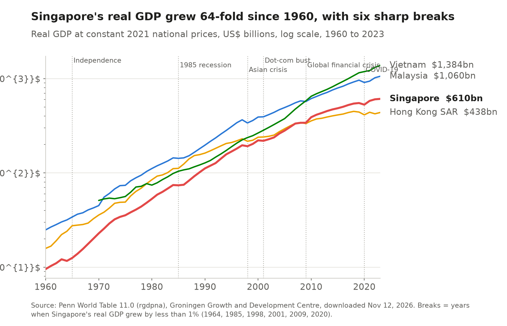
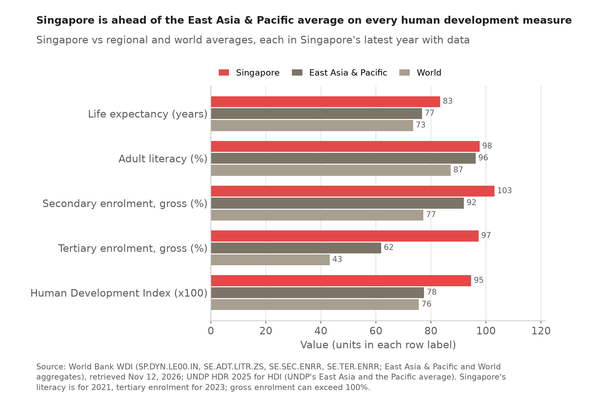
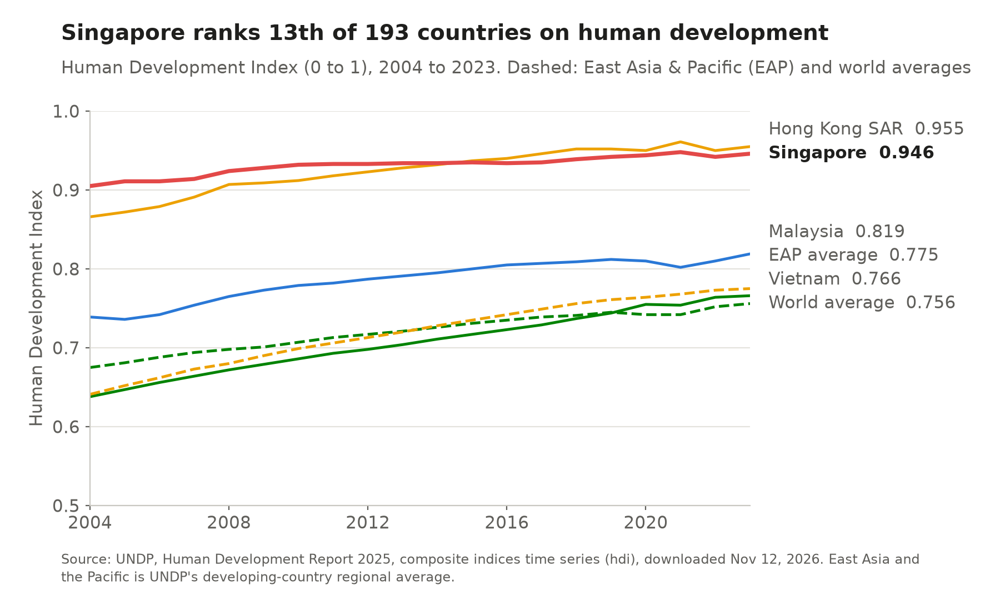
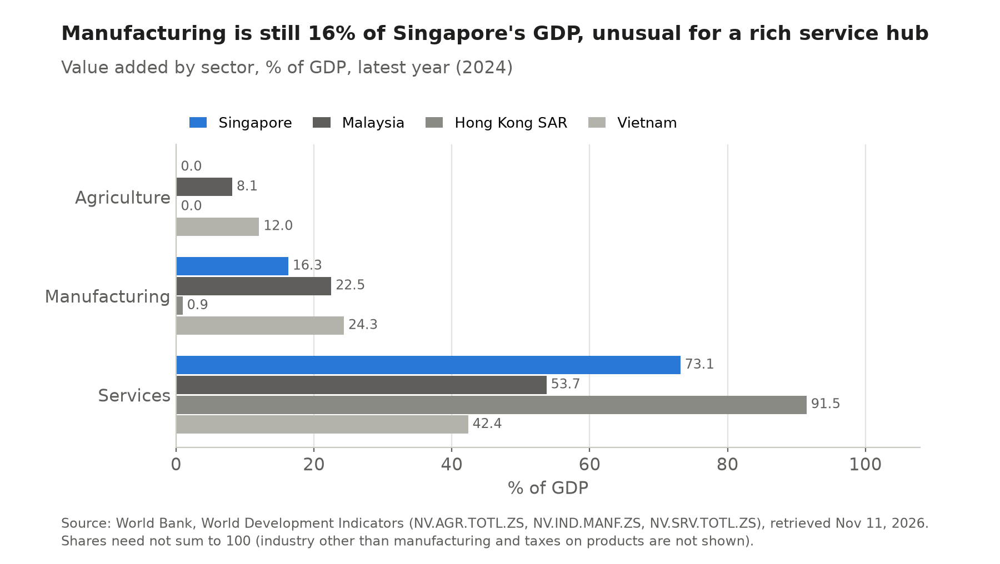

# 1 Country profile

## Key finding

Singapore is a city state with the land of a small county and the human development of a rich nation. Its 6.2 million people live on 725 square kilometres, 181st of 214 economies by area, and its Human Development Index ranks 13th of 193 and 3rd in East Asia and the Pacific.

## What kind of country is it?

<!-- interactive: sgmap -->

**A crowded island republic on one of the world's busiest sea lanes.** Singapore sits on the Strait of Malacca, its capital is the city itself, and the People's Action Party has governed the parliamentary republic since 1959. A third of the 6.21 million people (June 2026) are foreign workers and students, so the labour force can grow with demand, and the four official languages, with English for business, connect it to China, India and the Malay world.

More on land, population, languages and politics

Singapore's land area was 581.5 square kilometres in 1965 and 744.3 square kilometres at the end of 2025, an increase of 28 percent that came mostly from reclamation ([SingStat via data.gov.sg](https://data.gov.sg/datasets/d_0b2c034da121ef8efc71949af1694b4d/view)). The World Bank series used in the table below records 725 square kilometres for 2024 because it lags the national figure.

In June 2026 the population was 6.21 million, of whom 4.23 million were residents (3.68 million citizens and 0.55 million permanent residents) and about 1.98 million were foreign workers, students and dependants ([SingStat, Population Trends 2026](https://www.singstat.gov.sg/publication-resources/population-trends-2026)). The resident population is 73.9 percent Chinese, 13.5 percent Malay, 9.0 percent Indian and 3.6 percent other groups. Malay is the national language and English the working language of government and business. The large share of non-residents matters for trade, because the labour force can expand with demand in a way that a country of six million citizens could not manage on its own.

The prime minister and cabinet answer to an elected parliament, and a directly elected president holds a largely ceremonial office with custodial powers over the national reserves. In the general election of 3 May 2025 the People's Action Party won 87 of 97 seats with about 65.6 percent of the vote ([AP via PBS](https://www.pbs.org/newshour/world/singapores-long-ruling-party-wins-another-election-landslide-in-boost-for-new-prime-minister)). Lawrence Wong has been prime minister since 15 May 2024 and Tharman Shanmugaratnam president since September 2023. This long continuity of government is one reason investors treat policy in Singapore as predictable, a point Chapter 2 returns to with the governance indicators.

## How did it get rich? {Structural breaks}

**By answering every outside shock with a move up the value chain.** Real GDP grew 64-fold between 1960 and 2023, interrupted six times when growth fell below 1 percent, in 1964, 1985, 1998, 2001, 2009 and 2020. Each break came through trade, and each was followed by a policy push toward higher value work, from export factories in the 1960s to services, biomedicine and digital trade.

<section class="timeline">
<b>1819</b>Free port
Raffles opens a free port and Singapore lives by moving goods it does not make.

<b>1961</b>EDB founded
The Economic Development Board begins to court foreign manufacturers.

<b>1964 to 65</b>Break and independence
Output falls, then separation from Malaysia ends a brief turn to import substitution.

<b>1965 to 79</b>Export factories
Multinationals build labour intensive plants in Jurong until full employment.

<b>1979</b>Wage correction
Higher wages push firms toward higher value work.

<b>1985</b>Recession
Cost cuts and services become a second engine of growth.

<b>1990s</b>Clusters and the region
Industry clusters at home and parks abroad, such as Suzhou in 1994.

<b>1998 and 2001</b>Asian crisis, chip slump
Two external shocks hit trade and electronics.

<b>2000</b>Biomedical pillar
Biomedicine joins electronics, chemicals and engineering.

<b>2009 and 2020</b>Global crisis, pandemic
World demand collapses twice and recovers.

<b>2020s</b>Resilience
Digital trade, AI, energy and supply chain security.

Shaded: years in which real GDP grew by less than 1 percent (Penn World Table). Sources: NLB Infopedia, METI, EDB.
</section>

More on the development phases, from entrepôt port to knowledge economy

The Penn World Table shows output falling by 3.8 percent in 1964, the year of race riots and confrontation with Indonesia that preceded separation from Malaysia in 1965, by 0.6 percent in 1985, by 2.2 percent in 1998 and by 1.1 percent in 2001, stalling in 2009 and falling by 3.9 percent in 2020.

Singapore's modern economy began as an entrepôt. Stamford Raffles established a free port in 1819, and within five years it had become the main transit point for regional trade, earning its living by moving goods it did not produce ([NLB Infopedia](https://eresources.nlb.gov.sg/infopedia/articles/SIP_2018-04-20_085007.html)). This history explains why re-exports are still more than half of Singapore's merchandise exports today (Chapter 3).

The Economic Development Board was set up in 1961, and after independence in August 1965 the government turned from a short attempt at import substitution to export oriented manufacturing led by foreign multinationals. Labour intensive plants in Jurong produced garments, wigs and electronic components, and by the late 1970s the economy had reached full employment. In 1979 the National Wages Council deliberately raised wages to push firms toward higher value activities ([NLB](https://www.nlb.gov.sg/main/article-detail?cmsuuid=98e1b55f-093d-4d44-b219-d51f6a38c313)). The 1985 recession led to cuts in business costs and a decision to build services as a second engine of growth alongside manufacturing.

The 1990s brought a Strategic Economic Plan built on industry clusters and a drive to invest in the region, symbolised by the China Singapore Suzhou Industrial Park of 1994. In 2000 the Biomedical Sciences Initiative added a fourth manufacturing pillar next to electronics, chemicals and engineering. The 2010s were about productivity, with a target of 2 to 3 percent productivity growth a year. In the 2020s the agenda has shifted to resilience, digital trade, artificial intelligence and energy, and in October 2026 the Ministry of Trade and Industry was renamed the Ministry of Energy, Trade and Industry ([METI](https://www.mti.gov.sg/newsroom/mti-to-be-renamed-ministry-of-energy--trade-and-industry/)).

## How does it compare with the region?

**It leads the region on every human development measure, most of all in university education and longevity.** Gross tertiary enrolment is 97 percent against 63 percent in East Asia and the Pacific, and life expectancy 83.3 years against 76.7. Literacy (97.7 percent) is close to the regional 96.6 percent because basic literacy is now near universal in the region.

More: HDI over time, schooling, PISA and the full ranking table

Singapore's Human Development Index rose from 0.905 in 2004 to 0.946 in 2023. It was ahead of Hong Kong SAR until 2014 and slightly behind it since 2015, while both city economies stay far above Malaysia (0.819) and Vietnam (0.766). A child entering school can expect 16.7 years of education, and Singapore's fifteen year olds ranked first of 81 systems in mathematics, reading and science in PISA 2022 and first in reading and second in mathematics and science in PISA 2025 ([Ministry of Education](https://www.moe.gov.sg/news/press-releases/20260908-pisa-2025-singapore-students-demonstrate-strong-real-world-problem-solving-skills-in-computational-thinking-domain)). Mean years of schooling of adults (12.0 years, 42nd) ranks lower because older cohorts were educated before the expansion of secondary and university education.

<!-- include: data/derived/ch01_profile_table.md -->

## What does the economy produce?

**Mostly services, with a factory sector that Hong Kong SAR gave up.** Services are 73 percent of value added and manufacturing 16 percent, against less than 1 percent in Hong Kong SAR, which moved its factories into mainland China while Singapore kept courting high value manufacturing at home.

## Implications for trade and investment

A small island with no resources and a skilled, partly foreign workforce has to trade to live, importing food, water and energy and reaching scale only in world markets. Investors get skills and stable government at the price of very expensive land and a population ageing fast (13.7 percent were 65 or older in 2024). Chapter 2 asks how this mix has turned into income and institutions.

Sources for this chapter

World Bank, World Development Indicators; Penn World Table 11.0; UNDP, Human Development Report 2025; Singapore Department of Statistics; National Library Board Infopedia; Ministry of Education; Ministry of Energy, Trade and Industry. Full list in the [appendix](appendix.html).

