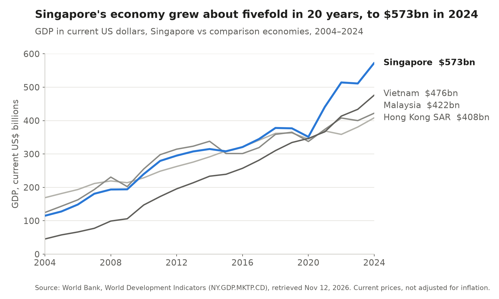
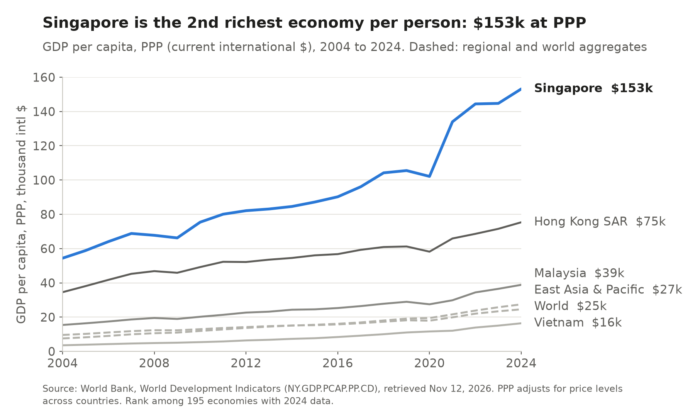
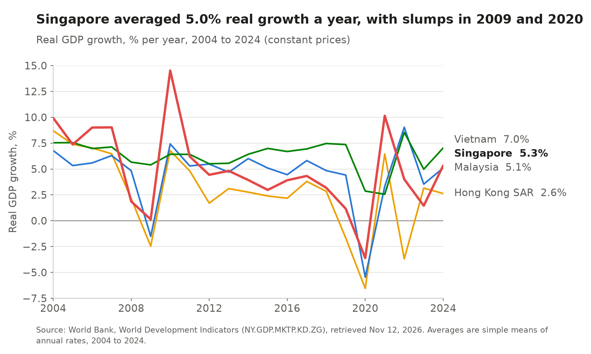
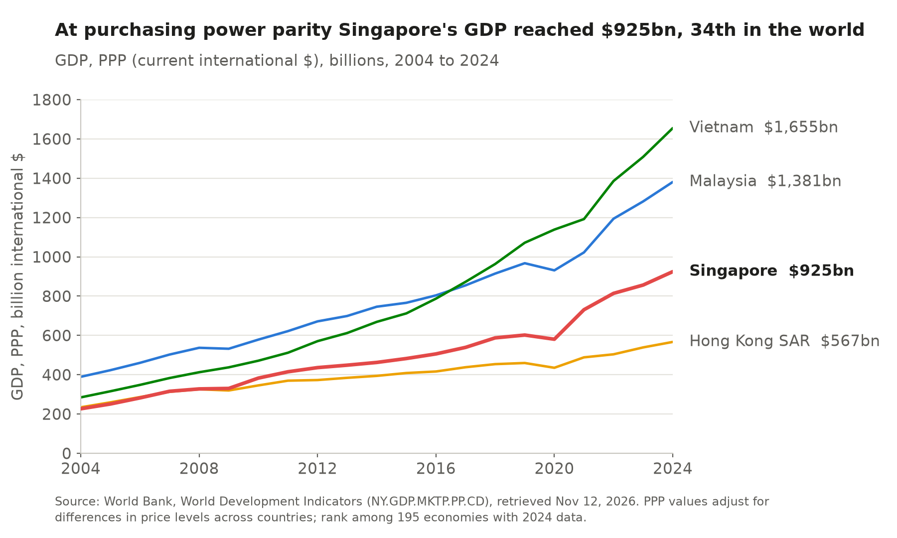
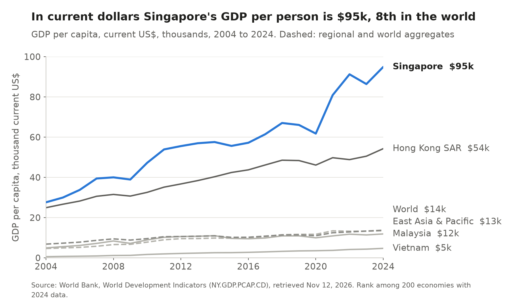
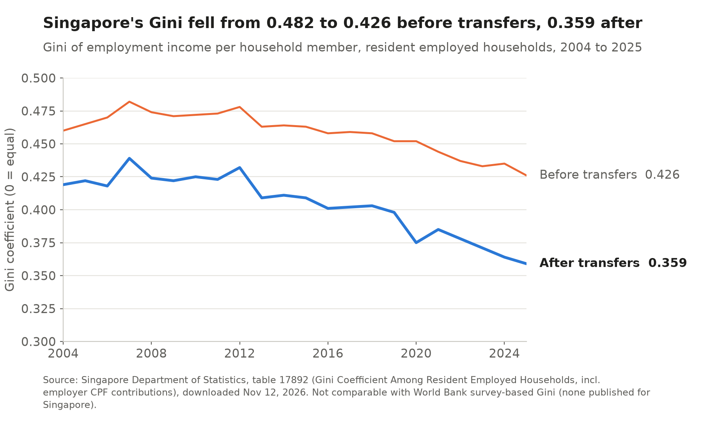
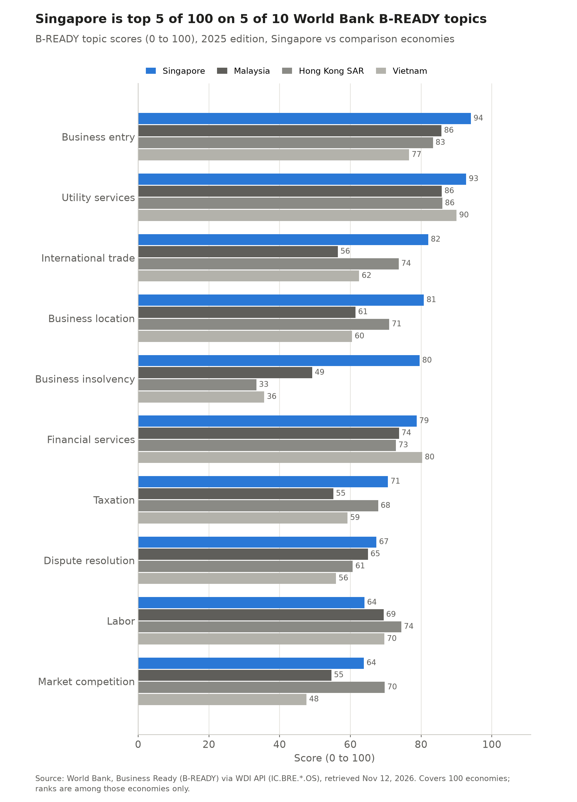
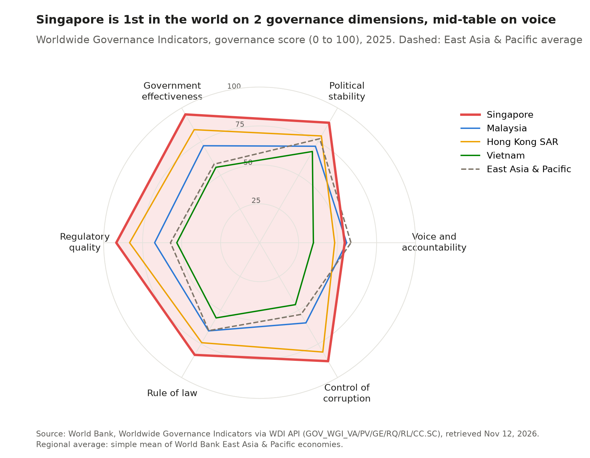
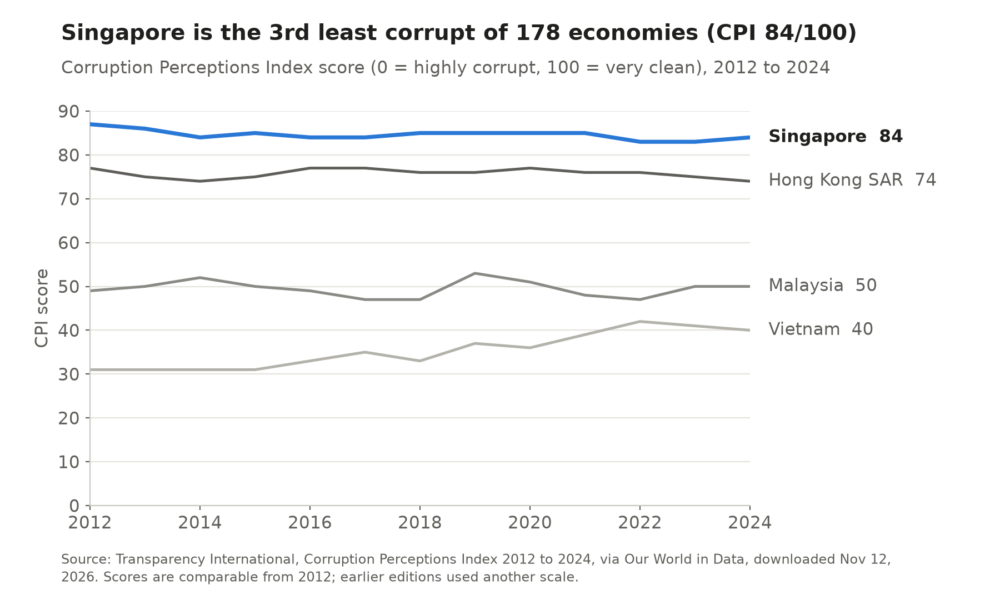

# 2 Macroeconomy, business climate and governance

## Key finding

Singapore is the second richest economy in the world per person at purchasing power parity, and one of the best governed. It ranks first of 205 on government effectiveness and regulatory quality, and only on voice and accountability does it fall to the middle of the table.

## How big and how rich is it?

**About five times bigger than in 2004, and second in the world and first in East Asia and the Pacific per person.** GDP rose from $115 billion to $573 billion between 2004 and 2024, from 43rd to 26th in the world and from 9th to 6th of 33 in East Asia and the Pacific, overtaking Malaysia in 2015 and Hong Kong SAR in 2017 with a sixth of Malaysia's population. GDP per person at purchasing power parity is $153,161, almost four times Malaysia's, and real growth averaged 5.0 percent a year, 41st of 193.

More: income per person, real growth, GDP at PPP and the current account

GDP per person at purchasing power parity almost tripled from $54,384 in 2004. Income per resident is lower, because foreign owners and workers send part of it home (Chapter 6).

Growth swings with world demand. Output stalled in 2009, rebounded by 14.5 percent in 2010 and fell by 3.6 percent in 2020, less than in Malaysia (5.5 percent) or Hong Kong SAR (6.5 percent).

At purchasing power parity the economy is $925 billion, 34th in the world.

In current dollars GDP per person was $94,897 in 2024, eighth in the world. The current account surplus of 17.2 percent of GDP, the sixth largest relative to output, reflects high national saving and income from investment abroad.

## Is growth shared?

**Less evenly than in most rich countries, although inequality is falling.** The World Bank publishes no poverty or Gini data for Singapore, so we use the official series. The Gini of employment income fell from a peak of 0.482 in 2007 to 0.426 in 2025 before taxes and transfers, and from 0.419 in 2004 to 0.359 after them.

More on the poverty line and why this Gini is not ranked

In June 2025 the World Bank replaced the $2.15 a day line named in the guidelines with $3.00 a day in 2021 prices, and Singapore's surveys are not in its poverty database. In East Asia and the Pacific 2.0 percent of people lived below $3.00 a day in 2024, against 10.1 percent worldwide, so extreme poverty is not the relevant measure for a high income city. The national Gini covers only the employment income of resident households, so we do not rank it against survey based figures such as Malaysia's 40.7 (2021) and Vietnam's 36.1 (2022).

## Is it easy to do business?

**Almost nowhere is easier.** Singapore was second of 190 economies in the last Doing Business report (2020). Its successor, B-READY 2025, ranks it first of 100 on operational efficiency, how quickly and cheaply firms get through procedures, and in the top five on business entry, location, utilities, international trade and taxation.

More: B-READY scores by topic, compared with Malaysia, Hong Kong SAR and Vietnam

In the last Doing Business report Hong Kong SAR was third, Malaysia twelfth and Vietnam seventieth. B-READY places Singapore lower on labour regulation (65th) and market competition (17th), where the index rewards worker protection and competition rules that Singapore keeps deliberately light.

## How good is its government? {WGI}

**Among the best in the world, with one exception.** Singapore is first of 205 for government effectiveness and regulatory quality, fourth for control of corruption and first of 138 on the Logistics Performance Index. Voice and accountability (54.6, 111th of 203) is below the regional average, reflecting limits on press freedom and political competition.

<!-- include: data/derived/ch02_rank_table.md -->

More: corruption perceptions since 2012

Transparency International scores Singapore 84 of 100 in 2024, third of 178 economies and first in the region, and the score has stayed between 83 and 87 since 2012.

## Implications for trade and investment {Module 9 · Nunn 2007}

Nunn (2007) shows that countries that enforce contracts well specialize in goods built from made to order inputs, such as electronics and machinery. Singapore's courts, regulators and logistics are that kind of advantage, and they explain why supply chains and regional headquarters settle there despite high costs. Chapter 3 follows the trade these institutions carry.

Sources for this chapter

World Bank, World Development Indicators, Worldwide Governance Indicators, B-READY and Doing Business (via the WDI API); Transparency International, Corruption Perceptions Index; Singapore Department of Statistics, table 17892. All figures are generated by `scripts/ch02_macro.py`.

