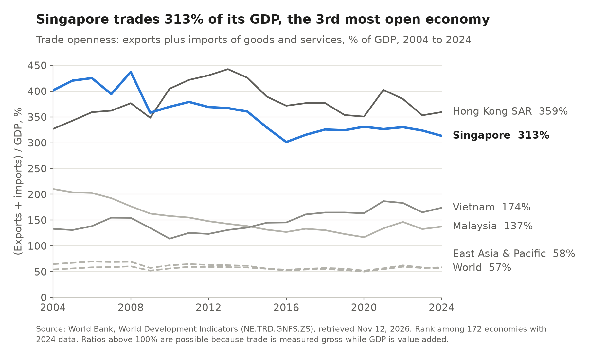
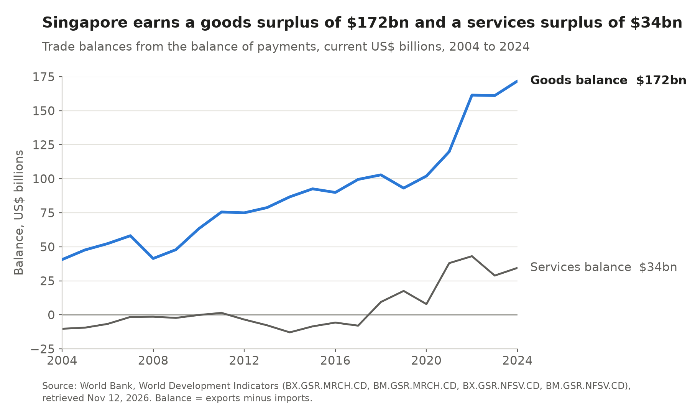
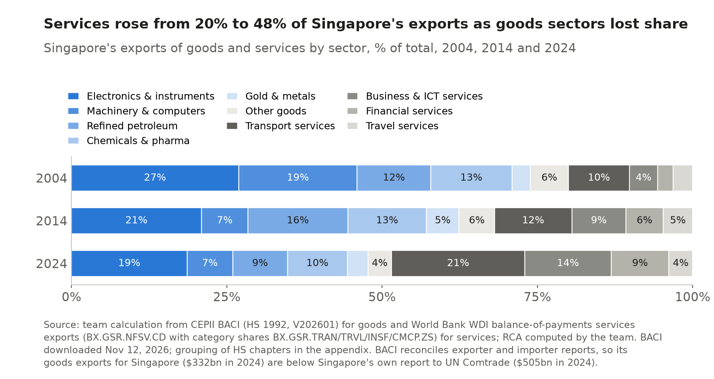
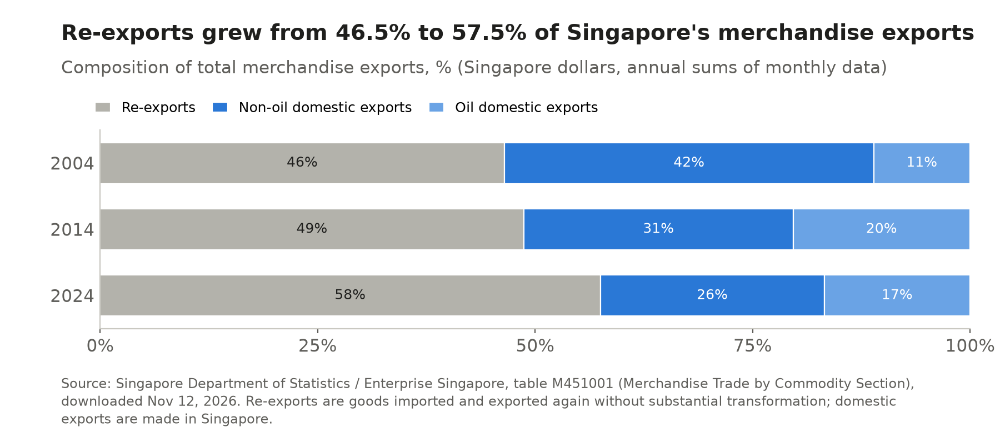
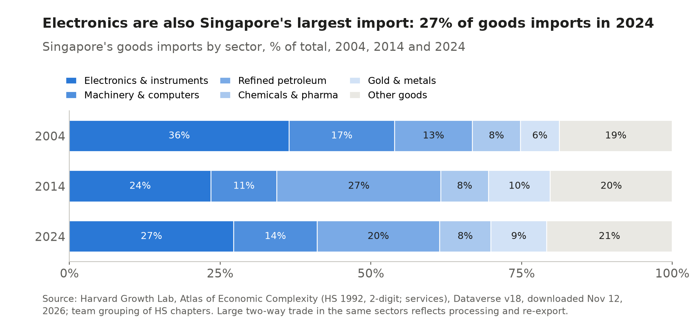
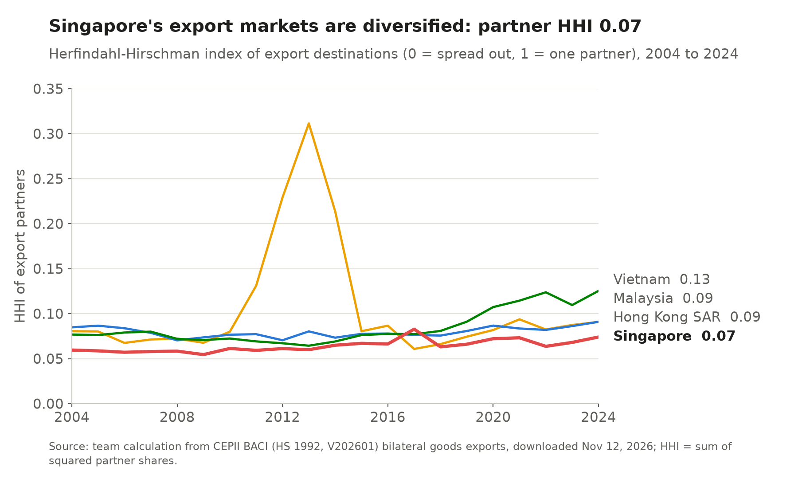
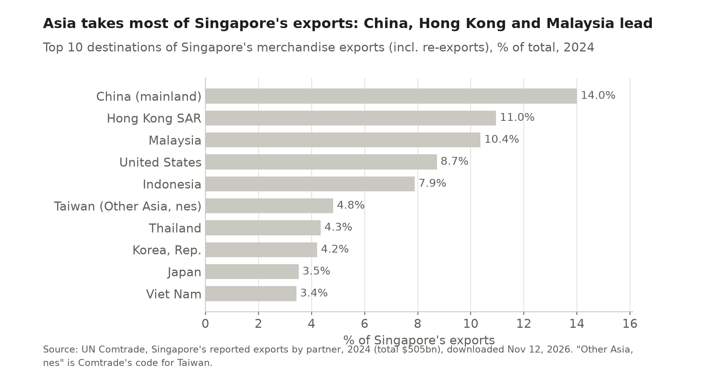
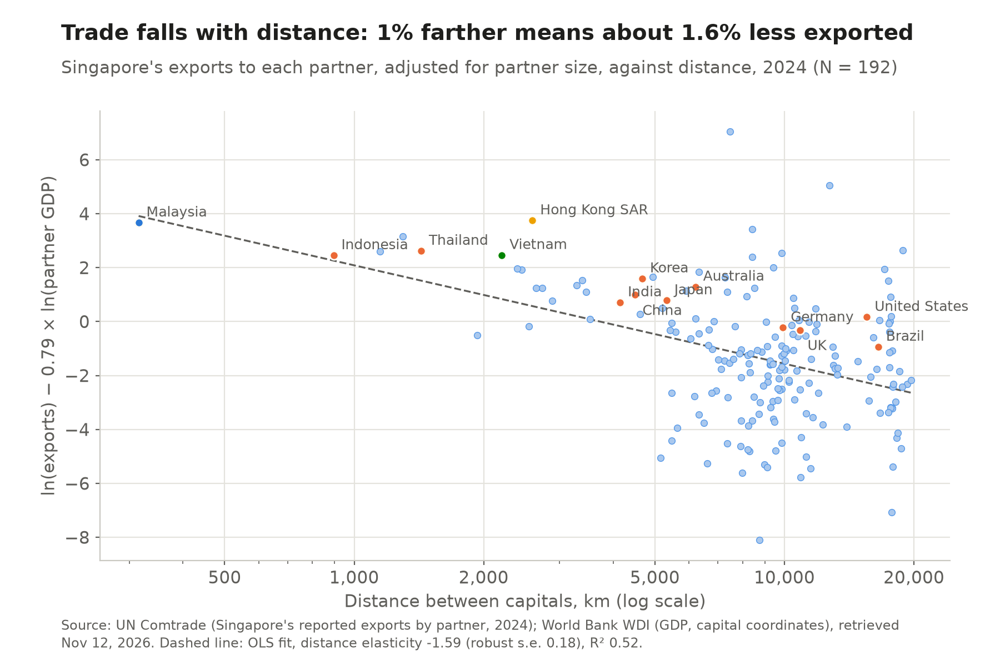

# 3 Openness and trade patterns

## Key finding

Singapore is the third most open economy in the world, and almost half of what it sells abroad is now services. Its trade is spread across many partners and follows the gravity model, with distance mattering slightly more than in the class estimate.

## How open is it? {Module 2 · Balance of payments}

**Trade is three times GDP, the third highest ratio of 172 economies and second in East Asia and the Pacific.** Exports plus imports were 313 percent of GDP in 2024, against 137 percent in Malaysia and 58 percent in East Asia and the Pacific.

**Surpluses on goods and on services.** The goods surplus grew from $41 billion in 2004 to $172 billion in 2024, and services swung from a $10 billion deficit to a $34.5 billion surplus. Services exports of $399 billion are 6th in the world and 1st in the region.

More: the balances chart, and why openness has fallen since 2008

Openness peaked at 437 percent in 2008 and has drifted down as services and domestic activity grew faster than goods trade. It can pass 100 percent because trade is counted gross while GDP is value added.

## What does it sell, and how much does it make?

**More and more services.** Combining goods from CEPII's BACI with services from the World Bank, services rose from 20 to 48 percent of exports between 2004 and 2024, led by transport (21.5 percent). Electronics remain the largest goods group but fell from 26.9 to 18.7 percent.

**Less than half of what it ships is made at home.** Re-exports rose from 46.5 to 57.5 percent of merchandise exports, so gross exports overstate what Singapore produces. That is why we use BACI, which assigns re-exports to their origin, and value added in Chapter 5.

More: re-exports, imports and the BACI correction

BACI's $332 billion of goods exports in 2024 is about a third below the $505 billion Singapore reports to UN Comtrade.

Imports mirror exports, with electronics and instruments at 34.8 percent of goods imports, the signature of an economy that processes inputs and ships them on.

## Who does it trade with?

<!-- interactive: sankey -->

**Mostly Asia, and no single market dominates.** On Singapore's own figures mainland China took 14.0 percent of exports in 2024, Hong Kong SAR 11.0 percent and Malaysia 10.4 percent. The concentration index on BACI data, 0.074, is 45th lowest of 208 exporters and 3rd of 37 in East Asia and the Pacific, so a downturn in one market hurts Singapore less than its neighbours.

More: partner shares and concentration over time

Singapore's index has barely moved since 2004 (0.060), while Vietnam's rose from 0.077 to 0.125 as exports to the United States grew.

## Does its trade follow gravity? {Module 8 · Gravity model · Feyrer 2009}

**Yes, slightly more tightly than world trade as a whole.** Log exports to each partner in 2024 on log partner GDP and log distance between capitals give:

<!-- include: data/derived/ch03_gravity_eq.md -->

**Distance and size.** A partner 1 percent farther away buys 1.59 percent less, close to the class estimate of −1.46 (and −1.69 on BACI data), and nearby small economies buy more than their size predicts, as expected of a hub. Agreement partners buy about seven times what size and distance predict.

**Distance as a cost.** Feyrer's (2009) Suez Canal experiment gives a sea distance elasticity of −0.46, less than a third of ours, because distance between capitals also carries history and networks. Chapter 4 asks what Singapore is good at producing.

More: the regression table, with BACI, the FTA dummy and the class estimate

<!-- include: data/derived/ch03_gravity_table.md -->

Sources for this chapter

World Bank, World Development Indicators; Singapore Department of Statistics and Enterprise Singapore, table M451001; CEPII, BACI HS92 V202601 (Gaulier and Zignago, 2010); UN Comtrade; EC 391 lecture "The Gravity Equation: Geography and Size as Sources of Comparative Advantage" (Prof. Ramondo), slides on gravity determinants, the 2000 and 2024 class estimates and Feyrer's first stage; Feyrer, J. (2009), "The 1967 to 1975 Suez Canal closure: lessons for trade and the trade income link", VoxEU, CEPR, 23 December; Head, K. and T. Mayer (2014), "Gravity equations: workhorse, toolkit, and cookbook", *Handbook of International Economics* 4. Figures generated by `scripts/ch03_trade.py`.

