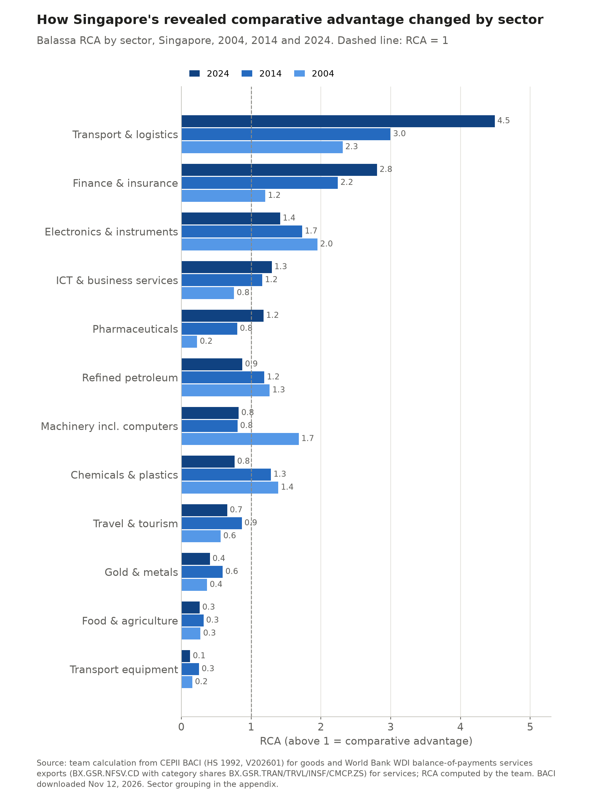
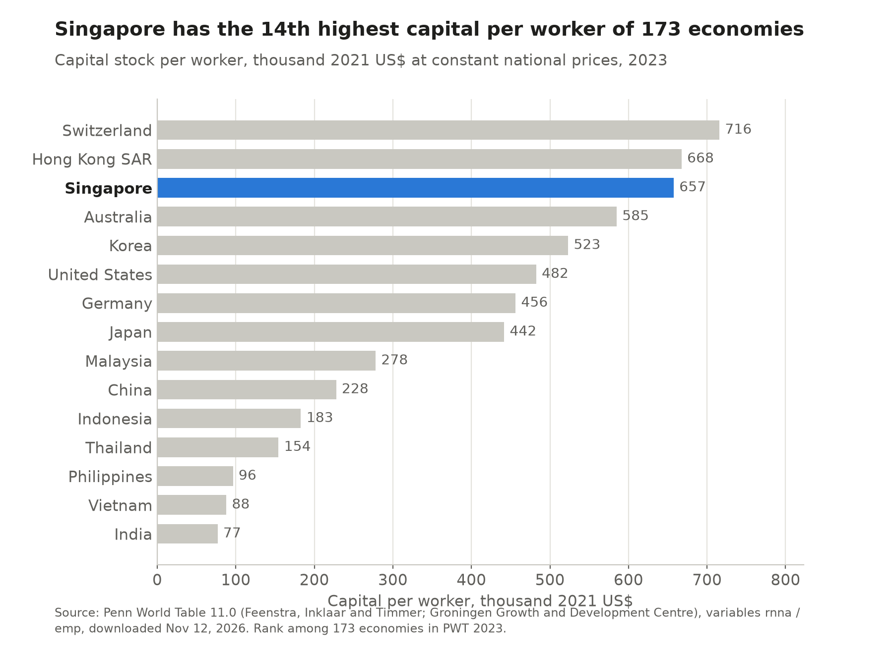

# 4 Specialization and comparative advantage

## Key finding

Singapore's comparative advantage has moved from factories to services, and transport and finance are now its strongest sectors. The pattern fits its abundance of capital and skills, and it fits Nunn's institutional explanation even better.

## How do we measure it? {Balassa RCA}

**With Balassa's index, which we computed ourselves from raw trade data.** A sector's share in Singapore's exports is divided by its share in world exports, so a value above 1 is a revealed comparative advantage. Goods come from CEPII's BACI database and services from the World Bank's balance of payments, grouped in the team's sector table (see the [appendix](appendix.html)). BACI assigns most re-exports to the country that made the goods (Chapter 3), so these RCAs track what Singapore produces, and Vietnam's services RCAs are missing because the World Bank has no breakdown for it.

RCAik = (Xik / Xi) ÷ (Xwk / Xw)X = exports · i = Singapore · k = sector · w = world · above 1 = comparative advantage

<!-- interactive: treemap -->

## What is Singapore good at?

<!-- include: data/derived/ch04_rca_heat.md -->

**Moving goods and money, plus a core of high technology manufacturing.** Singapore's RCA is 4.5 in transport and logistics, 2.8 in finance, 1.4 in electronics, 1.3 in ICT and business services and 1.2 in pharmaceuticals. Only Singapore and Hong Kong SAR have advantages in both transport and finance, the fingerprint of a regional hub, while Malaysia's strengths are electronics, refined oil and food and Vietnam's are electronics and garments.

More: Hong Kong SAR's profile

Hong Kong SAR's largest advantages are finance (3.8), transport (3.0) and gold and metals (2.8). Its electronics RCA of 1.45 reflects trade it organizes for mainland China, since manufacturing is less than 1 percent of its GDP (Chapter 1).

## How has it changed?

**From goods to services within twenty years.** Between 2004 and 2024 the RCA in transport rose from 2.3 to 4.5, finance from 1.2 to 2.8 and ICT and business services from 0.8 to 1.3. Electronics stayed above 1 but fell from 1.95 to 1.41, and machinery, chemicals and refined petroleum lost their advantage as assembly moved to the region and refining grew in the Middle East and China. Pharmaceuticals moved the other way, from 0.2 to 1.2 (Chapter 9).

More: RCA by HS chapter

Measured within goods trade alone, which is why these values are higher than in the treemap, Singapore has an RCA above 1 in 17 of 97 HS chapters, the same number as Hong Kong SAR, against 11 for Malaysia and 27 for Vietnam. Its goods exports are concentrated in a few high value lines, led by electrical machinery (29.9 percent of goods exports, RCA 2.1).

<!-- include: data/derived/ch04_hs_table.md -->

## Does it fit Heckscher Ohlin? {Heckscher Ohlin · Nunn 2007}

**Yes, and institutions explain it even better.** Singapore has the 14th highest capital per worker of 173 economies ($657,000 in 2023), a human capital index 28th of 143 and the least arable land per person of 205, so it exports capital and skill intensive services and goods and imports food (RCA 0.3).

**The Nunn test.** Nunn (2007) finds that contract enforcement explains more of world trade than capital and skilled labour combined, because good courts favour goods built from made to order inputs. Singapore ranks 18th of 207 on rule of law, and its surviving goods advantage, electronics and instruments, sits among Nunn's most contract intensive industries, while the sectors it lost, refining and plastics, sit among his least. Those industries are skill intensive and less capital intensive than average, so Singapore's skills and courts appear to matter more than its capital.

More: endowments against the peers, and caveats

<!-- include: data/derived/ch04_endowments.md -->

Two caveats apply. Factor intensities are not observed in these data, so the test is a qualitative comparison. And much of the capital was brought in by foreign multinationals, the point Young (1992) made when he found that Singapore grew mainly by accumulating factors, so its abundance of capital is partly the result of the FDI analysed in Chapter 6.

## Implications for trade and investment

Activities that need capital, skills, reliable courts and connections, such as advanced chips, biologics, logistics and finance, play to Singapore's strengths, while those that need land, cheap labour or raw materials have moved to Malaysia and Vietnam. Chapter 5 asks how much of this value is created in Singapore.

Sources for this chapter

CEPII, BACI HS92 V202601 (Gaulier and Zignago, 2010); World Bank, World Development Indicators (services exports by category); UN Comtrade (HS chapter titles); Penn World Table 11.0 (Feenstra, Inklaar and Timmer, Groningen Growth and Development Centre); Nunn, N. (2007) and Young, A. (1992), see appendix. Figures and tables generated by `scripts/ch04_rca.py`.

