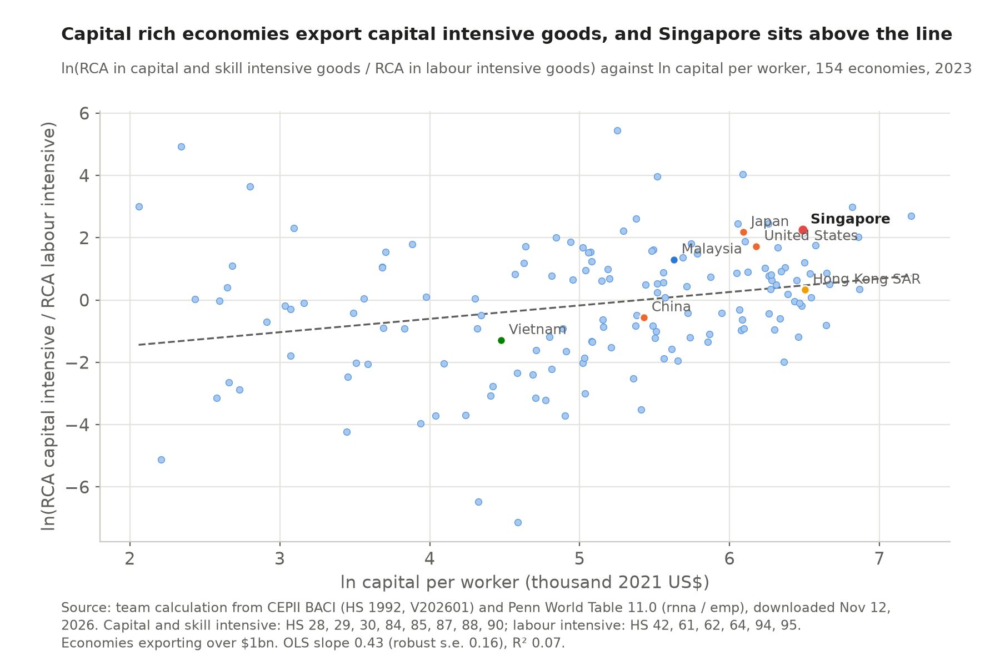

# 4 Specialization and comparative advantage

## Key finding

Singapore's comparative advantage has moved from factories to services, and transport and finance are now its strongest sectors. The pattern fits its abundance of capital and skills, and it fits Nunn's institutional explanation even better.

## What is Singapore good at, and how has it changed? {Module 3 · Balassa RCA}

<!-- interactive: treemap -->

**Moving goods and money, plus a core of high technology manufacturing.** Singapore's RCA is 4.5 in transport and logistics, 2.8 in finance, 1.4 in electronics, 1.3 in ICT and business services and 1.2 in pharmaceuticals. Only Singapore and Hong Kong SAR have advantages in both transport and finance, the fingerprint of a regional hub.

**From goods to services within twenty years.** Transport rose from 2.3 to 4.5 and finance from 1.2 to 2.8 between 2004 and 2024, while electronics fell from 1.95 to 1.41. Since 2014 refined petroleum (1.19 to 0.87) and chemicals (1.28 to 0.76) lost their advantage and pharmaceuticals gained one (0.80 to 1.18).

More: the index, and Singapore against its peers

RCAik = (Xik / Xi) ÷ (Xwk / Xw)X = exports · i = Singapore · k = sector · w = world · above 1 = comparative advantage

We computed the index ourselves, goods from BACI and services from the World Bank.

<!-- include: data/derived/ch04_rca_heat.md -->

Malaysia's strengths are electronics, refined oil and food and Vietnam's electronics and garments. Hong Kong SAR's are finance (3.8) and transport (3.0).

More: RCA by HS chapter

Within goods alone Singapore has an RCA above 1 in 17 of 97 HS chapters, against 11 for Malaysia and 27 for Vietnam, led by electrical machinery (RCA 2.1).

<!-- include: data/derived/ch04_hs_table.md -->

## Does it fit Heckscher Ohlin? {Modules 4 and 9 · Heckscher Ohlin · Nunn 2007}

**Yes, and institutions explain it even better.** Singapore has the 14th highest capital per worker of 173 economies and almost no resource rents (178th of 197), so it is capital and skill abundant and resource poor.

**A cross-country check.** Across 154 economies, 1 percent more capital per worker goes with a 0.43 percent higher ratio of capital to labour intensive RCA (s.e. 0.16), as Heckscher and Ohlin predict, but it explains only 7 percent of the variation, and Singapore sits far above the line.

**The Nunn test.** Singapore ranks 18th of 207 on rule of law, and the goods it kept, electronics and instruments, are among Nunn's (2007) most contract intensive industries while those it lost are among the least. Chapter 5 asks how much of the value is made at home.

More: capital per worker, endowments against the peers, and caveats

<!-- include: data/derived/ch04_endowments.md -->

Two caveats apply. The split of HS chapters by factor intensity follows textbook examples, and much of the capital was brought in by foreign multinationals, as Young (1992) stressed (Chapter 6).

Sources for this chapter

CEPII, BACI HS92 V202601 (Gaulier and Zignago, 2010); World Bank, World Development Indicators (services exports by category); UN Comtrade (HS chapter titles); Penn World Table 11.0 (Feenstra, Inklaar and Timmer, Groningen Growth and Development Centre); Nunn, N. (2007) and Young, A. (1992), see appendix. Figures and tables generated by `scripts/ch04_rca.py`.

