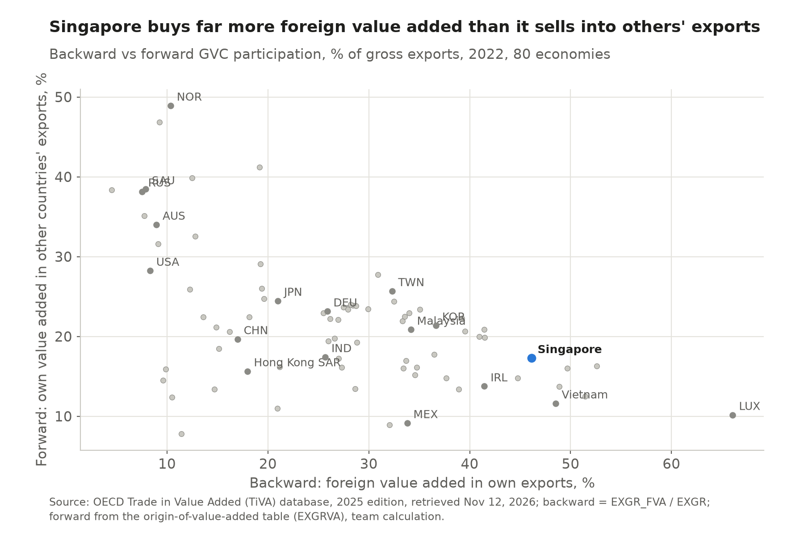
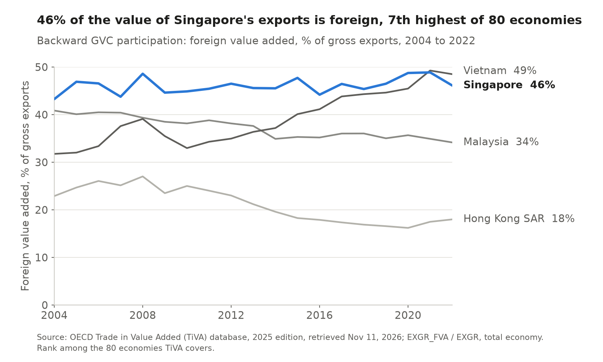
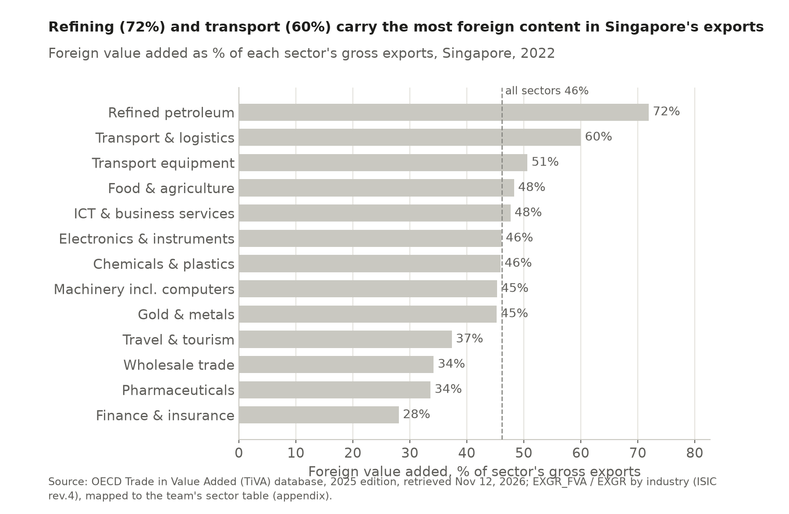
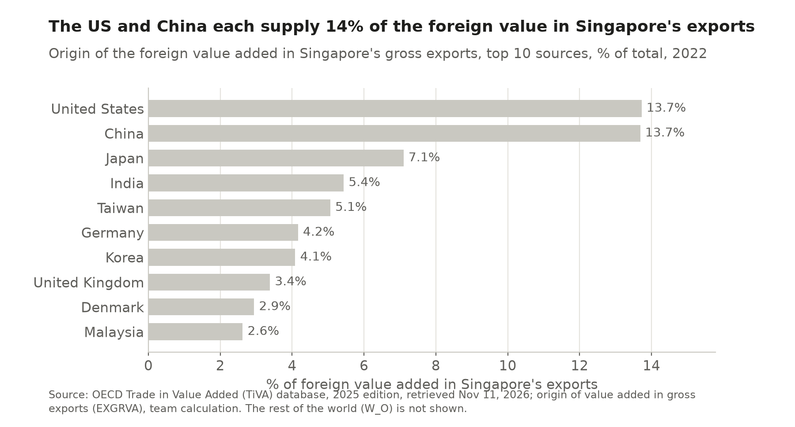

# 5 Global value chains

## Key finding

Almost half the value of Singapore's exports is created abroad, which makes it one of the most integrated and most downstream economies in global value chains. It buys components, crude oil and services, adds processing and coordination, and ships the result on.

## How much of its exports is foreign, and where does it sit? {Module 6 · Koopman et al. 2010}

**Almost half, 46.1 percent in 2022, the 7th highest share of 80 economies and 2nd of 17 in East Asia and the Pacific.** Among the peers only Vietnam, with its foreign owned electronics assembly, is higher, while Malaysia (34.2 percent) and Hong Kong SAR (18.0 percent) export more home grown resources and services.

**Far downstream, 73rd of 80 on the position index.** Singapore's value added used in other countries' exports is only 17.3 percent of its exports, against 46.1 percent foreign content, so total participation of 63.4 percent ranks 5th in the world while the position index (Koopman and coauthors, 2010) is −0.22.

More: how we measured participation, the foreign share chart, what downstream looks like and the participation table

Backward participation is the foreign share of a country's exports, forward participation the share of its exports used in other countries' exports. We computed both from OECD TiVA 2025, which covers 80 economies up to 2022.

<!-- include: data/derived/ch05_chains.md -->

<!-- include: data/derived/ch05_participation_table.md -->

Re-exported intermediate imports equalled 47.1 percent of gross exports in 2022, the 7th highest share, which confirms Singapore's role as the region's processor.

## Which sectors rely most on foreign inputs? {Module 6 · Fort 2017 · Boehm et al. 2015}

**Refining and transport, while finance is the most home grown.** Refined fuels carry 72 percent foreign value and transport 60 percent, against 28 percent for finance.

More: sector table and where Singapore's foreign inputs come from

<!-- include: data/derived/ch05_sector_table.md -->

The United States and China each supplied 13.7 percent of the foreign value added in 2022, while Malaysia supplies only 2.6 percent although it is a top source of imports, so much of what comes from Malaysia passes through.

**Why a high cost location wins some stages.** Fort (2017) finds that cheaper communication lets firms split production toward high human capital locations, so Singapore (28th of 143 on human capital) keeps design intensive stages while assembly moves to its neighbours. The price is exposure to upstream shocks, which after the 2011 Tohoku earthquake cut American affiliates' output almost one for one with lost Japanese inputs (Boehm, Flaaen and Pandalai Nayar, 2015). Chapter 6 turns to the foreign firms that run these links.

Sources for this chapter

OECD, Trade in Value Added (TiVA) database, 2025 edition (principal indicators and origin of value added in gross exports), via the OECD SDMX API; Koopman, R., W. Powers, Z. Wang and S.J. Wei (2010), "Give credit where credit is due: tracing value added in global production chains", NBER Working Paper 16426; Fort, T.C. (2017), "Technology and production fragmentation: domestic versus foreign sourcing", *Review of Economic Studies* 84(2); Boehm, C.E., A. Flaaen and N. Pandalai Nayar (2015), VoxEU, CEPR, 9 January. Figures and tables generated by `scripts/ch05_gvc.py`.

