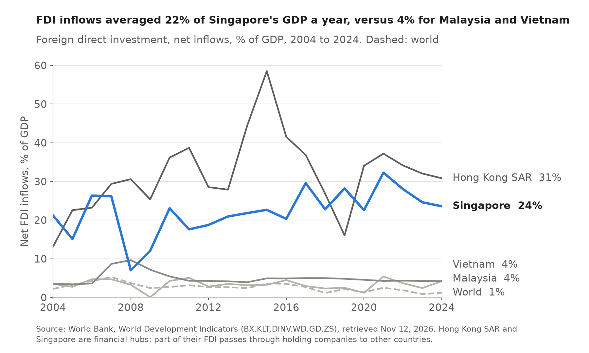
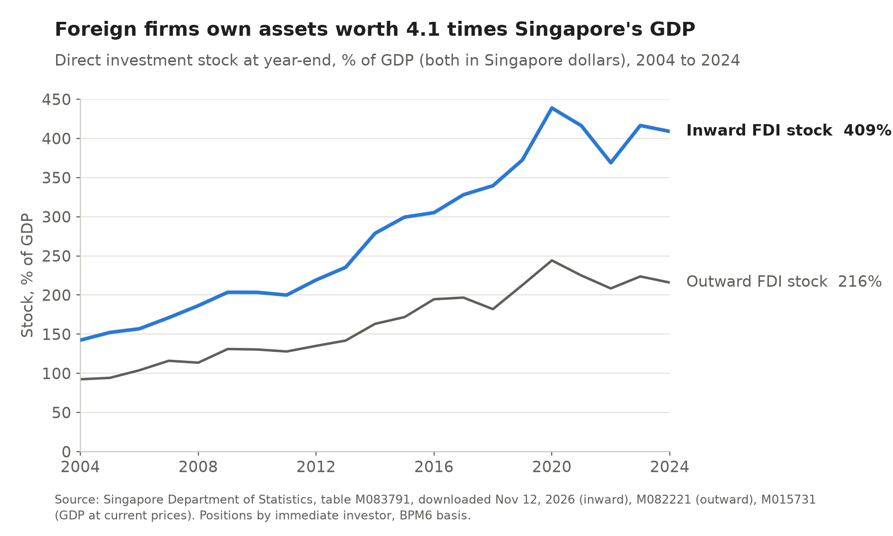
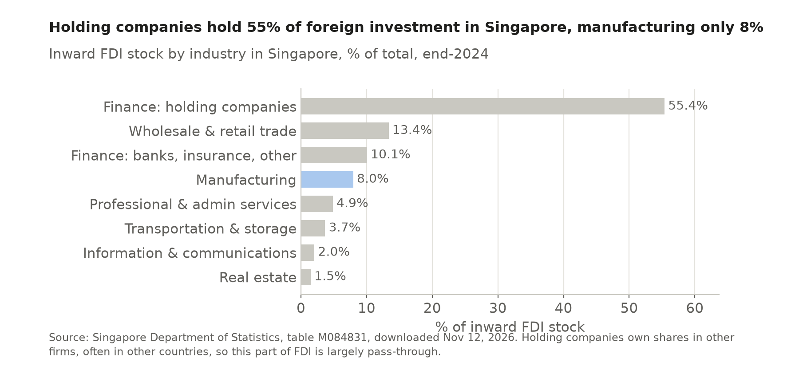
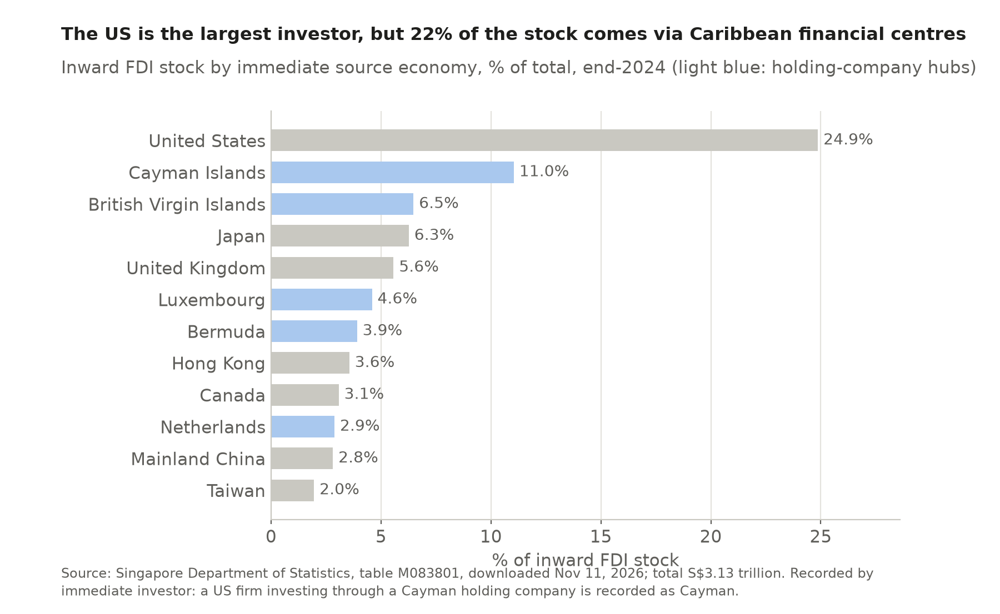
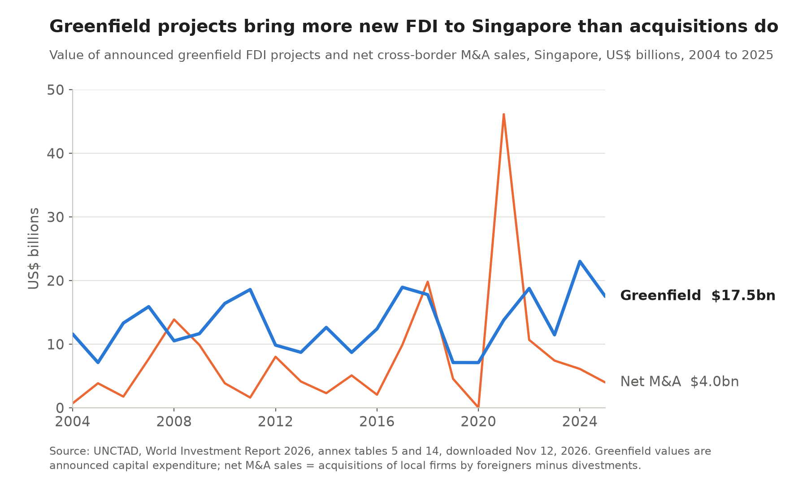
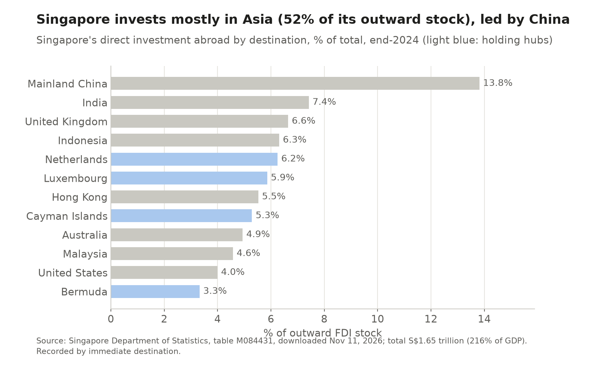
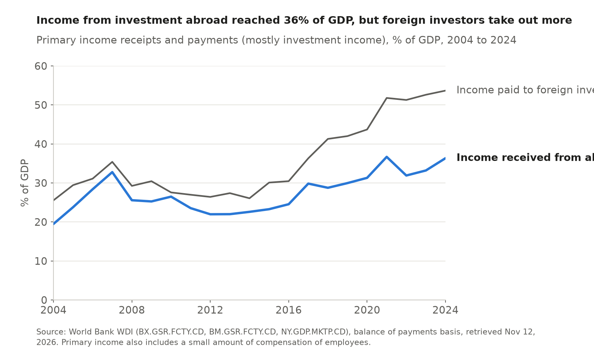
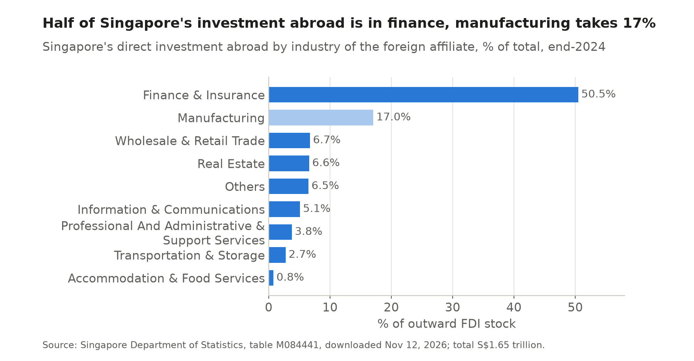

# 6 Foreign direct investment

## Key finding

Singapore is the world's second largest destination for foreign direct investment, and foreign firms own assets worth four times its GDP. Much of that money passes through holding companies on its way to the rest of Asia, while the productive part sits in trade, chips and business services.

## How much FDI comes in?

**About a fifth of GDP every year, second only to the United States in dollars.** Net inflows averaged 22 percent of GDP between 2004 and 2024, against 3 percent in Malaysia and 5 percent in Vietnam, and reached $135 billion in 2024, 6th of 194 relative to GDP (2nd in East Asia and the Pacific) and 2nd in the world in value. UNCTAD records $151 billion for 2025.

More: the accumulated stock of inward and outward FDI

Inward FDI rose from 142 percent of GDP at the end of 2004 to 409 percent (S$3,130 billion) at the end of 2024, the profile of a base from which multinationals hold and finance operations in other countries. Malaysia and Vietnam, whose FDI goes mainly into factories, receive far less relative to GDP.

## Who invests, and in what? {Module 2 · Phantom FDI}

<!-- interactive: fdi -->

**American firms and Caribbean holding companies, mostly in holding companies themselves.** The United States holds 24.9 percent of the inward stock and the Cayman Islands and British Virgin Islands together 17.5 percent, and by industry holding companies hold 55.4 percent. Because the data record the immediate investor, much of this is pass through money owned by American, European and Japanese parents and invested onward in Asia.

More: sources by country, and immediate versus ultimate investors

Finance and insurance hold 65.5 percent of the stock, wholesale and retail trade 13.4 percent and manufacturing 8.0 percent, of which semiconductors are 2.2 percent and pharmaceuticals only 0.3 percent (Chapter 9). Singapore publishes no series by ultimate investor ([SingStat technical notes](https://www.singstat.gov.sg/files/4603e8e3-2291-424f-9c8d-b96962ef6a02.pdf)). Damgaard, Elkjaer and Johannesen (2019) estimate that close to 40 percent of global FDI is "phantom" investment through empty corporate shells and name Singapore among the ten economies that host most of it ([IMF Finance and Development](https://www.imf.org/en/Publications/fandd/issues/2019/09/the-rise-of-phantom-FDI-in-tax-havens-damgaard)).

## New plants or takeovers?

**Slightly more new plants.** Announced greenfield projects were worth $17.5 billion in 2025 against $4.0 billion of net acquisitions, and over 2016 to 2025 greenfield was 1.3 times acquisitions. That places Singapore between Malaysia and Vietnam, where new factories dominate, and Hong Kong SAR, where buying firms dominates.

More: greenfield and M&A for all four economies

<!-- include: data/derived/ch06_entry_mode_table.md -->

Singapore combines a large flow of new plants and headquarters with an active market for corporate control, including a spike of $46 billion of acquisitions in 2021.

## What do foreign firms seek? {Module 6 · Dunning OLI · export platform FDI}

**A base for the region.** Six million people are too few to explain market seeking investment, so firms come for export platform investment (Ekholm, Forslid and Markusen, 2007) and regional headquarters, about 4,200 of them ([EDB](https://www.edb.gov.sg/en/news-and-insights/futuristic-workspace-spore-a-hub-for-corporate-headquarters)). In Dunning's OLI terms the location advantages are the institutions and logistics of Chapter 2, a 17 percent corporate tax with incentives, skilled workers and the trade agreements of Chapter 7.

## Does Singapore invest abroad?

**Heavily, mostly in Asia.** Direct investment abroad reached S$1,653 billion at the end of 2024, 216 percent of GDP, and Asia, led by mainland China, India and Indonesia, takes 52 percent. Income from it rose from 19.5 to 36.3 percent of GDP between 2004 and 2024, but foreign investors in Singapore earn even more (53.7 percent of GDP), so gross national income is only 82.7 percent of GDP.

More: investment income over time and outward FDI by industry

Half of the outward stock (50.5 percent) is in finance and insurance, much of it holding companies that own firms elsewhere, and 17.0 percent in manufacturing, including labour intensive production moved to neighbouring countries, a shift the Johor Singapore Special Economic Zone agreed with Malaysia in January 2025 is designed to support.

## Implications for trade and investment

FDI brings the capital, technology and market access that six million people could not build alone. Because so much of it is pass through money, the headline numbers overstate productive capital and react to global tax rules such as the minimum tax of 2025 (Chapter 9). Chapter 7 looks at the policies that keep it coming.

Sources for this chapter

World Bank, World Development Indicators; Singapore Department of Statistics, tables M083791, M083801, M084831, M082221, M084431, M084441, M015731; UNCTAD, World Investment Report 2026, annex tables 1, 5, 7, 14, 17; Economic Development Board; Damgaard, J., T. Elkjaer and N. Johannesen (2019), IMF; Ekholm, K., R. Forslid and J. Markusen (2007), "Export-platform foreign direct investment", *Journal of the European Economic Association* 5(4). Figures generated by `scripts/ch06_fdi.py`.

