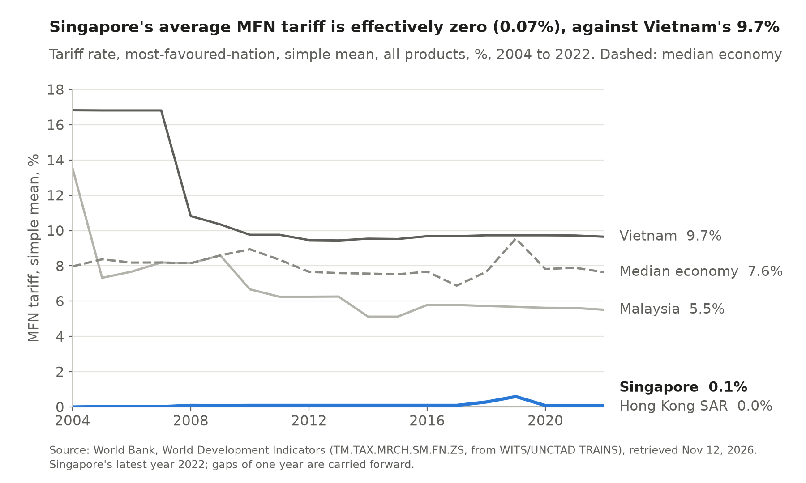
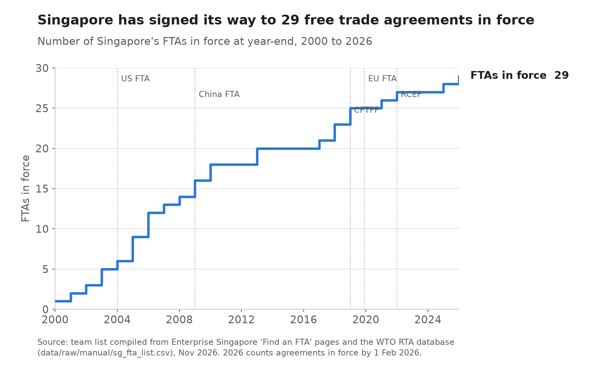
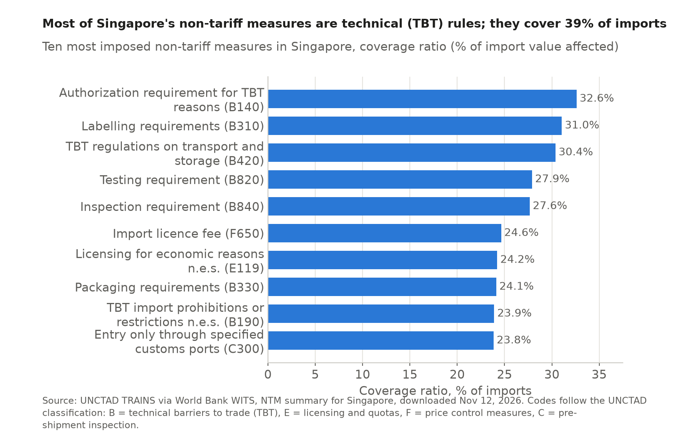
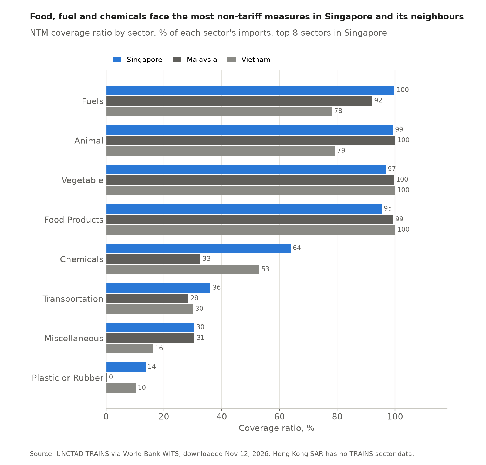
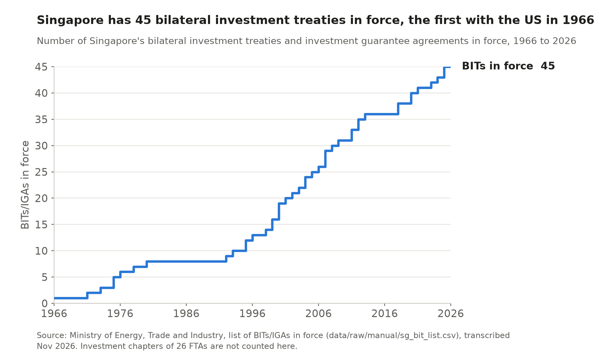

# 7 Trade policy

## Key finding

Singapore is close to a pure free trader at home and uses 29 free trade agreements to open markets abroad. Its new risks come from outside, as US tariffs and export controls reach it whatever its own policy.

## How high are its tariffs?

**Close to zero.** A GATT member since 1973 and a founding member of the WTO in 1995, Singapore had an average MFN tariff of 0.07 percent in 2022, 3rd lowest of 143 economies, against 5.5 percent in Malaysia and 9.7 percent in Vietnam. Only beer, stout and two rice spirits pay customs duty, so peak tariffs above 15 percent cover just 0.2 percent of farm lines, against 41.8 percent in Vietnam.

<!-- include: data/derived/ch07_wto_profile_table.md -->

More: tariff rankings, bound rates and excise duties

<!-- include: data/derived/ch07_tariff_table.md -->

Singapore's average bound rate is 8.9 percent, so it has committed to keep tariffs below that level but applies far less ([WTO tariff profile](https://www.wto.org/english/res_e/statis_e/daily_update_e/tariff_profiles/SG_e.pdf)). Hong Kong SAR, also a free port, applies no tariffs at all. Revenue is raised instead through excise duties on liquor, tobacco, motor vehicles and petroleum, which apply equally to imports and local production, and through a 9 percent goods and services tax. Malaysia's highest duty, on alcoholic drinks, exceeds 1,000 percent.

## What are its trade agreements for? {Rules of origin · Conconi et al. 2016}

**To open partners' markets, since Singapore's own is already open.** The network grew from 6 agreements in 2004 to 29 in 2026, including the US (2004), China (2009), CPTPP (2018), the EU (2019) and RCEP (2022), and covers services, investment and digital trade. **Rules of origin.** Because Singapore charges no tariffs, partners rely on rules of origin to stop third country goods entering through it, and Conconi and coauthors (2016) show such rules cut NAFTA Mexico's imports of non member inputs by around 30 percentage points. With 46 percent foreign content in its exports (Chapter 5), Singapore gains most from RCEP's common rules, which count inputs from all fifteen members.

Full list of the 29 FTAs: partners, year of entry into force and scope

Fifteen are bilateral agreements, six are agreements between ASEAN and a partner, five are plurilateral and two are mega regional agreements. MERCOSUR became the twenty-ninth in February 2026 ([METI](https://www.meti.gov.sg/newsroom/mercosur-singapore-free-trade-agreement-enters-into-force-for-singapore-and-paraguay)).

<!-- include: data/derived/ch07_fta_table.md -->

Singapore has also pioneered agreements on digital trade, beginning with the Digital Economy Partnership Agreement with Chile and New Zealand in 2020 and followed by agreements with Australia, the United Kingdom, Korea and the European Union ([METI](https://www.meti.gov.sg/trade/digital-economy-agreements)). These set rules on data flows, electronic payments and digital identity, the services trade in which Singapore's comparative advantage is growing (Chapter 4).

## How far has regional integration gone? {Balassa's stages}

**ASEAN is still a free trade area, the first rung of Balassa's ladder.** Each member keeps its own external tariff, and Singapore's zero next to Vietnam's 9.7 percent shows there is no common one, so ASEAN cannot become a customs union without one side changing. The ASEAN Economic Community of 2015 reaches toward a common market in services, investment and skilled labour, but only in part.

## Are non-tariff measures a barrier?

**Mostly they protect consumers.** Non-tariff measures touch 39.3 percent of Singapore's imports, against 55.0 percent in Malaysia ([WITS](https://wits.worldbank.org/tariff/non-tariff-measures/en/country/SGP)), and nine of the ten most common are technical rules on labelling, testing and inspection, concentrated on food, fuel and chemicals that Singapore hardly produces.

More: non-tariff measures by sector, compared with the peers

Almost all imports of fuels, animal and vegetable products and processed food are covered by at least one measure, followed by chemicals. These are the sectors with the greatest health, safety and environmental risks, and Singapore produces little of them, so the measures protect consumers and are not designed to shield domestic producers. By tariff line, measures cover 27.8 percent of Singapore's lines, against 36.6 percent in Malaysia and 47.0 percent in Vietnam.

## How does it protect investors?

**With 45 investment treaties and investment chapters in 26 trade agreements.** The treaties run from the United States in 1966 to Nigeria and Côte d'Ivoire in 2025, and with the FTA chapters they cover more than 60 partners ([METI](https://www.meti.gov.sg/trade-international-economic-relations/agreements-/international-investment-agreements--iias-/)). Free Trade Zones at the seaports and Changi Airport, and specialised estates such as Jurong Island and the wafer fab parks, add ready infrastructure for foreign plants (map in Chapter 1).

All 45 treaty partners, by decade of entry into force

<!-- include: data/derived/ch07_bit_table.md -->

Most treaties date from the 1970s to the 2000s, when Singapore was both attracting investment and starting to invest abroad, and recent ones with Kazakhstan, Nigeria and Côte d'Ivoire reflect Singaporean investment in new regions. Ten treaties with EU members will lapse when the EU Singapore Investment Protection Agreement enters into force.

## What is the controversy now?

**US tariffs and chip export controls.** The United States imposed a 10 percent tariff on Singapore in April 2025 despite its goods surplus and their FTA, and after a court ruling a 12.5 percent Section 301 tariff has applied since July 2026 to about a third of Singapore's domestic exports to the US, with pharmaceuticals and chips under separate investigation ([METI](https://www.meti.gov.sg/newsroom/mti-media-statement-on-the-office-of-the-united-states-trade-representative--ustr--s-determination-on-the-section-301-investigation-on-forced-labour/)). Singapore has not retaliated and has tightened its own export controls.

More on the US tariffs, export controls and relations with Malaysia

Between the Supreme Court ruling and July 2026 the US applied a temporary 10 percent tariff. Singapore updated its strategic goods control list from December 2025. Closer to home, the 1962 water agreement with Malaysia remains a sensitive topic, while the Johor Singapore Special Economic Zone signed in January 2025 points toward deeper cooperation.

## Implications for trade and investment

Singapore's policy makes it cheap to move goods in and out and gives a single base preferential access to most of Asia and the Pacific. The open rules it depends on are weakening, and Chapter 9 asks how its industrial policy copes.

Sources for this chapter

WTO tariff profiles and member page; World Bank WDI (WITS/UNCTAD TRAINS); UNCTAD TRAINS NTM summaries via WITS; Enterprise Singapore and the WTO RTA database (FTA list in `data/raw/manual/sg_fta_list.csv`); Ministry of Energy, Trade and Industry (BIT list in `data/raw/manual/sg_bit_list.csv`); Singapore Customs; Conconi, P., M. García Santana, L. Puccio and R. Venturini (2016), "The perverse effect of preferential rules of origins", VoxEU, CEPR, 16 March. Figures and tables generated by `scripts/ch07_policy.py`.

