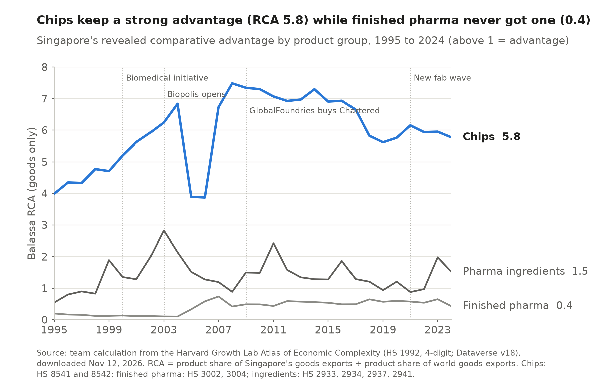
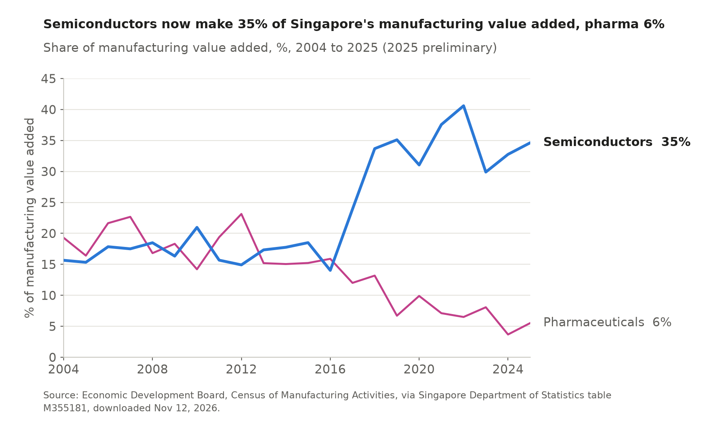
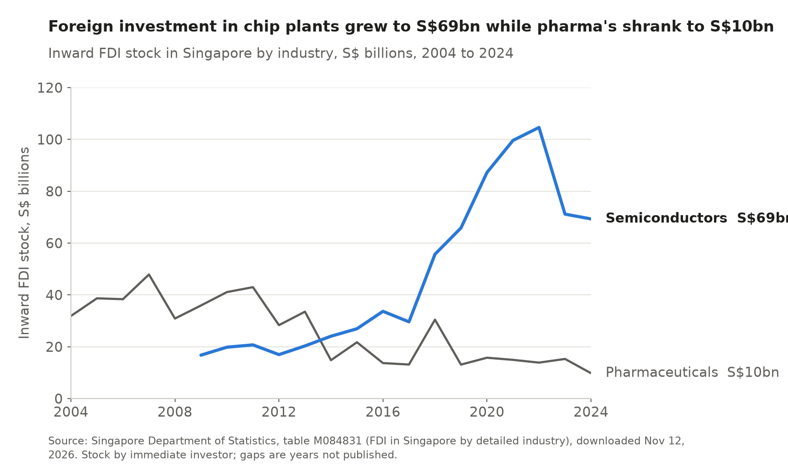

# 9 Case study: chips and pills, Singapore's investment-led industrial policy

## Key finding

Singapore twice tried to grow a high technology industry by courting foreign firms instead of raising tariffs. Chips learned, keeping a strong advantage while value added and investment grew, and pharmaceuticals learned only to export, building an advantage abroad while their weight at home shrank.

## The course argument {Infant industry}

**Comparative advantage can be learned, if support stops once the learning is done.** In the infant industry model a new industry's productivity rises with experience, so temporary help lets it ride down the learning curve until it can compete and export on its own. Most countries gave that help with tariffs. Singapore could not, with a tiny home market and zero tariffs (Chapter 7), so the Economic Development Board offered foreign firms tax holidays, ready built estates, training and research money instead, with pioneer firms paying 5 to 15 percent or nothing against a headline rate of 17 percent ([EDB](https://www.edb.gov.sg/content/dam/edb-en/how-we-help/incentive-and-schemes/factsheets/DEI(Mfg)%20Factsheet.pdf)).

## The two bets

**Chips from 1968, pills from 2000.** National Semiconductor opened an assembly plant in 1968, followed by Fairchild and Texas Instruments, and the state backed Chartered Semiconductor opened the first wafer fab in 1987, moving the industry from assembly into fabrication ([EDB](https://www.edb.gov.sg/en/business-insights/insights/made-in-singapore-60-years-of-manufacturing.html)). The Biomedical Sciences Initiative of June 2000 made medicines the fourth pillar of manufacturing, with Tuas Biomedical Park, the Biopolis research complex of 2003 and plants from Pfizer, GSK, Novartis, Lonza and others.

More: the new wave of investment and an evaluation of the pharma cluster

Chips drew a new wave after 2021, including GlobalFoundries' $4 billion expansion (2023), UMC's $5 billion fab (2025), the $7.8 billion VisionPower fab of Vanguard and NXP and Micron's $7 billion memory packaging plant, and the research budget for 2026 to 2030 of S$37 billion names semiconductors as its first flagship ([EDB](https://www.edb.gov.sg/en/news-and-insights/singapore-invests-s37-billion-in-rie2030-research-plan-semiconductors-ageing-among-focus-areas)). In medicines AstraZeneca announced a $1.5 billion plant for antibody drug conjugates in 2024 ([AstraZeneca](https://www.astrazeneca.com/country-sites/singapore/press-releases/astrazeneca-to-manufacture-adcs-in-singapore.html)), and an evaluation found that the cluster met its output and jobs targets but missed its target for research spending and produced few spin-off firms ([CIIP 2021](https://www.ciip.group.cam.ac.uk/wp-content/uploads/2021/02/2021-02-19-SBS.pdf)).

## The scorecard

**Both industries export with an advantage, and only one has deepened at home.** We computed RCAs from four digit BACI data for 1995 to 2024. Chips have stayed far above 1 throughout, at 4.6 in 2024 with $70.7 billion of integrated circuit exports, 7.1 percent of the world. Finished medicines and biologics rose from 0.16 in 2004 to 1.78 in 2024 and have stayed above 1 since 2018, driven by biologics and vaccines (3.06). Yet semiconductors' share of manufacturing value added rose from 16 to 35 percent while pharmaceuticals' fell from 19 to 5.5 percent, and the foreign capital stock in pharmaceuticals shrank from S$32 billion to S$10 billion.

<!-- include: data/derived/ch09_scorecard.md -->

More: value added and foreign investment over time

The pharmaceutical share swings sharply because a few foreign plants make most of the output and the value booked in Singapore depends on where parents place patents and profits. Part of its fall is mechanical, since chips grew so fast, and the EDB's commitments show a revival, with biomedical manufacturing at 31 percent of fixed asset commitments in 2025 against 33 percent for electronics ([EDB Year in Review 2025](https://www.edb.gov.sg/content/dam/edb-en/about-edb/media-releases/news/edb-year-2025-in-review/EDB%20YIR%202025%20Media%20Release.pdf)).

More: the 2017 outlier and the product detail

BACI records Singapore's chip exports at $125 billion in 2017, more than twice the neighbouring years, which lifts the RCA to 7.6 for that year only, and we treat it as a reporting anomaly. Integrated circuits alone (HS 8542) had an RCA of 4.9 in 2024 and other semiconductor devices (HS 8541) 2.6. The world share of 7.1 percent counts value, which is why it sits below the EDB's statement that Singapore makes one in ten of the world's chips by units.

## The verdict {Young 1992}

**Chips learned, and pills learned only to export.** In the model's terms chips are a successful infant industry raised without a tariff. Support attracted firms, the industry climbed from assembly to fabrication, and the advantage has survived decades of rising wages because Singapore's capital, skills and suppliers now carry it (Chapter 4). Pharmaceuticals took almost two decades to turn export capacity into a stable advantage, while value added and foreign capital moved the other way. That fits Young's (1992) finding that Singapore grew mainly by accumulating capital and labour and only a little through productivity.

## How we would test it properly

**Compare targeted and untargeted products before and after the Biomedical Sciences Initiative.** A difference in differences on BACI data would estimate ln RCAckt = ack + bt + β (Singaporec × Targetedk × Post2000t) + eckt, with pharmaceutical products as the targeted group, other chemicals as the control and Malaysia and Hong Kong SAR as comparison economies. A positive β in exports with no rise in local value added or local suppliers would confirm export capacity without learning. This needs all four digit products for the comparison economies, SingStat's investment commitments by industry and plant level data on local suppliers, which we have not collected.

## The next test

**A global minimum tax and US trade policy hit both bets at once.** The OECD minimum tax took effect in Singapore on 1 January 2025 and lifts large groups' effective rate to at least 15 percent, which weakens tax holidays ([IRAS](https://www.iras.gov.sg/taxes/pillar-2-top-up-taxes/global-anti-base-erosion-(globe)-rules-and-domestic-top-up-tax-(dtt))). Singapore answered with a Refundable Investment Credit that pays up to 50 percent of qualifying spending in cash, a subsidy the global rules allow ([IRAS](https://www.iras.gov.sg/schemes/disbursement-schemes/refundable-investment-credit-(ric))), while US tariffs and export controls (Chapter 7) put both industries at the centre of strategic rivalry.

## Sources

CEPII, BACI HS92 V202601 (4-digit products); Economic Development Board, Census of Manufacturing Activities via SingStat table M355181; Singapore Department of Statistics, table M084831; EDB; IRAS; Cambridge CIIP (2021); Young (1992). Figures generated by `scripts/ch09_case.py`.
